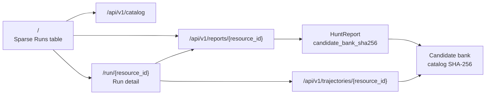
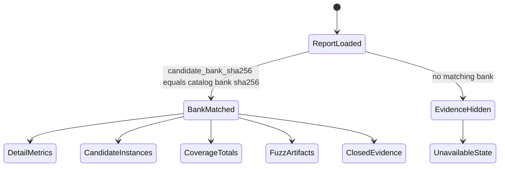

# dLLM Hunt Dashboard Design System

## 0. Research Log

- Static reference: the supplied LLaDA figure contributes the pale-to-deep blue confidence
  grammar; its conversational layout and serif typography are not copied.
- Live/reference code: `ossf/oss-crs` commit
  `0061473c1afd37c93a00483e0aebc704b4897609` contributes run summaries, liveness,
  coverage, history, and artifact drill-down patterns; its branding and CRSBench copy are
  not copied.
- Generated implementation reference:
  `docs/assets/dllm-hunt-console-reference.png`, SHA-256
  `815780baf08ee57b64531ef06f081794eca3051cf89bcfec324cfd86d39101db`.
- Current direction: a sparse local evidence dashboard. The memorable surface is the strict
  join between run reports, candidate banks,
  coverage, fuzz artifacts, and SHA-bound evidence disclosures.

## 1. Atmosphere & Identity

The dashboard feels like a calm forensic workbench: dense enough for evidence, restrained
enough to preserve reading order. It uses OSS-CRS-style run and artifact grammar, then
keeps dLLM-specific evidence in explicit detail sections. The UI never presents model
output as proof; sanitizer, coverage, and hash evidence remain visually and semantically
separate.

## 2. Routes & Information Architecture

| Route | Contract |
| --- | --- |
| `/` | Sparse Runs table with Run ID, Status, Target, dLLM Instances, Coverage, Findings, Artifacts. |
| `/run/{resource_id}` | Detail view for one hunt report, joined to a candidate bank only by SHA-256. |
| `/showcase` | UI-only primitive fixture page, separate from production evidence. |

The first viewport is a report index, not an operation cockpit. Stored evidence is the
primary object; job APIs may exist behind the server, but they are not part of this
dashboard screen contract.

## 3. Color

### Palette

| Role | Token | Value | Usage |
| --- | --- | --- | --- |
| Canvas | `--surface-canvas` | `#0b0f14` | App background |
| Rail | `--surface-rail` | `#0f151d` | Top navigation and fixed chrome |
| Panel | `--surface-panel` | `#121922` | Summary and detail panels |
| Raised | `--surface-raised` | `#17212c` | Metric cells, cards, buttons, source blocks |
| Hover | `--surface-hover` | `#1b2835` | Interactive hover and selected card background |
| Text primary | `--text-primary` | `#ecf3f8` | Titles and high-priority values |
| Text secondary | `--text-secondary` | `#a8b7c4` | Body text, labels, table cells |
| Text tertiary | `--text-tertiary` | `#71818f` | Captions, disabled content, low-priority metadata |
| Border default | `--border-default` | `#273442` | Panel, table, card, and control separation |
| Border strong | `--border-strong` | `#3a4c5e` | Strong boundaries and claim/evidence boxes |
| Accent | `--accent-primary` | `#58b8f6` | Links and active navigation |
| Accent strong | `--accent-strong` | `#2f8fce` | Primary action token retained by shared CSS |
| Confidence 1 | `--confidence-1` | `#dcecf7` | Shared confidence ramp token |
| Confidence 2 | `--confidence-2` | `#bdd9eb` | Shared confidence ramp token |
| Confidence 3 | `--confidence-3` | `#91bad5` | Shared confidence ramp token |
| Confidence 4 | `--confidence-4` | `#5f91b5` | Shared confidence ramp token |
| Confidence 5 | `--confidence-5` | `#276b98` | Shared confidence ramp token |
| Proved | `--status-proved` | `#63d587` | Proven oracle/status text only |
| Warning | `--status-warning` | `#e9b75d` | Bank mismatch or warning status |
| Error | `--status-error` | `#f07070` | Failed execution or unavailable action |
| Info | `--status-info` | `#69b9ef` | Running and informational state |
| Focus | `--focus-ring` | `#72d6ff` | Keyboard focus and selected instance border |

### Rules

- Green means an execution-backed `proved` state, never generic success or model confidence.
- Warning marks bank mismatch, blocked, rejected, or incomplete evidence.
- Red is reserved for failed execution or unavailable operations.
- Status, selection, sanitizer, and SHA-boundary states must not rely on color alone.
- No raw color value may appear in UI CSS outside the `:root` token declaration.

## 4. Typography

### Scale

| Level | Token | Size | Weight | Line height | Tracking | Usage |
| --- | --- | ---: | ---: | ---: | ---: | --- |
| Page title | `--type-title` | `1.25rem` | 680 | 1.2 | `0` | Product title |
| Section title | `--type-section` | `1rem` | 650 | 1.35 | `0` | Panel headings |
| Body | `--type-body` | `0.9375rem` | 430 | 1.55 | `0` | Default UI copy |
| Body small | `--type-small` | `0.8125rem` | 450 | 1.45 | `0` | Secondary values and card titles |
| Caption | `--type-caption` | `0.75rem` | 560 | 1.4 | `0` | Tables, badges, metadata |
| Overline | `--type-overline` | `0.6875rem` | 680 | 1.3 | `0.08em` | Uppercase group labels |
| Metric | `--type-metric` | `1.5rem` | 680 | 1.1 | `0` | Detail summary values |

### Font Stack

- Primary: `Inter`, `ui-sans-serif`, `system-ui`, `-apple-system`, `sans-serif`.
- Mono: `SFMono-Regular`, `Cascadia Code`, `Liberation Mono`, `monospace`.
- External font requests are forbidden; the dashboard must remain offline and immediate.

### Rules

- Hashes, source code, step rows, and command evidence use the mono stack.
- UI labels, table content, badges, and descriptions use the primary stack unless they are
  source/hash evidence.
- Body text is never smaller than the Caption scale.
- Letter spacing remains `0` except uppercase overlines.

## 5. Spacing & Layout

All intentional spacing is a multiple of 4px.

| Token | Value | Usage |
| --- | ---: | --- |
| `--space-1` | `0.25rem` | Tight metadata, focus outline offset, table cell compression |
| `--space-2` | `0.5rem` | Compact clusters, badges, table cells, topbar links |
| `--space-3` | `0.75rem` | Instance cards, metric gaps, button padding |
| `--space-4` | `1rem` | Dashboard gap, panel padding, default section rhythm |
| `--space-5` | `1.25rem` | Shared spacing token retained by CSS |
| `--space-6` | `1.5rem` | Shared spacing token retained by CSS |
| `--space-8` | `2rem` | Button height, empty state breathing room |
| `--space-10` | `2.5rem` | Shared spacing token retained by CSS |

### Current Layout

- The topbar is a grid: brand, dashboard context metrics, and primary navigation.
- The dashboard body is a single-column grid with `1rem` gaps and panel-level local
  boundaries.
- `/` renders one summary panel containing the Runs table.
- `/run/{resource_id}` renders stacked panels: detail summary, dLLM instances, coverage,
  fuzz stats/artifacts, trajectory disclosure, source disclosure, hash disclosure.
- Tables own local horizontal scrolling through `.table-wrap`; the page must not create
  horizontal overflow at desktop, tablet, or mobile widths.
- Instance cards use an auto-fit grid with a minimum card width of `18rem` capped to the
  container.
- Metric grids use auto-fit `8rem` columns and wrap values instead of clipping.

## 6. Components

### Topbar

- **Structure**: `header`, brand `h1`, dashboard context `dl`, and labelled primary `nav`.
- **States**: connecting, API connected, API unavailable; target and run-count update from
  loaded catalog/report state.
- **Accessibility**: skip link targets `main`; primary navigation is labelled.
- **Responsive**: collapses to one column below `1280px`; metric cells wrap.

### Runs Table

- **Structure**: captioned table with Run ID, Status, Target, dLLM Instances, Coverage,
  Findings, Artifacts.
- **Interaction**: Run ID links to `/run/{resource_id}`.
- **States**: loading row, populated rows, empty catalog row.
- **Accessibility**: table caption names the OSS-CRS-style minimal run index; status text is
  visible in the badge.
- **Overflow**: table has a fixed minimum inline size and scrolls only inside `.table-wrap`.

### Status Badge

- **Structure**: text label with optional status color class.
- **Variants**: completed/succeeded, running, bank mismatch, warning, error, neutral.
- **Accessibility**: status text is always present; color is redundant.
- **Motion**: no required idle animation.

### Detail Summary

- **Structure**: `dl.metric-strip` with Status, Target, Selected, Trajectory Truth.
- **Claim boundary**: a bordered copy block states whether sanitizer-backed crash evidence
  exists and avoids disclosure claims.
- **States**: loaded report, unavailable report, missing bank.
- **Responsive**: two columns by default, one column below `768px`.

### Candidate Instance Cards

- **Structure**: article card, heading, badge, and mini metrics for Score, API, NFE, Steps.
- **States**: selected, aggregate trajectory, exact-token trajectory, empty matched bank.
- **Evidence**: each card may include a closed `details` block with trajectory table, source,
  and source hash.
- **Accessibility**: selected state is conveyed by text and border/background, not color alone.

### Coverage Metrics

- **Structure**: description-list grid with exactly four HuntReport totals.
- **Metrics**: Lines, Functions, Branches, Regions.
- **States**: percentage value or `n/a`.
- **Responsive**: auto-fit columns with wrapped values.

### Fuzz Stats & Artifact Table

- **Stats**: Build, Fuzz, Oracle, Executed Units, Edges, Features, Exec/s, Sanitizer.
- **Artifact table**: Kind, Status, Name, Size, Copy.
- **Interaction**: Copy hash button writes the artifact SHA-256 when clipboard access is
  available and reports an unavailable state otherwise.
- **Overflow**: long artifact names and hashes wrap inside the local table.

### Evidence Disclosures

- **Trajectory evidence**: closed page-level disclosure containing the selected candidate
  trajectory table.
- **Source evidence**: closed page-level disclosure containing selected source code.
- **Hash evidence**: closed page-level disclosure containing report, command, source, coverage,
  fuzz, and artifact hashes.
- **Default state**: all evidence disclosures are closed on initial detail render.
- **Accessibility**: native `details` and `summary` elements provide keyboard disclosure
  behavior.

### Source View

- **Structure**: bounded `pre > code` block with local scrolling.
- **Use**: selected source and candidate-card source evidence.
- **Typography**: mono stack at body-small scale.
- **Overflow**: wraps long source/hash-adjacent text where tables require it; source blocks own
  vertical scrolling.

### Empty State

- **Structure**: dashed bordered message block.
- **Use**: missing catalog rows, no matched candidate bank, no selected trajectory, no artifacts.
- **Accessibility**: text describes the missing evidence directly.

### Primitive Showcase

- **Structure**: deterministic fixture page for shared primitives.
- **Boundary**: not production evidence and not a substitute for `/` or `/run/{resource_id}` QA.
- **Accessibility**: uses the same token, table, card, panel, and reduced-motion primitives as
  production.

## 7. SHA Truth Boundary

- A report and candidate bank join only when `report.candidate_bank_sha256` equals the
  catalog candidate bank `sha256`.
- Candidate IDs are never sufficient to join evidence across banks.
- Bank mismatch hides validation evidence and renders unavailable/empty states.
- A proved finding requires sanitizer-backed fuzz evidence in the HuntReport; candidate score
  or trajectory truth is not proof.
- Hash evidence is visible only through disclosure tables and copy actions; the dashboard does
  not render raw crash bytes by default.

## 8. Motion & Interaction

| Type | Token | Duration | Usage |
| --- | --- | ---: | --- |
| Micro | `--motion-micro` | `120ms` | Button hover/press and shared primitive transitions |
| Standard | `--motion-standard` | `220ms` | Shared primitive transitions and token fixture motion |

- Production dashboard motion is minimal: hover/focus transitions, disclosure behavior, and
  shared primitive transitions.
- Visual state changes do not trigger model or fuzzer execution.
- `prefers-reduced-motion: reduce` sets transition and animation duration to `0ms`.
- Only `transform`, `opacity`, border, background, and focus-safe color changes may animate.

## 9. Accessibility Constraints & Accepted Debt

### Constraints

- Target: WCAG 2.2 AA; body contrast at least 4.5:1 and large text/UI graphics at least 3:1.
- All production routes are keyboard operable; visible focus is never removed.
- Status, coverage, sanitizer, selection, and proof states are never color-only.
- Tables have captions or section labels and keep header associations.
- Long text, hashes, repository names, artifact names, and source code must not overlap adjacent
  content.
- Page-level horizontal overflow is not allowed; wide tables and source blocks own local
  scrolling.
- Localized Korean/English UI text may expand without clipping.
- Raw crash bytes are never rendered by the default dashboard.

### Accepted Debt

| Item | Location | Why accepted | Exit |
| --- | --- | --- | --- |
| Shared CSS still contains primitive classes for older showcase fixtures. | `src/dllm_agent/web/static/app.css` | They are not part of the current production route contract, but deleting them is outside this documentation task. | Remove or re-document when the showcase is intentionally pruned. |
| Stored evidence is loaded as complete reports and banks. | `/` and `/run/{resource_id}` | The current dashboard is a local evidence viewer, not a live stream. | Add a versioned event contract before documenting streaming behavior. |
| Browser QA is local only. | Minimal dashboard evidence under `.omo/evidence/minimal-dashboard/` | The product boundary is a loopback research tool. | Re-audit if remote hosting, auth, or multi-user job isolation is introduced. |
