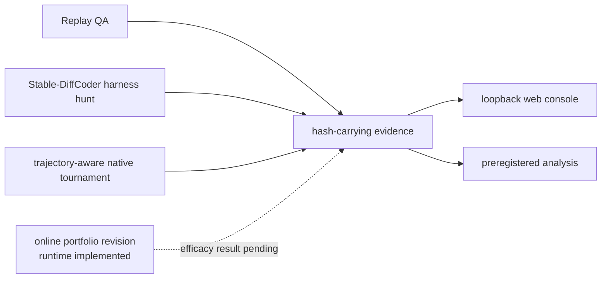

# dLLM Agent 문서 허브

**검토 기준:** 2026-08-31, Asia/Seoul
**범위:** 현재 작업 트리, 저장된 실행 artifact, 공개 1차 자료

이 문서는 코드가 존재한다는 사실, 실제 실행으로 측정한 결과, 아직 검증하지 않은 설계를
구분하는 진입점이다. 상태 표시는 다음 의미로 사용한다.

- **구현·검증:** 사용자 표면과 자동 검증이 존재한다.
- **측정:** pin과 hash를 가진 실제 실행 artifact가 존재한다.
- **구현 중:** 일부 모듈과 테스트는 존재하지만 공개 실행 표면이나 end-to-end 증거가 없다.
- **설계:** spec 또는 plan만 있으며 성능 근거가 아니다.

## 현재 프로젝트 상태

| 영역 | 사용자 표면 | 상태와 근거 | 주장할 수 없는 것 |
| --- | --- | --- | --- |
| 결정론적 replay QA | `scan`, `plan` | **구현·검증.** 저장소 소유 CWE-121 fixture에서 ASan proof와 hash report를 확인한다. | 실제 모델 또는 제3자 취약점 탐지 성능 |
| 실제 harness hunt | `sample`, `hunt` | **측정.** Stable-DiffCoder 후보로 pin된 `jsoncons`를 실행해 UBSan-only zero-length copy 위반 두 위치를 재현했다. 별도 ASan-only 121초 실행은 crash 0이었다. | ASan memory corruption, CVE, zero-day, dLLM 우월성 |
| trajectory-aware tournament | `native-hunt` | **측정.** OpenEXR 후보 두 개를 probe하고 독립 proof를 수행했다. 단일 실행에서 native wall-clock은 86.20초, static baseline은 50.29초였고 sanitizer finding은 없었다. | 속도 향상, trajectory의 인과 효과, 통계적 coverage 우위 |
| 증거 조회 콘솔 | `web` | **구현·검증.** loopback에서 저장된 report와 candidate bank를 hash로 결합해 조회한다. | 원격 다중 사용자 운영, 실시간 사고 과정 또는 token playback |
| dLLM-native online portfolio revision | `poc-revision` + 전용 online config | **구현·검증, 효능 미측정.** 실제 model-selected token commit, resident worker, lineage별 selective remask, crash-artifact exact proof, shared cause/Pareto archive가 코드와 자동 테스트로 연결돼 있다. | 새 runtime의 실제 Stable-DiffCoder×OpenEXR end-to-end 결과, ablation 이득, 취약점 발견, dLLM 우월성·전역 최적성 |
| 논문 효능 연구 | 없음 | **설계.** protocol과 판정 gate가 있으며 powered AR/dLLM 비교는 아직 없다. | dLLM 탐지 우월성, 일반화, 유의한 효과 크기 |
| trajectory 신호 기반 harness synthesis (RQ1/RQ3, 종료) | `tools/harness_synthesis/*.py`(수동 실행 스크립트, 기본 CLI·`openexr_one_day` 파이프라인에는 연결되지 않음) | **측정, RQ3 종료.** Dream-Coder로 OpenEXR 하네스(본문) 생성·컴파일·fuzz가 실제 GPU에서 가능함을 확인(고정 scaffold, 수정량을 고정한 window remask까지). confidence 기반 위치 선택이 random보다 컴파일률·coverage에서 낫다는 증거는 RQ1(N=224, 3개 신호)과 RQ3의 여러 재설계(스모크, B0/B0v2 baseline 감사, region 기반·수정량 통제 window pilot)에서 일관되게 나오지 않았다. | confidence 신호에 효과가 "없다"는 확정(표본이 작아 판정 불가에 가까움), dLLM 대 AR의 퍼징 성능·버그 발견·비용 우위(미판정), 프로덕션 파이프라인 연동 |

위 표의 OpenEXR 비교는 한 번의 bring-up 실행이다. native proof가 static baseline보다 target
coverage가 소폭 높았지만 후보 source와 trajectory가 서로 같고 반복 측정도 없어서 controller
효과로 해석하지 않는다. 현재 가장 중요한 연구 gap은 서로 다른 후보·trajectory, AR/FIM과
generator/fuzzer baseline, 반복 seed, 동일 wall-clock·CPU/GPU accounting이다.

## 권장 읽기 순서

1. [`../README.md`](../README.md): 설치, CLI, 현재 결론
2. [`research-report.md`](research-report.md): 연구 질문, 최신 관련 연구, 기여와 반증 경계
3. [`experiment-protocol.md`](experiment-protocol.md): 실험 schema, leakage gate, 비교군, 자원 accounting
4. [`source-layout.md`](source-layout.md): 패키지 책임과 의존 방향
5. [`live-hunt.md`](live-hunt.md): 실제 OSS target 실행·격리 계약
6. [`dllm-native-fuzzing-harness.md`](dllm-native-fuzzing-harness.md): trajectory-aware tournament의 목표 동작
7. [`dllm-native-online-portfolio-harness.md`](dllm-native-online-portfolio-harness.md): 현재 online portfolio 구현, dLLM-native 기제, 한계와 필수 ablation
8. [`superpowers/specs/2026-08-31-dllm-native-online-portfolio-design.md`](superpowers/specs/2026-08-31-dllm-native-online-portfolio-design.md): online portfolio의 승인된 설계
9. [`superpowers/specs/2026-08-20-feedback-conditioned-poc-revision-design.md`](superpowers/specs/2026-08-20-feedback-conditioned-poc-revision-design.md): 이전 selective revision 설계

## 측정 결과

날짜가 붙은 결과 문서는 당시 pin과 artifact에 대한 불변 snapshot이다. 최신 구현 설명과
다를 수 있으므로 결과를 다시 쓰지 말고 후속 문서를 연결한다.

| 문서 | 증거 범위 |
| --- | --- |
| [`live-hunt-results-20260819.md`](live-hunt-results-20260819.md) | Stable-DiffCoder × `jsoncons`, UBSan 재현과 ASan 음성 실행 |
| [`openexr-fuzz-results-20260819.md`](openexr-fuzz-results-20260819.md) | 공식 OpenEXR harness bootstrap baseline |
| [`dllm-native-fuzz-results-20260819.md`](dllm-native-fuzz-results-20260819.md) | dLLM 후보 native tournament와 static baseline 1회 비교 |
| [`web-console-results-20260819.md`](web-console-results-20260819.md) | 당시 catalog를 사용한 브라우저 QA snapshot |

## 설계·운영·역사 문서

| 문서 | 분류 |
| --- | --- |
| [`experiment-protocol.md`](experiment-protocol.md) | 사전등록 계약. 관측 결과가 아닌 판정 규칙 |
| [`dllm-native-fuzzing-harness.md`](dllm-native-fuzzing-harness.md) | 목표 동작 계약. 실제 결과는 별도 결과 문서 참조 |
| [`dllm-native-online-portfolio-harness.md`](dllm-native-online-portfolio-harness.md) | 구현된 online portfolio runtime과 아직 측정하지 않은 효능의 경계 |
| [`web-console.md`](web-console.md) | 현재 운영·보안 경계 |
| [`../DESIGN.md`](../DESIGN.md) | 웹 콘솔 디자인 시스템 |
| [`dllm-fuzzing-feedback-loop.md`](dllm-fuzzing-feedback-loop.md) | `hunt` v1의 한계에서 출발한 역사적 설계 메모 |
| [`superpowers/plans/2026-08-20-feedback-conditioned-poc-revision.md`](superpowers/plans/2026-08-20-feedback-conditioned-poc-revision.md) | 작업 계획. 체크박스나 계획 문구는 구현 증거가 아님 |
| [`superpowers/specs/2026-08-31-dllm-native-online-portfolio-design.md`](superpowers/specs/2026-08-31-dllm-native-online-portfolio-design.md) | 승인 설계. 실제 구현 상태와 효능은 online portfolio 문서에서 분리 |
| [`superpowers/plans/2026-09-29-trajectory-signal-harness-synthesis.md`](superpowers/plans/2026-09-29-trajectory-signal-harness-synthesis.md) | 동결 프로토콜·원시 결과·판정 근거를 함께 담은 통합 기록. RQ1/RQ3 확정 결과와 RQ3 종료 판단, N=469는 사용하지 않은 과거 pilot 추정치임을 명시한 종합 결론 포함 |

## 증거와 source of truth

- `prompts/`가 현재 prompt 계약이다. `artifacts/live/*prompt*`는 특정 실행의 불변 snapshot이다.
- `artifacts/`의 report, log, corpus, hash가 측정값의 source of truth다. 요약 문서는 이를
  해석할 뿐 대체하지 않는다.
- `docs/superpowers/plans/`와 `docs/superpowers/specs/`는 실행 방향을 고정하지만 완료나
  효능을 증명하지 않는다.
- sanitizer-backed 독립 재현이 없으면 vulnerability 또는 zero-day로 세지 않는다.
- 새 결과에는 model·target·container·command·input/output hash와 wall-clock·CPU/GPU 비용을
  함께 남긴다.

문서는 Markdown/Mermaid로 유지하며 PDF/DOCX 생성물을 source of truth로 관리하지 않는다.
