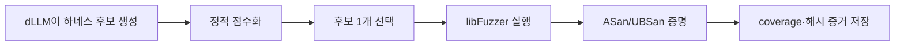
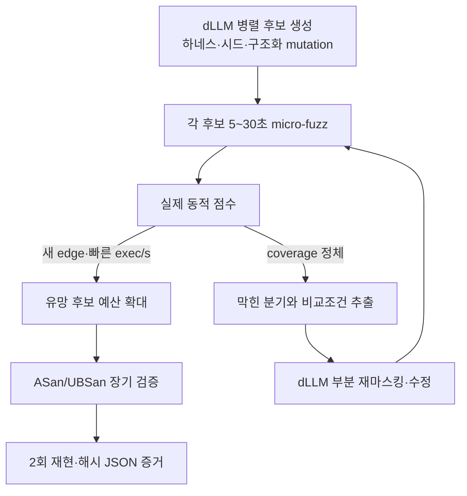

# dLLM 취약점 분석 에이전트와 퍼징 피드백 루프

> **상태: 역사적 설계 메모.** 이 문서의 출발점은 단일 후보를 선택하던 `hunt` v1이다.
> 현재 `native-hunt`는 다중 후보 micro-fuzz tournament와 독립 proof를 구현했고,
> feedback-conditioned OpenEXR 경로는 [online portfolio 구현 문서](dllm-native-online-portfolio-harness.md)의
> resident selective-revision prototype으로 이어졌다.

이 메모는 coverage-driven revision이 왜 필요한지 설명하는 배경 자료다. 현재 구현 계약이나
완료 증거로 사용하지 않으며, 실제 상태는 [문서 허브](README.md), native 결과는
[측정 문서](dllm-native-fuzz-results-20260819.md)를 따른다.

## 당시 `hunt` v1 구조

초기 구현은 기본적으로 다음 구조였다.

dLLM은 하네스 후보를 생성하고, 모델 confidence·API 심볼 포함률·NFE로 순위를 정한다. 이후 선택된 후보 하나를 일반 libFuzzer로 정해진 시간 동안 실행하며, coverage는 퍼징이 끝난 뒤 측정한다.

- 후보 선택과 퍼징 연결: [`hunt/pipeline.py`](../src/dllm_agent/hunt/pipeline.py)
- 후보 점수화: [`hunt/scoring.py`](../src/dllm_agent/hunt/scoring.py)
- libFuzzer 실행: [`fuzzing/execution.py`](../src/dllm_agent/fuzzing/execution.py)

## 당시 구조의 한계

전체 취약점 발견 시간은 다음처럼 볼 수 있다.

$$
T_{find} = T_{dLLM\ generation} + T_{build} + T_{fuzz\ to\ bug}
$$

현재 dLLM이 직접 줄이는 것은 주로 $T_{dLLM\ generation}$이다. 실제 실행 시간의 대부분이 $T_{fuzz\ to\ bug}$에 쓰인다면 전체 취약점 발견 시간은 거의 줄지 않는다. 모델 로딩과 생성 시간이 추가되어 기존 libFuzzer보다 느려질 수도 있다.

또한 "dLLM이 빠르다"는 것은 프로그램 실행이나 퍼징 자체가 빨라진다는 의미가 아니다. 여러 토큰과 코드 영역을 반복적으로 병렬 복원하여 하네스나 입력을 빠르게 생성·수정할 가능성이 있다는 의미다.

따라서 현재 구조는 초기 MVP로는 타당하지만, dLLM의 장점을 취약점 발견 속도까지 연결하는 최종 연구 구조로는 부족하다.

## 다음 단계로 제안한 구조

dLLM을 처음 한 번만 호출하지 않고 퍼징 피드백 루프 안에 넣어야 한다.

핵심 변경점은 다음과 같다.

- 모델 confidence 대신 실제 `Δcoverage`, rare edge, exec/s, sanitizer signal로 후보를 평가한다.
- 한 후보를 오래 퍼징하지 않고 여러 후보를 5~30초씩 짧게 실행한다.
- coverage가 늘어난 후보에만 추가 시간을 배분하는 successive halving 또는 bandit 방식을 사용한다.
- coverage가 정체되면 dLLM이 하네스 전체를 다시 만들지 않고, 막힌 API 호출·조건문·입력 구조만 마스킹해 수정한다.
- dLLM을 하네스뿐 아니라 seed corpus, dictionary, 구조화 mutation, checksum·length 제약 해결에도 사용한다.
- 일정 시간 안에 일반 libFuzzer 기준선보다 개선되지 않으면 해당 dLLM 후보를 중단한다.

이 구조에서 dLLM의 가치는 "하네스를 빨리 작성한다"가 아니라 "퍼저가 깊은 상태에 도달하는 시간을 줄인다"가 된다.

## dLLM이 효과적인 타깃

dLLM 피드백 루프는 단순 바이트 파서보다 다음 타깃에서 효과를 기대할 수 있다.

- 복잡한 파일 포맷과 중첩 구조
- 여러 API를 특정 순서로 호출해야 하는 라이브러리
- checksum, 길이, 상태 제약 때문에 mutation이 쉽게 깨지는 입력
- 기존 하네스의 coverage가 낮은 대형 C/C++ 프로젝트
- 프로토콜·컴파일러·직렬화기·상태 머신

## 연구 평가 지표

퍼저는 실제 실행과 sanitizer를 통한 취약점 증명을 위해 계속 필요하다. 다만 dLLM을 하네스 생성에만 사용하면 연구적 이점이 약하다.

논문의 핵심 구조는 다음과 같아야 한다.

> dLLM 생성 → 짧은 퍼징 → coverage 피드백 → 부분 재생성 → 예산 집중

평가 지표도 단순 생성 속도 대신 다음처럼 정의하는 것이 적절하다.

- `time-to-first-new-edge`
- `time-to-target-branch`
- `time-to-first-sanitizer-crash`
- 동일 wall-clock·CPU 예산에서의 coverage 증가량
- 기존 libFuzzer 대비 sanitizer crash 발견률

## 결론

퍼저는 독립 실행 oracle로 계속 필요하다. 현재 online portfolio prototype은 lineage별
selective remask, parent-child archive, exact crash-artifact ASan proof까지 구현했다. 다만 실제
target-only branch/rare-edge oracle와 동일 예산 반복 비교는 아직 완료되지 않았다. Proposal
token·confidence·top-2 margin·flip·mask lifespan은 현재 worker에서 field policy까지 연결됐지만,
revision 사이 frozen field의 장기 trajectory history는 합치지 않는다. 따라서 속도나 발견률
향상은 post-fix live artifact와 신뢰구간이 생긴 뒤에만 주장한다.
