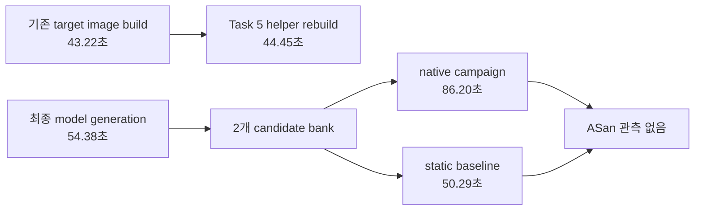

# dLLM native OpenEXR 퍼징 측정 결과

측정일은 2026-08-19부터 2026-08-20까지이며 시간대는 Asia/Seoul이다. 이 문서는
Stable-DiffCoder의 실제 후보 두 개를 사용한 native controller 1회와, 같은 후보·manifest에
40초를 준 static baseline 1회의 공학적 bring-up 결과다. 통계적 실험이나 논문 수준의
우월성 주장이 아니다. 기존 공식 OpenEXR harness 실행은
[OpenEXR baseline 문서](openexr-fuzz-results-20260819.md)에 분리되어 있다.

## 결론

- native controller는 0으로 종료했고 네 probe, 한 selection, 독립 proof를 모두 실행했다.
- static baseline도 0으로 종료했다.
- 요청한 퍼징 시간은 양쪽 모두 40초였다. native는 `2 candidates × 2 seeds × 5초 + 20초 proof`,
  baseline은 선택 후보 한 개에 40초였다.
- wall-clock은 native 86.20초, baseline 50.29초였다. native가 35.91초, 71.4% 느렸고
  비율은 1.714배였다. 이 1회 측정에서는 속도가 개선되지 않고 악화됐다.
- native proof의 target coverage는 baseline보다 regions 0.47%p, functions 0.31%p,
  lines 0.66%p, branches 0.54%p 높았다. 다만 두 campaign의 corpus 진화와 budget 배치가
  다르고 반복 측정이 없으므로 이 차이를 controller 효과로 해석하지 않는다.
- 모든 raw fuzz log에서 `ERROR: AddressSanitizer`, `SUMMARY: AddressSanitizer`,
  `UndefinedBehaviorSanitizer`, `runtime error:`가 없었다. crash artifact도 없었다.
  sanitizer-backed finding이나 취약점은 관측되지 않았다.



이미지 build/rebuild와 model generation은 campaign wall-clock에 포함하지 않았다.

## 고정 입력

| 항목 | 측정값 |
| --- | --- |
| repository | `https://github.com/AcademySoftwareFoundation/openexr.git` |
| commit | `777d231a179de1711d2a942810d9559216ab3f4c` |
| tree | `962a0b40842bc4bc73a81294af5bef6dc974272a` |
| detached/clean | detached HEAD, `git status --porcelain=v1` empty |
| `SECURITY.md` SHA-256 | `a29644c43663d8cad3a3f2f22fa064f1d138df9873e32e410265756d25755087` |
| verified Git archive SHA-256 | `16bc190fb90d40f6e6658109fddd7f2bbdcfaaf79897776d418fae674aebfbe5` |
| target profile | `openexr-v3.4` |
| sanitizer | `address` |
| rebuilt image ID | `sha256:de7bef7b8c28a04e7c1c73e909a6e52958eada1a4538b03c289396556d139531` |
| model | `ByteDance-Seed/Stable-DiffCoder-8B-Instruct` |
| model revision | `10cdaf9b486f1cf0273ad968459dbe2d21a1482a` |
| remote code SHA-256 | `298b19a464f32c00d38e43603516174a73fb4c531193369ff1aabbef32593104` |
| runtime | Python 3.12.13, transformers 5.3.0, torch 2.5.1+cu121 |
| device | `cuda:0`, NVIDIA GeForce RTX 3090 24,576 MiB |
| prompt SHA-256 | `9be698db11101839ea6ed17666ff56bfdd35065cb06d18932a7e1c208aeb5323` |
| candidate bank SHA-256 | `72ba923a27c499857760706b983ce86f61f4f572387c867e64dea0e7a3a5a857` |
| corpus byte sizes | 8, 30, 415, 480, 231, 569, 740 bytes |
| runtime limits | `max_len=1048576`, `rss_limit_mb=2048`, timeout 10초 |

최종 image는 기존 Task 4 image의 container-owned CMake cleanup 문제를 수정하면서 같은
commit/tree/SECURITY/Imath pin으로 다시 만들었다. 기존 1회 build는 43.22초였고 Task 5
rebuild는 44.45초였다. 두 비용은 controller와 baseline 비교에서 제외했다.

## 실제 model generation

첫 시도는 요구된 seed `20260819`, steps 192, generation length 192, block length 4,
temperature 0.2로 정확히 후보 두 개를 만들었다. wall-clock은 54.69초였다. 두 후보 모두
현재 정적 gate는 통과했지만 `std::uint8_t*`를 `const char*` API에 직접 전달해 실제 compiler가
두 오류로 거부했다. model source는 수정하지 않았고 bank를
`openexr-v3.4.14-candidate-bank-attempt-01-invalid.json`에 그대로 보존했다.

prompt에 `reinterpret_cast<const char*>(data)` 계약을 추가하고 전체 bank를 seed `20260821`,
동일한 192/192/4/0.2 budget으로 다시 생성했다. 최종 생성 wall-clock은 54.38초였다.
output을 수리·병합·수정하지 않았으며 attempt 02 bytes를 최종 bank로 그대로 복사했다.

| candidate | generation seed | NFE | 관측 step | transfer 수 | source SHA-256 |
| --- | ---: | ---: | ---: | ---: | --- |
| `candidate-01` | 20260821 | 172 | 138 | 138 | `07edbdcb74287f0440c5b4b1521680a2426d34b1464b8f95c3750e44e7bd0afe` |
| `candidate-02` | 20260822 | 172 | 138 | 138 | `07edbdcb74287f0440c5b4b1521680a2426d34b1464b8f95c3750e44e7bd0afe` |

두 후보는 서로 다른 generation seed와 candidate ID를 갖지만 최종 source bytes는 같았다.
둘 다 unchanged source로 실제 ASan helper compile preflight를 통과했다.

## trajectory

| candidate | weighted confidence | floor | volatility | commitment AUC | NFE efficiency | quality |
| --- | ---: | ---: | ---: | ---: | ---: | ---: |
| `candidate-01` | 0.992073 | 0.620461 | 0.011553 | 0.992754 | 0.664062 | 0.884542 |
| `candidate-02` | 0.992073 | 0.620461 | 0.011553 | 0.992754 | 0.664062 | 0.884542 |

trajectory도 같아서 초기 순서는 candidate ID tie-breaker로 결정됐다. 이 실행은 trajectory
차이가 선택을 개선했다는 증거를 제공하지 않는다.

## native probe 일정과 결과

controller 설정은 1 stage, 각 probe 5초, fixed seeds `20260819`와 `20260820`, survivor 1,
proof 20초였다. ledger에는 sequence 1부터 6까지 probe 네 개, stage 하나, selection 하나가
정확히 기록됐다.

| seq | candidate | seed | build/fuzz | edge | feature | exec/s | regions | functions | lines | branches | sanitizer |
| ---: | --- | ---: | --- | ---: | ---: | ---: | ---: | ---: | ---: | ---: | --- |
| 1 | `candidate-01` | 20260819 | succeeded/completed | 2069 | 4157 | 3169 | 15.37 | 20.40 | 17.32 | 13.26 | 없음 |
| 2 | `candidate-01` | 20260820 | succeeded/completed | 2110 | 4349 | 2643 | 15.78 | 20.61 | 17.71 | 13.62 | 없음 |
| 3 | `candidate-02` | 20260819 | succeeded/completed | 2059 | 4141 | 3271 | 15.30 | 20.25 | 17.16 | 13.15 | 없음 |
| 4 | `candidate-02` | 20260820 | succeeded/completed | 2110 | 4349 | 2627 | 15.78 | 20.61 | 17.71 | 13.62 | 없음 |

순위는 `candidate-01`, `candidate-02`였고 `candidate-01`이 promote 및 proof 대상으로
선택됐다. 동일한 source/trajectory 사이에서 candidate-01의 두 seed coverage 중앙값이
근소하게 높았던 결과다.

## native proof와 동일-budget baseline

| 지표 | native proof 20초 | static baseline 40초 | native - baseline |
| --- | ---: | ---: | ---: |
| campaign 전체 요청 fuzz seconds | 40 | 40 | 0 |
| wall-clock | 86.20초 | 50.29초 | +35.91초 |
| executed units | 62,110 | 117,786 | -55,676 |
| edge coverage | 2,237 | 2,298 | -61 |
| feature coverage | 4,729 | 5,109 | -380 |
| executions/s | 2,957 | 2,872 | +85 |
| regions | 16.21% | 15.74% | +0.47%p |
| functions | 20.71% | 20.40% | +0.31%p |
| lines | 18.16% | 17.50% | +0.66%p |
| branches | 14.20% | 13.66% | +0.54%p |
| persisted corpus artifacts | 256 | 256 | 0 |
| oracle | `not_observed` | `not_observed` | 동일 |

둘 다 `candidate-01`을 선택했다. native의 40초 중 절반은 후보 비교 probe에 사용됐고 최종
proof는 20초였으며, baseline은 한 후보에 40초를 연속 사용했다. 따라서 final proof의
executed units/edge/feature가 baseline보다 낮은 것은 budget 배치와 일치한다. native의
target coverage가 조금 높았던 것은 stochastic corpus 차이일 수 있으며 한 번의 실행으로
일반화하지 않는다.

## hash 증거

| artifact | SHA-256 |
| --- | --- |
| native report | `67d340fd89f512d5ff1ff0afe6f933112b9cab2e3d012b37ab523aac7cb18025` |
| baseline report | `f6ad57911939036c8d92def472bf204baa2ced1c2b5005f9451720ceaf65ead5` |
| exact controller ledger bytes | `95785e403cabc46ba0872f52dd2f223109f106814c057940fc8244436221eb10` |
| native evidence tree | `9582a74a671e1906ea73bf99c762af6d8efcb97f596a846645c12e32bcba0921` |
| baseline evidence tree | `ce3e94f8b2775c0c774c14b976a25cffa96c550960eb8307c2425db6e8e6a6cb` |
| native proof fuzz log | `522fc2c8df78d0cd7feb1b751c73171d9a3baf036ed359a74f8638ba433a27c0` |
| baseline fuzz log | `5ca9f86c014450a73411ebb8c6b083d12e6f80d14a019f5bf436f6346d47d069` |
| native proof coverage report | `cae6b63fcd356591bf4e57a2ce29b8276b59bb4404ce9bb434fda95cde534148` |
| baseline coverage report | `d7a7d46aaad1ab9aac862bfb544534be21d6bdd8c842d5ab94d704ec1b3fc51f` |
| `build-fuzz` helper | `6e05013a2ba546438e2a6919d81a8e055a061255112bf2bde44f698c6312e218` |
| `build-coverage` helper | `cedf6843f7e572afa43e0569a16e23f7077cc44ff789b97a9e4613f7ac95207b` |

evidence tree hash는 다음 checked-in command로 재현했다.

```sh
uv run tools/evidence_tree_sha256.py \
  artifacts/live/openexr-v3.4.14-native-run-20260819 \
  artifacts/live/openexr-v3.4.14-baseline-run-20260819
```

tool은 symlink와 special entry를 거부하고 regular file만 POSIX 상대 경로 UTF-8 bytes의
오름차순으로 처리한다. 각 record의 정확한 bytes는
`UTF8(relative_path) || 0x00 || SHA256(file_bytes).digest()`이고 tree hash는 모든 record를
연결한 bytes의 SHA-256이다. report가 직접 결합하는 proof/baseline corpus·crash artifact는
각 파일의 size와 SHA-256을 raw bytes에 다시 대조했다. probe report는 build/fuzz/coverage
log hash를 결합하지만 probe corpus file hash 목록을 schema에 포함하지 않는다는 제한이 있다.

## sanitizer 판정

native probe 네 개, native proof, baseline의 모든 `.log`를 raw bytes로 다시 검색했다.
ASan/UBSan marker는 0개였고 proof와 baseline의 crash directory도 비어 있었다. 두 report의
`sanitizer`는 `null`, `oracle_status`는 `not_observed`였다. 따라서 crash, 취약점, zero-day를
주장하지 않는다.

## 제한

- 후보 source와 trajectory가 각각 동일해 trajectory-aware 선택의 인과 효과를 평가할 수 없다.
- controller와 baseline을 각각 한 번만 실행했다. 분산, 신뢰구간, 재현 확률이 없다.
- 동일한 것은 요청 fuzz seconds이지 wall-clock이 아니다. native는 probe별 build와 coverage를
  반복하므로 overhead가 크다.
- native 최종 proof는 20초, baseline 최종 run은 40초다. native의 나머지 20초는 네 probe에
  분산됐다.
- corpus persistence는 runner의 deterministic 256-artifact 상한을 따른다.
- model generation, 최초 image build, Task 5 image rebuild, compile preflight는 두 campaign
  wall-clock에서 제외했다.
- 이 결과는 dLLM 우월성, OpenEXR의 새로운 취약점, sanitizer 재현을 증명하지 않는다.
