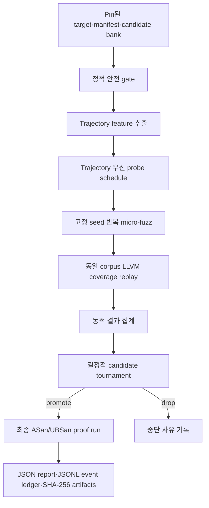
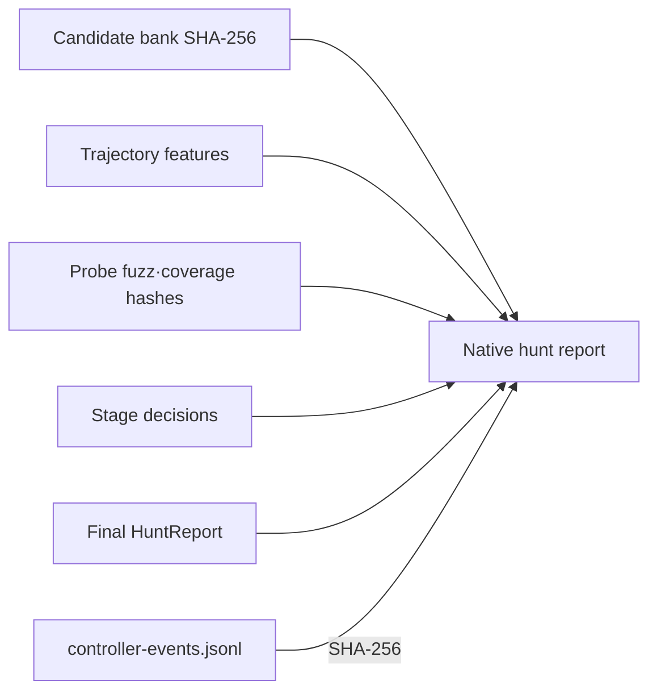

# dLLM-native fuzzing harness

> **상태: 구현된 runtime 계약 + 측정 결과 분리.** native harness 구현 및 첫 bring-up 결과는
> [dLLM native OpenEXR 퍼징 측정 결과](dllm-native-fuzz-results-20260819.md)에 분리한다.
> 첫 실행은 source와 trajectory가 동일한 후보 두 개를 사용했으므로 아래
> `trajectory-aware` 효과를 입증하지 못했다.
> feedback-conditioned PoC revision의 canonical 5-arm×5-rep pilot은
> [OpenEXR PoC revision results](poc-revision-openexr-results-20260820.md)에 분리한다.
> 그 pilot의 primary verdict는 `NO-GO`이며 sanitizer-backed finding은 없었다.

## 목표

최종 코드만 평가하는 일반 LLM 퍼징 루프가 아니라, Stable-DiffCoder의 실제
denoising trajectory를 후보 실행 순서와 검증 예산에 반영하는 최소 실행 시스템을 만든다.

> 핵심 연구 질문: 동일한 후보·퍼징 예산에서 trajectory를 이용한 선택이 최종 출력만
> 이용한 선택보다 검증 가능한 프로그램 진행과 취약점 증명에 더 빨리 도달하는가?

## v1 구조

## `trajectory-aware`의 실행 정의

후보 `c`의 최종 source뿐 아니라 다음 관측값을 controller 입력으로 사용한다.

- committed token 가중 평균 confidence
- step confidence 최솟값
- 인접 step confidence 변동성
- 전체 mask 대비 commitment progress의 면적
- realised NFE와 관측 step 수

Trajectory는 화면에 표시만 하지 않는다. 다음 결정 중 하나 이상을 실제로 바꿔야 한다.

1. micro-fuzz 실행 순서
2. 다음 stage 생존 후보
3. 최종 proof 후보

동적 결과가 같으면 trajectory quality가 tie-breaker가 된다. 이후 실험에서는 candidate
source와 fuzz 결과를 고정한 채 trajectory를 candidate 사이에서 뒤섞는 pseudo-trace
대조군으로 이 효과를 검증한다.

## Probe와 proof의 분리

| 단계 | 목적 | 허용 주장 |
| --- | --- | --- |
| probe | 후보 비교와 예산 배분 | 우선순위 신호 |
| proof | 선택 후보의 독립 sanitizer 실행 | sanitizer 재현 여부 |

Probe crash는 최종 취약점 증명으로 승격하지 않는다. 선택된 후보는 별도의 proof run을
통과해야 하며, raw log·corpus·crash·argv hash를 별도 디렉터리에 보존한다.

## 결정 정책

각 stage는 동일한 duration과 둘 이상의 고정 libFuzzer seed를 모든 active candidate에
적용한다. 후보 순위는 다음 key를 위에서부터 사전 고정해 비교한다.

1. sanitizer crash 관측 여부
2. build 성공률
3. target branch coverage 중앙값
4. target line coverage 중앙값
5. libFuzzer feature·edge coverage 중앙값
6. trajectory quality
7. executions/sec 중앙값
8. candidate ID 오름차순

Stage가 끝나면 설정된 수만 promote하고 나머지는 drop한다. 모든 후보가 build에 실패하면
fail closed한다. 모든 event는 timestamp 대신 단조 증가 sequence를 사용해 동일 입력에서
byte-stable JSONL을 만든다.

## Stock Stable-DiffCoder 경계

현재 checkpoint는 committed token을 generation 중 다시 여는 true remasking을 제공하지
않는다. 따라서 v1은 다음만 구현한다.

- 실제 trajectory 기반 scheduling
- 실행 피드백 기반 candidate tournament
- revision이 필요한 정체 상태의 증거화

True feedback-conditioned remasking은 별도 `RevisionSampler` treatment로 추가한다. v1 결과를
"Stable remasking" 또는 "모델 내부 self-correction"이라고 부르지 않는다.

## 구현된 revision runtime 경계

`poc-revision` runtime은 native harness 위에 별도 selective-revision treatment를 둔다.
구현된 경계는 다음과 같다.

- 모델은 고정된 OpenEXR particle grammar의 selector slot을 채우며 raw EXR bytes를 직접
  생성하지 않는다.
- materializer가 dependent size와 offset을 재계산한 뒤에만 prebuilt OpenEXR probe로
  snapshot을 전달한다.
- probe feedback은 후보 우선순위와 field attribution에만 사용한다. 독립 sanitizer proof가
  성공하지 않으면 `validated_success`는 false다.
- sanitizer signal이 없으면 proof는 skipped로 기록한다. skipped proof는 취약점 부재 증명이
  아니며 취약점 발견도 아니다.
- selective revision은 committed field slot을 다시 여는 새 sampler path다. stock
  Stable-DiffCoder remasking으로 표기하지 않는다.

Canonical OpenEXR pilot:

| 항목 | 값 |
| --- | --- |
| Artifact root | `/home/seory0/.cache/dllm-agent/openexr-poc-5arm-pilot-canonical-20260820-183739` |
| Arms×reps | 5×5 |
| `raw-arm-reports.jsonl` | `8204d8a07cc778e6f6810f6a69d2d68ee16da362b78322d9b4c191dcf1b633ae` |
| `paired-summary.json` | `f4e35bbf97f08679fc49e43bb8001abecc88575904306674b9ed40cfb844d2d7` |
| `live-index.json` | `f0b6c36f314c000c12174c0214f56e31ea71baf7c07a678f2b7c148dfd719934` |
| Primary result | all `validated_success=false`; `NO-GO` |
| Proof boundary | sanitizer signal false; proof skipped |

The deterministic successor-class commit records model confidence and trajectory evidence, but
the semantic selector value is committed by catalog successor class rather than sampled token
identity. Treat this as a pilot caveat when interpreting revision mechanism evidence.

## 증거 계약

최소 산출물은 다음과 같다.

- `dllm-native-hunt-report/v1` JSON
- `controller-events.jsonl`
- 후보·round별 probe harness, logs, corpus, crash artifacts
- 선택 후보의 기존 `dllm-hunt-report/v1` proof artifacts

## 실제 검증 타깃

- target: `AcademySoftwareFoundation/openexr` `v3.4.14`
- commit: `777d231a179de1711d2a942810d9559216ab3f4c`
- surface: in-memory `checkOpenEXRFile` C++/Core parser path
- candidate bank: 같은 prompt에서 실제 `Stable-DiffCoder-8B-Instruct`가 생성한 후보와
  token-transfer trajectory
- corpus: commit에 포함된 작은 EXR fixture와 magic/version seed
- execution: OpenEXR ASan·coverage 라이브러리를 한 번 빌드한 digest-pin 이미지,
  runtime `--network none`, read-only target, capability drop
- 목적: controller의 실제 build·micro-fuzz·coverage·proof·hash 경로와 구조화 바이너리
  parser에서의 후보 선택 효과 검증

OpenEXR 전체를 probe마다 다시 계측 빌드하면 후보 실행보다 target build 시간이 더 커진다.
따라서 target 라이브러리는 pin된 source로 이미지 생성 시 한 번 빌드하고, 각 probe는
생성된 얇은 harness만 다시 링크한다. 이미지 생성 비용과 campaign 비용은 별도로 보고한다.

## 예상 성능 범위

아래 값은 설계 목표이지 측정 결과가 아니다. 실제 수치는 OpenEXR 실행 문서에 분리한다.

| 적용 범위 | 예상 변화 | 해석 |
| --- | ---: | --- |
| tournament v1만 적용 | wall-clock `0.6–1.0x` | 모든 후보를 짧게 probe하므로 단일 one-shot보다 느릴 수 있다. |
| target 사전 빌드 | 후보 build 단계 `10x+` | OpenEXR 전체 재빌드 대신 얇은 harness만 링크한다. |
| resident model + batch | 생성 단계 `2–6x` | 모델 재적재를 제거했을 때의 목표다. v1에는 아직 포함하지 않는다. |
| GPU 생성·CPU probe 중첩 | 전체 `1.2–1.8x` | 비동기 queue가 구현된 후의 목표다. |
| 유망 후보 예산 집중 | target branch 도달 `1.3–2.5x` | 후보 품질 분산이 충분한 복잡한 target에서 기대한다. |
| 전체 구조 완성 | 유용 coverage 도달 `2–5x` | 단순 parser에서는 `0–20%` 또는 역효과일 수 있다. |

논문 주 지표는 단순 token 수가 아니라 동일 CPU/GPU·wall-clock 예산에서의
`time-to-target-branch`, target-only coverage, 그리고
`time-to-first-validated-vulnerability`이다.

이 제한 실행은 dLLM 우월성, 새로운 취약점 또는 제로데이를 주장하지 않는다.

## 완료 기준

아래는 기능 계약의 완료 기준이다. 논문상 trajectory 효과의 완료 기준은 별도이며, 서로
다른 후보·trajectory와 반복 seed를 사용한 real-vs-pseudo 비교가 필요하다.

- 고정 fuzzer seed가 실제 libFuzzer argv에 포함된다.
- 두 후보 이상이 동일한 반복 probe schedule을 받는다.
- trajectory가 실행 순서 또는 최종 선택에 실제 영향을 준다.
- probe와 proof evidence가 서로 분리되고 hash로 결합된다.
- 단위·통합·CLI 테스트와 pin된 OpenEXR 실제 실행이 완료된다. Canonical PoC revision
  pilot은 이 기능 완료 기준을 충족했지만, 논문상 trajectory/revision 효과는 primary no-go와
  exploratory inconclusive로 남았다.
