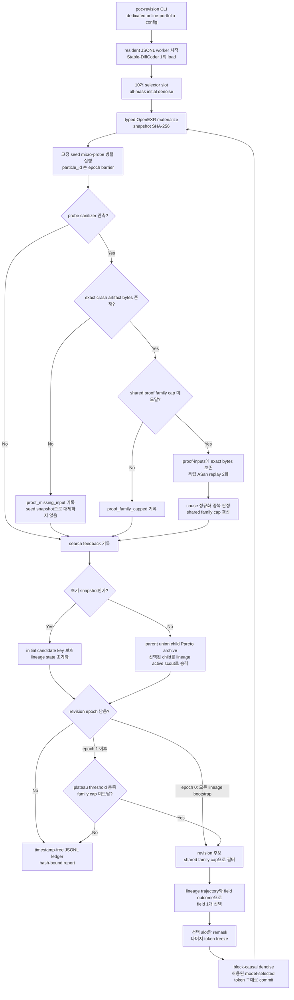

# dLLM-native online portfolio harness

**검토 기준:** 2026-08-31, Asia/Seoul
**상태:** 통합 prototype과 자동 검증 완료, strict spec·새 live 효능 실험은 미완료
**사용자 표면:** `dllm-agent poc-revision`, `controller_mode="online-portfolio"`
**전용 config:** [`openexr-v3.4.14-online-portfolio.json`](../configs/openexr-v3.4.14-online-portfolio.json)

> **판정:** 이 구현은 이 저장소에서 현재 코드와 자동 검증으로 확인할 수 있는 설계 중
> 가장 강한 dLLM-native online revision 설계다. 그러나 이론적·경험적 전역 최적해이거나
> 다른 dLLM/AR/FIM/fuzzer보다 우월하다고 증명된 것은 아니다.

승인 설계는 [dLLM-native online portfolio spec](superpowers/specs/2026-08-31-dllm-native-online-portfolio-design.md)에
있다. 이 문서는 설계 의도가 아니라 현재 작업 트리에 실제로 연결된 경로와 남은 차이를
기록한다.

## 구현 흐름



Probe 작업은 동시 실행되지만 결과는 `particle_id`와 고정 seed 순서로 다시 묶인다. Online
proof는 이름과 달리 현재 background queue가 아니라 epoch barrier 안에서 동기 실행되며,
proof event가 다음 `revision_completed`보다 먼저 기록된다.

## dLLM-native인 지점

| 메커니즘 | 현재 구현 | 단순 모델 교체와 다른 이유 |
| --- | --- | --- |
| all-mask 구조화 초기화 | 고정 prompt의 10개 OpenEXR selector slot을 모두 mask한 뒤 단계적으로 채운다. | 완성 문자열 한 번을 받는 것이 아니라 mask population과 commit 순서가 후보 상태를 만든다. |
| 선택적 재확산 | lineage별로 고른 materialized mutable field 한 개만 다시 mask하고 다른 committed token은 그대로 고정한다. | 전체 후보를 새 모델 출력으로 교체하지 않고 기존 해의 일부를 보존한 채 국소 denoising을 다시 수행한다. |
| 병렬 any-order commit | 영향받은 block의 남은 mask를 함께 forward하고, step별 confidence가 높은 위치부터 `transfer_counts` schedule만큼 commit한다. | 최종 출력뿐 아니라 어떤 slot이 언제 확정됐는지가 실행 가능한 제어 신호가 된다. |
| 실제 model token commit | field별 허용 numeric token grammar와 parent selector class 제외 조건 안에서 모델이 뽑은 token ID를 그대로 selector로 해석한다. | controller가 임의의 successor class로 치환하지 않으므로 dLLM token dynamics가 child bytes에 직접 반영된다. |
| proposal-level trajectory mask | 매 forward의 proposal token·confidence·선택 token과 runner-up의 확률 margin을 보존한다. Field별 commit step, proposal flip, mask lifespan과 이전 outcome을 lineage 안에서 결합하고, 성공·실패 field에는 cooldown을 주어 아직 미시도인 불안정 field를 먼저 탐색한다. | 최종 token이 같아도 그 전에 A→B로 뒤집혔는지, 얼마나 오래 mask였는지, 모델이 대안을 얼마나 근소하게 이겼는지가 다음 remask field를 바꿀 수 있다. |
| 실행 피드백 기반 NFE 배분 | Epoch 0 bootstrap도 shared family cap을 적용하고, 이후에는 Pareto 개선이 없는 lineage만 revision한다. | 초기 scout 이후 dLLM forward를 고정 횟수로 모든 후보에 쓰지 않고 실행 정체가 관측된 위치에만 추가한다. |
| resident worker | 한 CLI run 동안 worker와 모델을 한 번 열고 initial/revise 요청을 같은 JSONL process에 보낸다. | model residency 자체가 diffusion 알고리즘은 아니지만, 여러 번의 부분 denoising을 online loop로 사용할 수 있게 하는 실행 조건이다. |
| parent/archive/proof guard | search vector, exact crash-artifact proof, cause archive, `parent ∪ child` Pareto selection을 분리한다. | 이 부분은 모델 독립적 안전장치다. dLLM-native 주장의 근거가 아니라 selective denoising의 효과를 회귀·오탐 없이 검증하기 위한 경계다. |

실제 sampler는 stock Stable-DiffCoder가 제공하는 내장 remasking API가 아니라, pin된
Stable-DiffCoder logits 위에 이 저장소가 구현한 구조화 selective-revision 경로다. 따라서
“stock model의 자가 수정 기능”으로 표현하지 않는다.

## 오라클과 선택 규칙

Search controller의 Pareto 축은 다음 값이다.

```text
proved-new-cause novelty, valid snapshot, target branches,
rare edges, new edges, value-profile features, executions/second,
negative cumulative NFE/forward calls/GPU cost,
negative current probe wall/rejected/dedup cost
```

현재 OpenEXR probe에서 `target_branches_hit`와 `new_edges`는 libFuzzer의 최종 `cov`를
공유하는 proxy이고 `rare_edges`는 0이다. 따라서 위 축은 schema와 controller 경로가
연결됐다는 뜻이지, target-only branch ID·coverage delta·rare-edge frequency가 구현됐다는
뜻이 아니다. 이 세 신호가 실제 instrumentation으로 교체되기 전에는 target-branch 또는
rare-edge 최적화 효과를 주장하지 않는다.

- `canary_triggered`는 새 online controller 입력에 없으며 역사 artifact에만 남는다.
- `sanitizer_observed`는 exact proof 후보를 만드는 trigger일 뿐 search 순위와 field attribution
  축이 아니다.
- Probe가 hash와 bytes를 함께 제공한 crash artifact만 `artifact_dir/proof-inputs/<sha>.bin`에
  보존해 proof runner로 전달한다. Sanitizer 문자열만 있고 bytes가 없으면
  `proof_missing_input`을 기록하며 particle seed bytes로 대체하지 않는다.
- OpenEXR proof runner는 같은 crash artifact bytes를 서로 다른 고정 seed로 두 번 재생하고
  동일한 ASan signature가 나온 경우에만 `proved`를 반환한다.
- 새 cause는 `target commit + sanitizer class + address가 정규화된 root signature`의 canonical
  SHA-256으로 식별한다. Rich signature가 없으면 provisional family만 소비하고 새 cause 보상을
  주지 않는다.
- archive는 protected initial candidate key를 먼저 보존하고, 비지배 후보가 넘치면 crowding
  distance와 snapshot hash로 결정적으로 자른다.
- Pareto archive가 보존한 child는 해당 lineage의 다음 active scout가 되고, archive에서 탈락한
  child만 parent를 대체하지 못한다. Protected initial parent snapshot은 child가 active가 되어도
  archive anchor로 남는다.
- Online remask decision hash는 선택 field뿐 아니라 parent snapshot·feedback·trajectory hash,
  proposal-derived field feature, lineage-local outcome memory를 함께 canonical hash에 묶는다.

주요 구현 위치는 다음과 같다.

- runtime 조합과 event 순서: [`pipeline.py`](../src/dllm_agent/revision/pipeline.py)
- Pareto archive: [`archive.py`](../src/dllm_agent/revision/archive.py)
- proof cause와 family cap: [`proof_archive.py`](../src/dllm_agent/revision/proof_archive.py)
- plateau state: [`portfolio.py`](../src/dllm_agent/revision/portfolio.py)
- trajectory field 정책: [`trajectory_policy.py`](../src/dllm_agent/revision/trajectory_policy.py)
- report/config schema: [`models.py`](../src/dllm_agent/revision/models.py)
- resident client: [`revision_client.py`](../src/dllm_agent/runtime/revision_client.py)
- real model adapter와 sampler: [`selective_revision_worker.py`](../tools/selective_revision_worker.py),
  [`selective_revision_sampler.py`](../tools/selective_revision_sampler.py)
- exact two-replay ASan proof: [`proof.py`](../src/dllm_agent/targets/openexr/proof.py)

## 구현·검증 상태와 한계

| 항목 | 현재 확인 가능한 상태 |
| --- | --- |
| 설치 표면 | `poc-revision` CLI와 `online-portfolio` config가 production adapter, resident worker, OpenEXR probe/proof runner까지 연결돼 있다. |
| 자동 검증 | Archive, cause, plateau, proposal trajectory, pipeline, sampler, resident client, proof, CLI, sanitizer/canary 중립성을 자동 테스트한다. 최종 통과 수와 명령은 같은 날짜의 SDD ledger에 기록한다. 이는 fake/in-memory seam을 포함한 기능 증거다. |
| 실제 모델 효능 | 새 controller와 실제 Stable-DiffCoder·OpenEXR를 함께 사용한 hash-bound live result는 아직 없다. load count 1, wall-clock 개선, branch/proof 개선은 측정 전이다. |
| 대상 범위 | OpenEXR용 10-slot grammar이며 실제 revision 대상은 `origin_x`, `origin_y`, `width`, `height`, `payload_pattern` 다섯 field다. 일반 코드·임의 binary grammar로의 일반화는 미검증이다. |

현재 구현과 승인 spec 사이의 중요한 차이는 다음과 같다.

1. Epoch 0은 plateau 여부와 무관하게 모든 uncapped lineage에 bootstrap scout를 한 번 만든다.
   Plateau gate는 epoch 1 이후에만 적용된다.
2. Online proof는 다음 revision보다 먼저 끝나지만 비동기 queue가 아니라 동기 호출이다.
   GPU generation과 CPU probe/proof overlap도 구현되지 않았다.
3. Pareto archive 선택은 다음 active scout를 결정하지만, active population은 particle ID당
   한 branch뿐이다. Protected parent와 여러 trade-off snapshot이 archive에 함께 남아도 모든
   branch를 독립적으로 다시 probe/revision하지 않으며, 별도의 never-revised
   `baseline_anchor` 역할도 없다.
4. Cause archive와 family cap은 한 `run_poc_revision` 호출 안에서만 유지된다. Run 간 영속
   cause memory는 없다.
5. 매 forward의 proposal과 실제 selected-vs-runner-up probability margin은 기록하지만, child
   result에 frozen field의 parent proposal history를 합치지는 않는다. 따라서 여러 revision을
   가로지르는 장기 field trajectory memory는 아직 불완전하다.
6. Field outcome에는 후보별 reward delta, duplicate, invalid materialization, exact-proof 실패가
   연결된다. 이 memory는 현재 한 `run_poc_revision` 안의 field 선택에만 쓰이며 별도 영속
   학습 상태로 저장되지는 않는다.
7. `epochs`는 상한이지만 eligible lineage가 없으면 loop가 종료된다. 개선 중인 parent를 model
   revision 없이 계속 probe하는 장기 online scheduler는 아직 없다.
8. Report는 realized NFE·forward call·GPU ms와 probe/proof invocation·scheduled seconds를
   합산한다. 그러나 model load time/count, 실제 CPU seconds, end-to-end wall-clock, peak memory는
   아직 별도 campaign analyzer가 필요하다. Archive의 probe wall·rejected/dedup 비용도 현재
   feedback 단위다.

## 과거 `NO-GO`와의 증거 경계

[2026-08-20 OpenEXR PoC 결과](poc-revision-openexr-results-20260820.md)의 primary verdict
`NO-GO`는 그대로 유효한 역사적 결과다. 그러나 그 artifact는 이 새 설계를 실행하지 않았다.
당시 경로는 model token identity 대신 deterministic successor class를 semantic selector로
commit했고, 현재의 online cause archive, parent-preserving portfolio, plateau gate,
lineage-specific trajectory policy가 없었다.

따라서 그 `NO-GO`는 새 runtime의 성공 증거도 실패 증거도 아니다. 새 설계의 효능 판정에는
새 config·code hash·model/target pin으로 다시 생성한 end-to-end artifact가 필요하다.
역사 재현용 [`openexr-v3.4.14-poc-revision.json`](../configs/openexr-v3.4.14-poc-revision.json)은
legacy mode로 남고, 새 runtime은 별도 online portfolio config를 사용한다.

## 필수 ablation

| 비교군 | 제거·대체하는 요소 | 반증 가능한 관측 |
| --- | --- | --- |
| `final-only` | trajectory feature를 제거하고 최종 selector만 사용 | time-to-target-branch, coverage AUC, proved cause가 유지되면 trajectory 인과 주장은 기각 |
| `global-mask` | lineage별 field 대신 모든 lineage에 같은 field 적용 | lineage diversity와 plateau escape가 유지되면 per-lineage 정책 이점은 없음 |
| `full-regenerate` | 선택 slot remask 대신 모든 slot을 다시 생성 | 동일 개선당 NFE·GPU초가 같거나 낮으면 partial freeze 효율 주장은 실패 |
| `pseudo-trajectory` | final output과 budget은 고정하고 trace를 lineage 사이에서 순열 | real trace와 차이가 없으면 실제 token dynamics의 인과 효과는 없음 |
| `close-per-epoch` | resident worker를 epoch마다 재시작 | load·wall-clock 차이가 없으면 residency 효율 주장은 없음 |
| `child-only` | `parent ∪ child` 대신 child로 즉시 교체 | coverage/proof regression이 늘지 않으면 parent archive 보호 효과는 없음 |
| `successor-class-commit` | model-selected token을 과거 deterministic successor class로 대체 | 결과가 같으면 direct token commit의 추가 기여는 관측되지 않음 |

효능 비교에는 위 mechanism ablation과 별도로 동일 예산의 AR/FIM generator, 구조화 random
mutation, libFuzzer-only baseline이 필요하다.

## end-to-end 최소 지표

모든 arm은 같은 target/container pin, initial corpus, 반복 seed, 총 wall-clock, CPU
worker-seconds, GPU-seconds 한도를 사용해야 한다.

| 범주 | 필수 지표 |
| --- | --- |
| 최종 효능 | `time-to-first-proved-new-cause`의 right-censored 분포, unique proved causes, validated success rate |
| search 진행 | `time-to-target-branch`, target-only branch/edge coverage AUC, rare/new edges, value-profile features, executions/second |
| dLLM 기제 | lineage별 plateau escape rate, 선택 field 분포, commit step/confidence, remask 비율, parent 보존·child 승격·회귀율, archive diversity |
| 비용 | realized NFE, forward calls, GPU ms, model load count/time, probe/proof CPU seconds, end-to-end wall-clock, peak memory |
| 품질·낭비 | valid snapshot rate, rejected/dedup count, duplicate cause rate, proof family cap 절감량, `not_reproduced`·`crash_without_sanitizer` 비율 |
| 재현성 | config/model/target/container/prompt hash, snapshot·corpus·log·argv hash, seed, byte-stable event-ledger hash |

결과는 반복 seed의 paired 차이, effect size, confidence interval과 censoring을 함께 보고해야
한다. Coverage 개선이나 probe sanitizer 문자열만으로 vulnerability, zero-day, dLLM 우월성을
주장하지 않는다.
