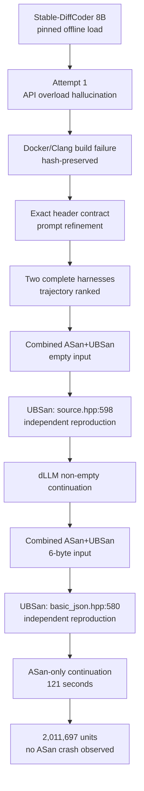

# Stable-DiffCoder × jsoncons 실제 퍼징 결과

**실행일:** 2026-08-19
**상태:** 실제 engineering run 완료 · 효능 비교 미실시 · zero-day 미확정

## 한 줄 결론

Pin된 Stable-DiffCoder-8B-Instruct가 실제로 C++ libFuzzer harness를 생성했고,
trajectory ranking으로 선택한 harness가 `jsoncons` 최신 `master`의 UBJSON bytes
경로에서 서로 다른 두 위치의 재현 가능한 **UBSan-only undefined behavior**를
발견했다. 별도 ASan-only continuation은 121초 동안 2,011,697 units를 실행했으며
ASan crash는 관찰되지 않았다. 이 결과는 dLLM 우월성이나 zero-day를 증명하지 않는다.

## 고정 환경

| 항목 | 측정값 |
| --- | --- |
| 모델 | `ByteDance-Seed/Stable-DiffCoder-8B-Instruct` |
| model revision | `10cdaf9b486f1cf0273ad968459dbe2d21a1482a` |
| custom model source SHA-256 | `298b19a464f32c00d38e43603516174a73fb4c531193369ff1aabbef32593104` |
| runtime | Python 3.12.13, Torch 2.5.1+cu121, Transformers 5.3.0 |
| GPU | RTX 3090 한 장 (`cuda:0`) |
| GPU load | allocated 16,500,925,440 bytes, reserved 16,636,706,816 bytes |
| target | `danielaparker/jsoncons` |
| target commit | `af497a1c1ea9043f4ad8d799617b7d00d6676153` |
| target archive SHA-256 | `753770e505cda06c0c1a1a3aff6998266dbb6d767735bcba5ae33514ab3a7f3c` |
| container image | `sha256:131884e6d9d2cc3962203c97a66c76634a521b1ff71a677f3c79022efb4a84cd` |
| compiler | Clang 18.1.8 |

네 weight shard, tokenizer, custom model source는 official Hub revision의 SHA-256과
일치한 뒤 오프라인으로 로드했다. 8B BF16 모델은 24GB 3090 한 장에 들어가므로 이번
2-candidate 기준선은 단일 GPU에서 한 번 로드했다. GPU 8장은 모델 sharding보다
후보 수가 충분히 클 때 GPU별 모델 사본으로 data-parallel sampling하는 편이 맞다.

## dLLM 후보 생성

첫 후보 은행은 정적 문자열 계약을 통과했지만 존재하지 않는 API overload를 사용해
Docker/Clang에서 실패했다. 실패 보고서와 prompt/candidate hash를 보존한 뒤 실제
header signature를 prompt에 추가했다. 두 번째 은행의 1위 후보는 다음과 같다.

| 필드 | 값 |
| --- | --- |
| candidate | `candidate-02` |
| seed | `20260822` |
| realised NFE | `242` |
| captured transfers | `194` |
| trajectory score | `0.946021` |
| trajectory confidence | `0.988811` |
| source SHA-256 | `057b6839e80a0447b498579cce3599e1c9b38fd3f1820244a2a73918b353f7de` |
| candidate-bank SHA-256 | `76256bb214e0c95d2663fa418893c1df87af36931f331374a9de36cffd8d3546` |

점수는 취약점 확률이 아니라 제한된 동적 검증 슬롯의 우선순위다. 두 후보만으로
trajectory ranking의 효능을 주장할 수 없으며 AR·pseudo-trace 대조군도 아직 없다.

## 동적 결과

### Finding A: empty byte source

- 위치: `include/jsoncons/source.hpp:598`
- 입력: 0 bytes, SHA-256
  `e3b0c44298fc1c149afbf4c8996fb92427ae41e4649b934ca495991b7852b855`
- 원인 후보: empty `std::vector<uint8_t>`의 null `data()`가 길이 0
  `std::memcpy`의 nonnull 인자로 전달됨
- 재현: 동일 pin/image에서 fuzzer 재실행과 최소 public-API 프로그램 모두 재현
- sanitizer matrix: ASan-only exit 0, UBSan-only exit 1

### Finding B: zero-length short string

- 위치: `include/jsoncons/basic_json.hpp:580`
- 입력: 6 bytes, SHA-256
  `ec89b438e1bc35e36f70b26261050ffdf3d17aaff2f593375489f4d73ab2ad92`
- 원인 후보: UBJSON 길이 0 문자열이 null data pointer를 갖는 string view로 전달되고,
  `short_string_storage`가 이를 길이 0 `std::memcpy` 인자로 사용함
- 재현: 동일 pin/image에서 최소 public-API 프로그램으로 재현
- sanitizer matrix: ASan-only exit 0, UBSan-only exit 1

두 결과 모두 sanitizer가 증명한 C++ undefined behavior이지만, 현재 관찰은 zero-byte
copy의 nonnull 계약 위반이다. 정상 빌드의 exploitability, 보안 영향, maintainer의
중복 판단은 확인되지 않았다. 따라서 “ASan memory corruption”, “CVE”, “zero-day”로
표기하지 않는다.

### ASan-only continuation

| 지표 | 값 |
| --- | ---: |
| wall budget | 120초 (`Done ... in 121 second(s)`) |
| executed units | 2,011,697 |
| executions/sec | 16,625 |
| edge coverage counter | 969 |
| feature coverage counter | 4,484 |
| final corpus count | 1,028 |
| preserved corpus | 256개, deterministic bounded prefix |
| ASan crash | 0 |
| LLVM regions | 52.80% |
| LLVM functions | 37.65% |
| LLVM lines | 26.20% |
| LLVM branches | 57.31% |

`ASan crash = 0`은 해당 시간·harness·corpus에서 crash가 관찰되지 않았다는 뜻뿐이며
취약점 부재를 뜻하지 않는다.

## 핵심 증거

| artifact | SHA-256 |
| --- | --- |
| main candidate bank | `76256bb214e0c95d2663fa418893c1df87af36931f331374a9de36cffd8d3546` |
| Finding A final hunt report | `3a6852e594885bc8a84788c70eff3ba877c0065e9fdbf7fa5809454bbbe2eddb` |
| Finding A minimal triage JSON | `563778a9e64b9a25120324681a6ce4d86af9ea9d772810cfa6d804b3ce1cacb3` |
| Finding A sanitizer matrix | `4f5e85f4b6992451af1df46dfea164d7e1bc454c576058ecb7c8674638982503` |
| Finding B combined report | `c0d27c167209aea6dd0bc08cf64d80ce24c21a196fbabd650de0f44e842533fc` |
| Finding B sanitizer matrix | `3370e494ce8bc4923cc54e47b7b2c0d0313f07751e5ae7b36c650c319310538d` |
| ASan-only hunt report | `ceee33fb0974faae2df45d8dedf5db634d1dd52d2260e6c5ae5b27f1fa18ca31` |
| ASan-only fuzz log | `9ff70b57249a51f91ed37266732d6192858c8d73a4e95f8811cae9f3d751f325` |
| ASan-only coverage report | `a2d497ecd3cb36f904c1b7ba754ac794deda6873a4ecbcf382bbbfb0c4ec15b3` |

최종 machine-readable index는
`artifacts/live/jsoncons-ubjson-evidence-index.json`에 둔다.

## 공개와 논문 경계

- 2026-08-19 확인 시 target commit은 upstream `master` HEAD와 동일했다.
- 공개 이슈 검색에서는 같은 소스 위치의 보고를 찾지 못했지만, 이는 중복 부재의
  증명이 아니다.
- 외부 이슈, advisory, 이메일은 생성하지 않았다.
- 공개 전에는 [GitHub Security Advisory 비공개 경로](https://github.com/danielaparker/jsoncons/security/advisories/new)로
  maintainer에게 재현·중복·영향 판단을 요청해야 한다.
- 논문에는 maintainer 확인 전 raw crash bytes나 exploitability 주장을 공개하지 않는다.
- 이 1-target run은 agent engineering 증거이며 dLLM-vs-AR 효능 결과가 아니다.
