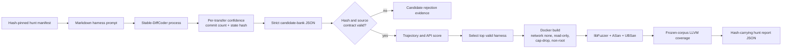

# 실제 dLLM 기반 OSS 퍼징 초기 구현

이 문서는 `Stable-DiffCoder → trajectory 점수화 → harness 선택 →
ASan/UBSan + libFuzzer → LLVM coverage → 해시 JSON` 경로의 실행 계약을
정리한다. 문서와 실행 증거는 Markdown, Mermaid, JSON, 텍스트 로그만 사용한다.

## 고정 구성

| 항목 | 값 |
| --- | --- |
| dLLM | `ByteDance-Seed/Stable-DiffCoder-8B-Instruct` |
| model revision | `10cdaf9b486f1cf0273ad968459dbe2d21a1482a` |
| target | `danielaparker/jsoncons`의 UBJSON bytes/cursor 경로 |
| target commit | `af497a1c1ea9043f4ad8d799617b7d00d6676153` |
| disclosure | GitHub Security Advisory 비공개 신고 |
| fuzzer image | `sha256:131884e6d9d2cc3962203c97a66c76634a521b1ff71a677f3c79022efb4a84cd` |
| compiler | 이미지 내부 Clang 18.1.8 |
| oracle | ASan+UBSan triage, ASan-only continuation, 별도 LLVM source coverage |

`jsoncons`는 이미 OSS-Fuzz 대상이므로 완전한 미개척 프로젝트는 아니다. 다만
2026-07-31 Fuzz Introspector에서 UBJSON 관련 개별 harness의 coverage가 0%,
14.77%, 19.43%로 낮게 관찰되어, 초기 실제 runner를 검증하기에 적절한
under-covered parser surface로 선택했다.

## 실행 구조



중간 denoising state는 도구 호출 권한이 없다. 모델 프로세스가 내보내는 것은
최종 C++ source와 각 token-transfer 단계의 `masked_tokens_before`,
`committed_tokens`, `mean_confidence`, post-transfer token-block SHA-256뿐이다.
최종 source도 정적 allowlist를 통과한 후에만 컨테이너로 전달된다.

## 실행 명령

모델 의존성은 프로젝트의 가벼운 기본 환경과 분리한다. 현재 검증 환경은
RTX 3090, NVIDIA driver 535, `torch 2.5.1+cu121`, `transformers 5.3.0`이다.

```bash
uv run dllm-agent sample configs/jsoncons-ubjson-hunt.json \
  --runtime-python /path/to/model-venv/bin/python \
  --cache-dir /path/to/huggingface-cache \
  --count 2 \
  --seed 20260819 \
  --steps 256 \
  --gen-length 256 \
  --block-length 4 \
  --temperature 0.2 \
  --device cuda:0 \
  --output /path/to/candidate-bank.json

uv run dllm-agent hunt configs/jsoncons-ubjson-hunt.json \
  --candidate-bank /path/to/candidate-bank.json \
  --source /path/to/jsoncons \
  --artifact-dir /path/to/run-artifacts \
  --output /path/to/hunt-report.json
```

## 점수와 해석

후보 점수는 다음 고정 결합이다.

```text
score = 0.60 × transfer-confidence
      + 0.30 × required-API coverage
      + 0.10 × NFE efficiency
```

이 점수는 취약점 존재 확률이 아니라 “제한된 동적 검증 예산을 먼저 받을
harness”의 우선순위다. 실제 취약점 증거는 오직 sanitizer crash와 재현 입력이다.
Crash가 없으면 결과는 `not_observed`이며, 취약점 부재나 모델 실패를 뜻하지 않는다.

실제 2026-08-19 측정값과 finding의 주장 경계는
[실행 결과 문서](live-hunt-results-20260819.md)에 분리했다.

## GPU 사용 원칙

Stable-DiffCoder-8B BF16은 RTX 3090 한 장에서 allocated 16.50GB, reserved
16.64GB로 로드됐다. 따라서 이번 2-candidate 기준선은 한 GPU에 한 번 로드한 뒤
순차 sampling했다. GPU 8장은 Hub 다운로드나 디스크 load를 빠르게 하지 않으며,
8B 모델을 여러 GPU에 sharding하면 통신 비용이 생긴다. 후보가 여러 개일 때는
GPU별 모델 사본으로 candidate sampling을 data-parallel하게 분배하는 용도가 적절하다.

## 격리와 증거

`hunt`는 다음 조건을 Docker argv에 강제하고 하나라도 구성할 수 없으면 host 실행으로
fallback하지 않는다.

- digest로 고정된 로컬 이미지와 `--pull never`
- `--network none`, read-only root filesystem
- `--cap-drop ALL`, `no-new-privileges=true`, UID/GID `65534:65534`
- source read-only mount와 campaign 전용 writable mount만 허용
- CPU, memory, PID, per-input timeout, total-time 제한
- shell string 없이 고정 argv만 실행
- corpus/crash output은 regular file, 개수, 크기, 이름을 다시 검사. Corpus는 모든
  entry를 검사한 뒤 이름순 최대 256개·총 8MiB를 보존하고, crash는 64개 초과 시
  fail-closed한다.

최종 JSON은 prompt, candidate bank, target archive, selected harness, compiler/fuzzer
로그, 정확한 command argv, corpus, crash, coverage 로그의 SHA-256을 포함한다.

## 공개 전 처리

새 sanitizer crash가 생겨도 즉시 제로데이로 부르지 않는다. 같은 고정 커밋에서
재현하고 최소화한 뒤, 기존 공개 이슈와 중복 여부를 확인하고, target의
`SECURITY.md`가 지정한 GitHub Security Advisory로 비공개 신고한다. Maintainer가
새 보안 결함임을 확인하기 전에는 논문에도 상세 crash input이나 exploitability
주장을 공개하지 않는다.
