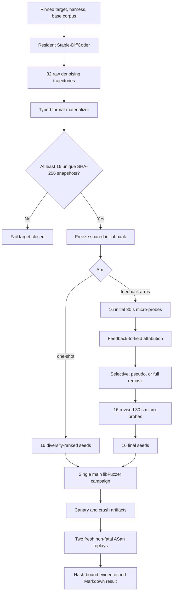

# dLLM-native multi-target 24-hour comparison protocol

Status: frozen before implementation and execution on 2026-08-21 (Asia/Seoul).

## Research question

Under the same end-to-end search worker budget, does executable feedback assigned to the
actual dLLM denoising trajectory improve vulnerability reachability over one-shot generation,
whole-particle regeneration, pseudo-feedback, and plain libFuzzer?

The primary causal contrast is `selective-revision` versus `pseudo-feedback`. With one
repetition, all results are descriptive; the run cannot support a statistical significance
claim.

## Frozen target matrix

| Target | Magma version | Upstream target commit | Program |
| --- | --- | --- | --- |
| libpng | Magma v1.2.1 (`1e4d8c248debacd7a5c4b157a1059d5290bd3a22`) | `a37d4836519517bdce6cb9d956092321eca3e73b` | `libpng_read_fuzzer` |
| libTIFF | Magma v1.2.1 (`1e4d8c248debacd7a5c4b157a1059d5290bd3a22`) | `c145a6c14978f73bb484c955eb9f84203efcb12e` | `tiff_read_rgba_fuzzer` |
| libxml2 | Magma v1.2.1 (`1e4d8c248debacd7a5c4b157a1059d5290bd3a22`) | `ec6e3efb06d7b15cf5a2328fabd3845acea4c815` | `libxml2_xml_read_memory_fuzzer` |

All three search binaries are built from the pinned Magma tree with its benchmark bug patches,
fatal canaries, and AddressSanitizer. Canary hits are benchmark ground-truth observations, not
zero-day findings. Any vulnerability claim additionally requires two fresh exact-input ASan
replays using the non-fatal proof build.

## Frozen runtime pins

| Target | Search image ID | Search build log SHA-256 | Non-fatal proof image ID | Proof build log SHA-256 |
| --- | --- | --- | --- | --- |
| libpng | `sha256:e304abee1c0d1a8366e10110b6267701eff4b761cc023ee882ebc7d46f74cf41` | `ed1b98292476ed5c250378cd3fcfdb3d43851843119f56606eeaaa2a4fbe39e5` | `sha256:32dc1104f9397670c9bc87ebfc72a75a2234ced77eea75435352f6d7c087c965` | `95aac151c23f808d1bc2370dc9313a878d1f4206ead1ada0860f0152cc57c5fb` |
| libTIFF | `sha256:6c98e35375e446c9ea08e2936f1470c1e3abf8dfcc2431d4a9c9fe47257e4894` | `7e9189e17b3cac367321867cb586bbf78bc3f9aa7f853e5da4340e46ba7b3b1e` | `sha256:79c3496b95953fcb6004d6e2bbcdd1d9c02a32772cbd544a803c3a44f4fc9ee4` | `fde4350dfb714f9cbce1d84de31787ac154ae9d16748502328b7bef69178f79f` |
| libxml2 | `sha256:76cd8aab328b4cd7cd4bf143448b6c1719ba821bd94a46567dedad8db7eb1046` | `9ccb9010da1017a426bffe3a0ce5ad7289bcaf1dd77aef4bf6075e2dbac4b9ae` | `sha256:edaba3bfc994869e79a5cac5bfca4d766fdd0a80797a08ce3c6d4993b58ae720` | `3d8fbf9e6cffabf5b4c7c22137f6435e599ccd30aabcd9a8300a4c1ce6636054` |

The search images use `MAGMA_ENABLE_CANARIES`, `MAGMA_FATAL_CANARIES`, and
`-fsanitize=address`. The proof images remove only `MAGMA_FATAL_CANARIES`, so a Magma canary
found during search remains distinct from an independently ASan-proved memory vulnerability.

Model execution uses stock `ByteDance-Seed/Stable-DiffCoder-8B-Instruct` at revision
`10cdaf9b486f1cf0273ad968459dbe2d21a1482a`. The loaded remote model code must hash to
`298b19a464f32c00d38e43603516174a73fb4c531193369ff1aabbef32593104`. The model virtual
environment at `/home/seory0/.cache/dllm-agent/model-venv/bin/python` includes `pydantic`
`2.13.4`, which is an execution dependency for the JSONL worker protocol and runtime schemas.

## Frozen experiment grid

The run contains `3 targets × 5 arms × 1 repetition = 15` cells.

| Arm | dLLM initial bank | Executable feedback | Revision treatment |
| --- | --- | --- | --- |
| `libfuzzer-only` | none | native libFuzzer only | none |
| `structured-one-shot` | shared target bank | none before campaign | none |
| `feedback-no-remask` | shared target bank | real | reopen all selector slots |
| `selective-revision` | shared target bank | real | reopen only the selected field slot |
| `pseudo-feedback` | shared target bank | fixed-point-free reassignment | same selective revision code |

Each target first produces exactly 32 raw Stable-DiffCoder trajectories. Their materialized byte
hashes are deduplicated, so the frozen gate is `32 raw -> minimum 16 unique`. A target fails
closed before any 24-hour cells start unless at least 16 unique snapshots remain. The same frozen
initial bank is reused across the four dLLM arms to make the comparison paired and to avoid
physically repeating identical model inference. Manifests record both logical per-arm model cost
and physical shared-generation cost. Concretely, the initial bank is physically generated once per
target and shared across `structured-one-shot`, `feedback-no-remask`, `selective-revision`, and
`pseudo-feedback`; it is logically charged to each dLLM arm report. The `libfuzzer-only` arm never
requests model initialization.

## Search budget

Every cell receives exactly `86,400` search worker-seconds.

| Arm class | Initial micro-probe | Revision micro-probe | Main campaign | Total |
| --- | ---: | ---: | ---: | ---: |
| `libfuzzer-only` | 0 | 0 | 86,400 | 86,400 |
| `structured-one-shot` | 0 | 0 | 86,400 | 86,400 |
| three feedback arms | 16 × 30 = 480 | 16 × 30 = 480 | 85,440 | 86,400 |

Micro-probes run sequentially within a cell, so each cell still consumes 24 hours of wall time
apart from model generation, build, proof, and reporting. The final 16 selected seeds form one
combined starting corpus for one libFuzzer instance; the 24-hour budget is not multiplied by the
number of particles. Independent crash minimization and proof replay are validation cost and are
reported separately from search worker-seconds.

The initial micro-probe input population is physically shared once per target across the three
feedback arms and is logically charged to each feedback arm. Revision micro-probes and main
campaigns remain arm-specific. For each feedback arm, the logical search split is `960` probe
worker-seconds plus `85,440` main-campaign worker-seconds. Each target-arm search cell ledger must
sum to exactly `86,400` worker-seconds; proof replay, minimization, image build time, model load
time, and report writing are excluded from that search total.

## Treatment flow

## Feedback and trajectory policy

- Initial dLLM slot filling uses an exact 8-step confidence-ordered commit schedule. At each step
  the sampler predicts remaining masked selector slots, then commits the highest-confidence
  predictions first, with token position as the deterministic tie-breaker. The trajectory records
  every committed token, confidence, remaining mask count, and state hash.
- Each structured field is constrained to one numeric selector token from the tokenizer-derived
  allowed set for that field cardinality. The real worker samples categorically from the softmax
  over only those allowed token IDs using the recorded seed. A frozen selector-class temperature
  of `8.0` flattens overconfident numeric logits enough to preserve particle exploration without
  changing their model-derived ordering. Revision excludes the parent's
  previous selector class when an alternate class exists. Re-running the same model pin, prompt,
  token state, allowed-token set, block, seed, and step must produce the same selected token.
- Initial-particle generation, model revision, initial probes, revision probes, main fuzzing, and
  proof replays use distinct recorded seed namespaces. Only the initial-particle and initial-probe
  namespaces are intentionally shared at target level.
- Snapshot reward is the micro-probe coverage delta, with sanitizer/canary reachability ordered
  above coverage, then value-profile features, then trajectory confidence as a tie-breaker.
- Field attribution combines the observed reward distribution for each selector class with the
  field's denoising uncertainty. This uses the model trajectory and executable behavior without
  launching ten counterfactual probes per particle.
- `selective-revision` binds each real feedback record to the trajectory that produced it.
- `pseudo-feedback` applies a seeded fixed-point-free permutation to the same feedback records.
  Candidate bank, seeds, probe duration, model calls, ranker, and budget router remain identical.
- `feedback-no-remask` uses the real feedback ranking but reopens all selector slots for the same
  revision step budget.

## Evidence contract

Every build, target bank, and cell records:

- repository, Magma, upstream target, model, remote-code, harness, Docker image, and prompt pins;
- full argv and selected environment hashes for build, generation, probe, campaign, and replay;
- 32 raw trajectory ledgers including token commits, confidence, NFE, forward calls, GPU time,
  selector values, materialization status, and snapshot SHA-256;
- the unique gate input set, dedup decisions, selected 16 hashes, and selection-policy hash;
- a worker-second ledger whose search entries sum exactly to 86,400;
- timestamped libFuzzer coverage/status samples, corpus hashes, crash hashes, and Magma canary data;
- two independent replay results for every deduplicated crash candidate;
- a canonical evidence-tree SHA-256 and a top-level JSONL stream hash.

Paths and hashes are relative to the immutable experiment root. Evidence hashing excludes only
the file that stores the tree hash itself, avoiding a self-reference.

## Result interpretation

The primary outcome is time to first independently ASan-reproduced input. Secondary outcomes are
unique independently reproduced root causes, Magma canary triggers, final edge coverage, coverage
AUC, executions per second, and plateau escapes. Model NFE, forward calls, GPU-seconds, physical
versus logically charged model work, CPU worker-seconds, corpus bytes, and proof cost are reported
separately.

No sanitizer-backed reproduction means no vulnerability claim. A Magma canary without ASan
reproduction is reported only as benchmark-bug reachability, even if the search image exits through
`MAGMA_FATAL_CANARIES`. One repetition (`n=1`) is descriptive only: it can show the frozen system's
mechanism behavior and effect-size direction, but it cannot establish statistical significance.
