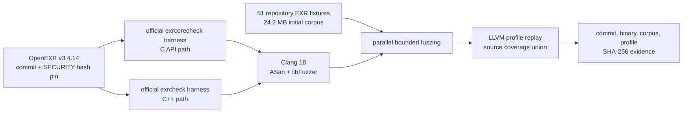

# OpenEXR v3.4.14 제한 퍼징 결과

기준일: 2026-08-19 (Asia/Seoul)

> **연대기 주의:** 이 문서는 공식 OpenEXR harness로 만든 bootstrap baseline이다.
> 이후 Stable-DiffCoder 후보를 사용한 native tournament는
> [별도 결과 문서](dllm-native-fuzz-results-20260819.md)에 기록했다. 아래의 “checkpoint
> 복구 미완료” 설명은 이 baseline을 실행한 당시 상태이며 현재 프로젝트 상태가 아니다.

## 결론

OpenEXR `v3.4.14`의 공식 C API 및 C++ 검사 하네스를 실제로 ASan/libFuzzer로
실행했다. 정확히 집계해 보존한 mutation 실행은 최소 `40,713`회였고, 두 하네스의
확장 corpus를 합친 LLVM source coverage는 Lines `33.53%`, Functions `31.57%`,
Branches `25.88%`, Regions `28.32%`였다.

이 제한 실행에서는 ASan이 증명한 메모리 안전성 크래시가 없었고 crash artifact도
`0`개였다. 따라서 **신고할 취약점이나 제로데이를 발견했다고 주장하지 않는다**.
이 결과는 OpenEXR이 안전하다는 증명도 아니며, 아래 시간·하네스·corpus 경계 안에서
동적 oracle이 발화하지 않았다는 뜻이다.

## 타깃 선정 근거

OpenEXR은 비공개 GitHub Security Advisory와 `security@openexr.com`을 제공하고,
취약점 제보 접수를 `48시간` 안에 확인하며 가능한 경우 치명적 취약점 패치를
`14일` 안에 게시한다는 정책을 명시한다. `3.4.x`도 지원 대상이다.
[OpenEXR 보안 정책](https://github.com/AcademySoftwareFoundation/openexr/blob/777d231a179de1711d2a942810d9559216ab3f4c/SECURITY.md)

실험은 2026-08-07 공개된 최신 패치 릴리스 `v3.4.14`의 실제 commit
`777d231a179de1711d2a942810d9559216ab3f4c`를 사용했다.
[OpenEXR v3.4.14 릴리스](https://github.com/AcademySoftwareFoundation/openexr/releases/tag/v3.4.14)

OpenEXR을 첫 실험 타깃으로 고른 이유는 다음과 같다.

- 공격자가 제공할 수 있는 구조화된 바이너리 이미지가 정상 입력이다.
- header, attribute, chunk table, 압축·압축 해제처럼 서로 의존하는 상태가 많아
  후보를 병렬 생성하고 전체 구조를 갱신하는 dLLM 실험과 잘 맞는다.
- 같은 입력을 C API와 C++ API 경로로 실행할 수 있어 differential harness로
  확장하기 쉽다.
- 공식 OSS-Fuzz 하네스가 있어 새 하네스의 품질과 별개로 baseline을 즉시 실행할 수 있다.

## 실행 경계



하네스는 OpenEXR 저장소에 포함된 공식 소스를 그대로 사용했다.

- [`openexr_exrcorecheck_fuzzer.cc`](https://github.com/AcademySoftwareFoundation/openexr/blob/777d231a179de1711d2a942810d9559216ab3f4c/src/test/oss-fuzz/openexr_exrcorecheck_fuzzer.cc)
- [`openexr_exrcheck_fuzzer.cc`](https://github.com/AcademySoftwareFoundation/openexr/blob/777d231a179de1711d2a942810d9559216ab3f4c/src/test/oss-fuzz/openexr_exrcheck_fuzzer.cc)
- [OSS-Fuzz OpenEXR 프로젝트 정의](https://github.com/google/oss-fuzz/tree/6a50925a5bd8e1bbc3b3b4d07e063cb817c10c83/projects/openexr)

초기 corpus는 해당 릴리스 저장소에 포함된 `.exr` fixture 51개만 사용했다. 공식
OSS-Fuzz public corpus URL은 이 환경의 익명 요청에 `403`을 반환했으므로 실험 입력에
포함하지 않았다.

## 고정 입력과 빌드 증거

| 항목 | 값 |
| --- | --- |
| OpenEXR commit | `777d231a179de1711d2a942810d9559216ab3f4c` |
| `SECURITY.md` SHA-256 | `a29644c43663d8cad3a3f2f22fa064f1d138df9873e32e410265756d25755087` |
| Core harness SHA-256 | `244cf82ce79b13f92f534eade5c4ec9257324535022a44add76b149a3a47d0e1` |
| C++ harness SHA-256 | `15d72dff735c1f6d340aa4d35038c86ceca6a4fe579038651602f1639326a60f` |
| compiler | `clang 18.1.8`, LLVM commit `3b5b5c1ec4a3095ab096dd780e84d7ab81f3d7ff` |
| toolchain image digest | `sha256:5ad76cffce259e1b6017b27409533b2b99c63e16277311f4bad0fd7adb9e4649` |
| Core ASan binary SHA-256 | `2f3cc3f4938a3e68365d79a0bb225d00b585550b4445d2427f46c9f6e3adb017` |
| C++ ASan binary SHA-256 | `d9a8256e0d9c47737660b21a81b7e6421d9c2a03ffeef0d34d8de56b0674e7b0` |
| initial corpus | 51 files, 24,186,127 bytes |
| initial corpus set digest | `fba53f0a268399c2827dc41f580fb9ecd46fe1fecca072bf432aa92b2c595a78` |

ASan build의 핵심 compiler flags는 다음과 같다.

```text
-O1 -gline-tables-only -fsanitize=address,fuzzer-no-link -fno-omit-frame-pointer
```

링크 단계에는 `-fsanitize=fuzzer,address`를 사용했다. 실행 시 leak 검사는 끄고,
ASan 오류는 즉시 중단하도록 `abort_on_error=1`을 적용했다.

## ASan/libFuzzer 결과

| 하네스 | 계측 실행 | 시간 | 정확히 기록된 units | 최종 edge (`cov`) | feature (`ft`) | peak RSS | crash |
| --- | --- | ---: | ---: | ---: | ---: | ---: | ---: |
| `openexr_exrcorecheck_fuzzer` | primary | 181초 | 38,316 | 2,015 | 8,912 | 916MB | 0 |
| `openexr_exrcheck_fuzzer` | reinforcement | 61초 | 2,397 | 3,742 | 15,309 | 1,025MB | 0 |

C++ 하네스는 위 계측 전에 180초 corpus-expansion pass도 수행했다. 해당 pass의
콘솔 출력이 과도한 정상 파서 오류 메시지 때문에 잘렸으므로 실행 횟수 합계에서는
보수적으로 제외했지만, 생성된 corpus는 coverage replay에 포함했다.

최종 corpus와 crash 디렉터리를 다시 해시·계수한 결과는 다음과 같다.

| 항목 | Core | C++ |
| --- | ---: | ---: |
| corpus files | 1,012 | 971 |
| corpus set SHA-256 | `2677b6ec31aca886a586fc0d5ea03ae6e4368beb8713d18dd6efae3aa34eb5c9` | `81bd26ba00ad74e725ffdb8a3df12d9cd7f315f9f803802587c5a0fca13cdd82` |
| crash artifacts | 0 | 0 |

## LLVM source coverage

ASan 실행에서 확장된 두 corpus를 별도의
`-fprofile-instr-generate -fcoverage-mapping` 빌드로 재생했다. 두 하네스의 profile을
합친 뒤 OpenEXR 소유 라이브러리 코드만 집계했다. `_deps`, `external`, `src/test`는
분모에서 제외했다.

| metric | total | missed | covered |
| --- | ---: | ---: | ---: |
| Regions | 23,085 | 16,547 | 28.32% |
| Functions | 1,980 | 1,355 | 31.57% |
| Lines | 34,544 | 22,962 | 33.53% |
| Branches | 14,278 | 10,583 | 25.88% |

| coverage artifact | SHA-256 |
| --- | --- |
| combined `.profdata` | `d1a115399cd0d8a1d5b1320a8289a7df73f8fe5ad2a5a382681a4bb8b1df38e5` |
| Core coverage binary | `66af9ba3a9bdb014c43d7bd7034bca7a9c5b94a38b42e76bb363045f55c42032` |
| C++ coverage binary | `9fa48fcb78a4236874ca2629f6538e7bc817b623892ea5bc10b7a575e4bb4bb6` |

## dLLM 연구에서의 해석

이번 OpenEXR 실행은 **공식 하네스로 만든 bootstrap baseline**이다. 현재 프로젝트의
자동 `hunt` 빌드 계약은 header-only C++ 타깃에 한정되어 있고, Stable-DiffCoder
checkpoint 복구 다운로드도 아직 완료되지 않았으므로 이 OpenEXR 하네스를 dLLM이
생성했다고 표시하지 않는다. 따라서 이 결과는 dLLM 우월성 실험이나 논문의 model
ablation 표본으로 세면 안 된다.

다음 dLLM 실험에서는 같은 commit·seed corpus·시간 예산을 고정하고 다음 후보군을
비교하는 것이 적절하다.

1. 공식 `exrcorecheck` baseline
2. dLLM이 제안한 attribute/chunk-table 상태 전이 하네스
3. C/C++ 결과 불일치와 sanitizer oracle을 함께 보는 differential 하네스

후보별 denoising trajectory로 정적 API 도달성과 구조적 다양성을 점수화한 뒤, 선택된
완성 source만 위와 같은 ASan/coverage 경계에 전달해야 한다.

## 신고 판단

현재 신고 대상은 없다. OpenEXR 정책상 정상 제품 입력으로 도달 가능한 프로젝트 코드의
결함이어야 하며, sanitizer-backed crash와 재현 입력이 먼저 필요하다. 향후 그런 증거가
나오면 공개 issue가 아니라 공식 비공개 Security Advisory 또는 보안 이메일 경로를
사용해야 한다.
