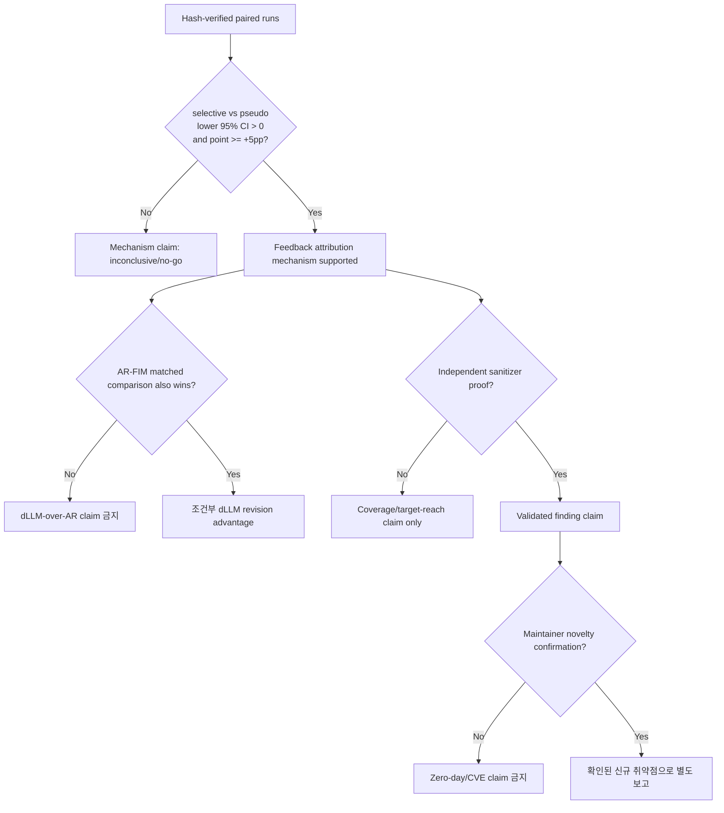

# dLLM-Native Fuzzing System: 초록과 평가·성능 주장 계획

> 문서 상태: 논문 작성용 연구 계약 초안
> 현재 증거 경계: `selective-revision/v1`의 반복 실험 결과는 아직 없으므로 아래 결과 수치는
> 자리표시자다. 측정 artifact와 신뢰구간이 확보되기 전에는 결과형 초록을 제출본에 사용하지
> 않는다.

## 1. 권장 제목과 기여 범위

### 권장 영문 제목

**A dLLM-Native Fuzzing System with Trajectory-Aware Selective Revision**

### 용어 경계

- **system**: 모델 worker, revision controller, target harness, probe, coverage, 독립 sanitizer
  검증 및 evidence ledger를 포함한 전체 결과물
- **runtime**: trajectory, particle, feedback, revision budget을 온라인으로 관리하는 실행 계층
- **harness**: 구조화 particle을 실제 target 입력으로 직렬화하고 parser를 호출하는 타깃별 계층

논문의 핵심 알고리즘 기여는 **trajectory-aware selective revision**으로 제한한다. Resident
worker, compile-once probe, CPU/GPU 비동기 실행과 hash ledger는 이 기제를 실용적으로 실행하고
재현하기 위한 시스템 기여로 분리한다.

다음과 같은 넓은 주장은 사용하지 않는다.

- 최초의 dLLM 보안 에이전트
- AR 모델은 선택적 수정이 원리적으로 불가능함
- 모든 coverage-guided fuzzer보다 우수함
- stock Stable-DiffCoder가 committed-token remasking을 제공함

대신 다음과 같이 한정한다.

> 본 연구는 실행 가능한 구조화 입력의 denoising trajectory와 target 실행 피드백을 결합하고,
> 이미 유효한 필드를 보존하면서 피드백에 귀속된 committed field만 다시 여는 dLLM-native
> selective-revision system을 연구한다.

## 2. 피드백을 반영한 결과형 초록

> 아래 초록은 실험이 성공한 경우의 제출용 템플릿이다. 대괄호는 machine-generated 결과표의
> 값으로만 교체한다.

기존 coverage-guided fuzzing은 높은 실행 처리량을 제공하지만, 길이·offset·타입 및 필드 간
의존성이 강한 구조화 입력에서는 유효성을 유지하며 깊은 분기를 탐색하기 어렵다. 기존
LLM 기반 자동화 역시 실행 실패 후 완성 입력 전체를 다시 생성하는 경우가 많아, 이미 만족한
제약과 도달한 프로그램 상태를 충분히 재사용하지 못한다. 본 연구는 diffusion Large Language
Model(dLLM)의 denoising trajectory를 실행 피드백과 결합하는 **dLLM-native fuzzing system**을
제안한다. 시스템은 모델이 생성한 의미 필드와 mask 상태를 target parser에 직접 전달하지 않고,
trajectory 경계마다 완전한 typed particle을 구성한다. Target-specific materializer는 고정된
grammar anchor를 보존하고 길이와 offset 같은 파생 값을 다시 계산하여 매 snapshot을 실행
가능한 바이너리 입력으로 직렬화한다. Compile-once micro-probe는 branch progress,
value-profile 및 입력 유효성을 측정하며, controlled single-field intervention으로 관측된
feedback을 의미 필드에 귀속한다. 새 selective-revision sampler는 정상 동작에 기여한
committed field를 고정하고 귀속된 field만 다시 mask 상태로 열어 제한된 denoising을 수행한다.
Resident model worker와 비동기 particle scheduler는 모델 생성과 CPU probe를 중첩하고, 승격된
입력에만 target-scoped coverage와 독립 ASan 검증을 적용한다.

OpenEXR와 [추가 구조화 타깃 수]개의 독립적인 structured-input target에서 동일 seed·oracle 및
wall-clock budget으로 평가한 결과, 제안 방식은 핵심 기제 대조군인 pseudo-feedback보다
preregistered target 도달률을 **[Δ percentage points, 95% CI]** 높였고, feedback은 사용하지만
selective remasking을 제거한 대조군보다 target branch 도달 시간의 restricted mean을
**[Δ seconds 또는 X.X배, 95% CI]** 개선했다. 공식 target harness를 사용하는 stock libFuzzer와의
실용 비교에서는 고정 wall-clock 내 unique target branch를 **[Δ 또는 X%, 95% CI]** 더 발견했으며,
총 CPU/GPU 비용을 포함한 결과는 **[Pareto 우위 또는 명시적인 비용-효과 trade-off]**를 보였다.
독립 sanitizer 검증에서는 **[재현·중복 제거된 root cause 수]**개를 확인했으며, 증명되지 않은
crash는 취약점으로 세지 않았다. Random remask, full regeneration, AR-FIM local edit 및
pseudo-feedback ablation은 성능 차이가 단순히 추가 생성·검증 예산이나 구조화 serializer에서
비롯된 것이 아니라, 실제 feedback에 귀속된 field의 선택적 revision과 관련됨을 보여준다.
모든 입력, 모델·target pin, revision 결정, 비용 및 sanitizer 증거는 hash-bound ledger로
기록한다. 이 결과는 dLLM을 단순 생성 백엔드로 사용하는 것을 넘어, 구조적으로 복잡한
타깃에서 유효 상태를 보존하는 feedback-conditioned denoising이 end-to-end 취약점 탐색
효율을 개선할 수 있음을 보여준다.

## 3. 초록에서 해결한 기존 약점

| 기존 약점 | 수정된 서술 |
| --- | --- |
| 중간 mask 상태를 그대로 parser가 실행하는 것처럼 보임 | trajectory 경계에서 **완전한 typed particle**만 materialize하며 mask token은 target에 전달하지 않음 |
| binary materialization 방법이 불명확함 | grammar anchor는 고정하고 length·offset 등 파생 값은 materializer가 재계산함 |
| `causal association`이 근거 없이 강함 | controlled single-field intervention에 의한 **feedback attribution**으로 한정함 |
| 시스템 컴포넌트가 모두 핵심 기여처럼 보임 | selective revision은 알고리즘 기여, resident/async/ledger는 시스템 기여로 분리함 |
| OpenEXR 한 개로 일반화함 | OpenEXR 결과는 OpenEXR로 한정하고, 일반화 주장은 사전 선택된 추가 target에서 재현될 때만 허용함 |
| 속도 향상을 추론 latency 없이 주장함 | wall-clock과 함께 CPU/GPU-seconds, NFE, probe·proof 비용 및 exec/s를 보고함 |

## 4. 연구 질문

### RQ1. 기제 유효성

동일한 particle, 실행 feedback, revision 횟수와 비용에서 실제 feedback-to-field attribution을
사용한 selective revision이 feedback을 particle 사이에서 뒤섞은 pseudo-feedback보다
사전등록한 목표 분기의 `validated_success@1`을 높이는가?

### RQ2. 탐색 효능

Selective revision이 one-shot, feedback-no-remask, random remask 및 full regeneration보다
target branch에 빨리 도달하고 coverage plateau를 더 자주 탈출하는가?

### RQ3. 실용 효율

모델 로딩, generation, probe, coverage 및 proof를 모두 포함한 동일 wall-clock에서 제안 시스템이
공식 harness를 사용하는 stock libFuzzer 및 강한 AR 기반 자동화와 비교해 더 나은
coverage/validated-finding 대 비용 trade-off를 제공하는가?

### RQ4. dLLM 고유 효과

동일 schema, feedback, editable field/span, revision 횟수와 계산 예산에서 dLLM selective
revision이 AR-FIM 또는 structured local edit보다 우수한가?

RQ1이 통과해도 RQ4가 자동으로 입증되지는 않는다. RQ1은 feedback attribution의 가치를,
RQ4는 model family와 revision 연산의 차이를 검정한다.

## 5. Baseline 구성

모든 baseline을 하나의 순위표에 섞지 않고 질문별로 분리한다.

### 5.1 핵심 기제 비교: 필수

| Arm | 유지하는 요소 | 제거·변경하는 요소 | 검정 목적 |
| --- | --- | --- | --- |
| `selective-revision` | 실제 feedback, attribution, field freeze, 동일 예산 | 없음 | 제안 방식 |
| `pseudo-feedback` | 초기 particle/snapshot, feedback multiset, probe seed, 예산 | feedback-field 대응만 fixed-point 없는 순열로 변경 | 실제 feedback 귀속의 인과 효과 |
| `random-remask` | remask 개수와 revision NFE | field를 무작위 선택 | field 선택 정책의 효과 |
| `full-regenerate` | feedback, 총 candidate/NFE budget | 유효 field 보존 없이 전체 재생성 | 부분 상태 보존의 효과 |
| `feedback-no-remask` | 동일 feedback과 probe | committed field를 다시 열지 않음 | feedback 관측만으로 생기는 효과 분리 |

**Primary contrast:** `selective-revision` 대 `pseudo-feedback`.

### 5.2 생성 방식 비교: 필수

| Baseline | 공정성 계약 | 허용되는 결론 |
| --- | --- | --- |
| Structured dLLM one-shot | 같은 particle schema, initial NFE, 후보 수 | closed loop 전체의 효능 |
| AR-FIM/structured local edit | 같은 editable field/span, feedback, revision 수, context와 validator | dLLM revision과 AR local edit 비교 |
| AR full regeneration | 같은 prompt 정보, 후보 수, wall-clock 및 validator budget | local revision과 reprompt 비교 |
| Strong independent AR | 같은 scaffold와 정보 수준, practical-time/dollar cell | 실용 모델 비교; 계통 통제는 아님 |

`AR은 수정할 수 없다`고 쓰지 않는다. Vanilla left-to-right decoding에는 동일 trajectory에서
임의 committed 위치를 다시 여는 native 연산이 없지만, FIM·edit model·structured replacement는
별도 conditioning으로 국소 수정을 수행할 수 있으므로 반드시 대조한다.

### 5.3 퍼징 실용 비교: 필수

| Baseline | 설정 | 검정 목적 |
| --- | --- | --- |
| 공식/human-written harness + stock libFuzzer | 동일 target pin, corpus, sanitizer, CPU, wall-clock | 모델 없는 강한 실용 기준선 |
| Structured generator + stock libFuzzer | serializer 구축·실행 비용 포함 | 구조 인식 효과와 dLLM 효과 분리 |
| `oss-fuzz-gen` 계열 AR harness agent | 같은 source/context, 후보 수, compile/fuzz budget | 기존 LLM harness 자동화와의 외적 비교 |

기존 `native-hunt-reference`는 harness 후보를 생성·선택하는 비동형 surface이므로 headline
causal table에서 제외하고 engineering reference로만 보고한다.

## 6. 타깃과 실험 단위

### 6.1 타깃 계층

1. **OpenEXR pinned primary target**: 시스템 구현과 mechanism evaluation의 주 타깃
2. **Known-bug structured benchmark**: time-to-bug와 탐지 민감도를 반복 측정할 타깃
3. **추가 structured parser 1~2개**: 다른 grammar/serializer 특성에서의 재현성 확인
4. **최신 upstream discovery campaign**: 새로운 finding 탐색용이며 benchmark 성능과 분리

추가 타깃은 결과를 본 뒤 선택하지 않는다. 포맷 복잡도, 공식 harness 존재 여부, sanitizer
빌드 가능성 및 field-level materialization 가능성을 기준으로 사전등록한다. OpenEXR만 평가한
경우 결론은 반드시 “OpenEXR에서”로 제한한다.

### 6.2 반복과 pairing

- 5회 반복은 runner와 분산을 확인하는 **pilot**으로만 사용한다.
- 본 실험 반복 수는 pilot의 분산, timeout/censoring 비율 및 최소 관심 효과 크기(SESOI)를
  사용한 사전 power analysis로 고정한다.
- 동일 repetition에서는 target, corpus, particle/model seed, fuzzer/proof seed와 예산을 arm 간
  pair한다.
- target 또는 advisory를 통계 단위로 사용하며 snapshot 수를 독립 표본처럼 부풀리지 않는다.
- 여러 target과 비교를 동시에 검정할 때는 Holm 방식 등 사전등록한 multiplicity 보정을 적용한다.

## 7. 지표와 비용 회계

### 7.1 Primary mechanism endpoint

- `validated_success@1`: 각 task에서 최종 선택된 한 particle이 격리된 probe에서 사전등록한
  target branch를 실제로 도달하면 1, 아니면 0인 task-level indicator
- `selective-revision - pseudo-feedback`의 paired percentage-point 차이
- Go 조건: 점추정치가 최소 `+5 percentage points`이고 paired 95% CI의 하한이 `0`보다 큼
- No-go 조건: 95% CI 상한이 `+5 percentage points`보다 작음
- 그 외에는 `inconclusive`

이 endpoint의 `validated`는 target-branch 관측이 trusted probe로 검증됐다는 뜻이며 취약점
증명을 뜻하지 않는다. Vulnerability outcome은 별도의 독립 sanitizer proof로만 판정한다.

### 7.2 Primary efficacy endpoints

- `time-to-target-branch`
- 고정 wall-clock에서 `unique target branches`
- 사전 정의한 `coverage plateau escape rate`
- `time-to-first-independent-sanitizer-proof`
- 독립 재현과 dedup을 통과한 `validated root cause` 수

Timeout이 있는 time-to-event 결과에서는 실패 arm을 단순히 budget 시간에 성공한 것으로
치환하지 않는다. 성공률과 censoring을 함께 보고하고, 충분한 표본에서는 RMST 차이 또는
사전등록한 survival analysis를 사용한다.

### 7.3 Secondary diagnostics

- parser acceptance 및 structured-input validity
- edge, feature, branch 및 target-scoped line/function coverage
- snapshot당 attribution hit rate와 field credit
- generation latency, probe latency, coverage replay와 proof latency
- exec/s와 coverage-over-time curve

### 7.4 반드시 포함할 비용

- 전체 wall-clock
- CPU-seconds와 GPU-seconds
- realized NFE와 forward calls
- model load 횟수와 peak GPU memory
- build, probe, coverage, validator 및 proof 호출 횟수
- cache/dedup hit rate
- 입력·출력 token과 dollar estimate

Token 수는 AR과 dLLM의 동일 계산 단위가 아니므로 단독 공정성 기준으로 사용하지 않는다.
Setup 비용은 별도 표로 보여주되 campaign-inclusive 결과에서 숨기지 않는다.

## 8. 성능 주장 규칙

### 8.1 주장 가능한 문장

#### 기제 gate를 통과한 경우

> 동일한 candidate·probe·revision 예산에서 selective revision은 pseudo-feedback보다
> validated success를 **[Δ] percentage points** 높였다(95% CI **[L, U]**). 이는 추가 검증
> 예산이 아니라 feedback과 remask field의 올바른 대응이 성능에 기여했음을 지지한다.

#### 기존 퍼징보다 coverage가 높은 경우

> 동일한 **[T시간]** wall-clock과 target pin에서 제안 시스템은 stock libFuzzer보다
> unique target branch를 **[절대 Δ개, 상대 X%]** 더 발견했다(95% CI **[L, U]**). 다만
> exec/s는 **[값]**으로 더 낮았으며, 이 결과는 구조적 제약 구간에서의 탐색 효율 향상으로
> 해석한다.

#### 취약점 증명이 있는 경우

> 독립 ASan 환경에서 exact input 재현과 root-cause dedup을 통과한 finding은 **[N]개**였고,
> 제안 시스템의 time-to-first-proof는 baseline 대비 **[RMST 차이 또는 비율]**이었다.

#### 비용 우위가 없는 경우

> 제안 방식은 target coverage를 **[Δ]** 개선하는 대신 GPU-seconds를 **[Δ]** 더 사용했다.
> 따라서 절대적 우위가 아니라 **[특정 예산 구간]**에서의 비용-효과 trade-off로 보고한다.

### 8.2 주장하면 안 되는 문장

- CI가 0을 포함하는데 “우수한 경향을 보였다”라고 결론 내리기
- OpenEXR 한 타깃의 결과를 structured fuzzing 전체로 일반화하기
- pseudo-feedback 승리를 dLLM 대 AR 승리로 해석하기
- sanitizer signal이나 unique crash 수를 그대로 unique vulnerability 수로 사용하기
- UBSan-only 또는 재현되지 않은 crash를 memory-corruption finding으로 부르기
- maintainer 확인과 공개 선행 finding 조사가 끝나기 전에 `zero-day` 또는 `CVE`로 부르기
- setup/model loading/실패한 build/retry 비용을 제외한 뒤 end-to-end speedup 주장하기
- 처리한 token 수만 맞추고 equal-compute 비교라고 부르기

## 9. 결과표 권장 구조

### Table 1. 기제 ablation

| Arm | Target hit % | Δ vs pseudo | 95% CI | Plateau escape % | NFE | GPU-s |
| --- | ---: | ---: | --- | ---: | ---: | ---: |
| selective-revision | TBD | TBD | TBD | TBD | TBD | TBD |
| pseudo-feedback | TBD | ref. | - | TBD | TBD | TBD |
| random-remask | TBD | TBD | TBD | TBD | TBD | TBD |
| full-regenerate | TBD | TBD | TBD | TBD | TBD | TBD |
| feedback-no-remask | TBD | TBD | TBD | TBD | TBD | TBD |

### Table 2. 실용 퍼징 성능

| System | Unique target branches | Time-to-target/RMST | Proofed root causes | exec/s | Wall-clock | CPU-s | GPU-s |
| --- | ---: | ---: | ---: | ---: | ---: | ---: | ---: |
| Proposed | TBD | TBD | TBD | TBD | TBD | TBD | TBD |
| Stock libFuzzer | TBD | TBD | TBD | TBD | TBD | TBD | 0 |
| Structured generator + libFuzzer | TBD | TBD | TBD | TBD | TBD | TBD | TBD |
| AR local edit | TBD | TBD | TBD | TBD | TBD | TBD | TBD |

### Figure 1. Coverage와 비용

- target-only branch coverage over wall-clock
- time-to-event curve with right-censor markers
- coverage 대 total CPU/GPU cost의 Pareto plot
- 평균선만 표시하지 않고 반복 run의 분산 또는 confidence band를 함께 표시

## 10. 최종 claim gate

## 11. 현재 프로젝트에 적용할 해석

현재 저장된 OpenEXR `native-hunt` 단일 실행은 static baseline보다 wall-clock이 느렸고 후보
source와 trajectory가 같아 selective revision의 효과를 식별하지 못한다. 따라서 이 결과는
시스템 bring-up 증거일 뿐 본 문서의 초록 수치나 headline 성능 주장에 사용할 수 없다.

논문 초록의 결과 문단은 다음 조건을 모두 만족한 뒤에만 채운다.

1. 실제 `selective-revision/v1`에서 committed field reopening과 frozen anchor 보존을 관찰한다.
2. 동일 예산 paired run과 pseudo-feedback control을 완료한다.
3. Machine-generated summary의 hash와 raw arm report를 검증한다.
4. Primary contrast의 effect size와 95% CI를 보고한다.
5. 취약점 수는 독립 sanitizer proof와 root-cause dedup을 통과한 경우에만 기록한다.
6. 일반화 문장은 추가 structured target에서 방향과 효과가 재현된 범위로 제한한다.

관련 실행 계약은 [PoC revision 실험 프로토콜](poc-revision-experiment-protocol.md), 전체 비교
경계는 [실험 프로토콜](experiment-protocol.md), 현재 측정/추론/미래 구분은
[연구 보고서](research-report.md)를 따른다.
