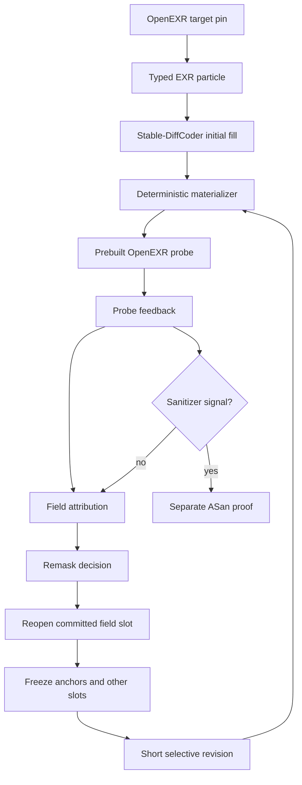

# Feedback-conditioned OpenEXR PoC revision results

**Measurement date:** 2026-08-20
**Status:** canonical five-arm pilot complete
**Target:** OpenEXR v3.4.14, commit `777d231a179de1711d2a942810d9559216ab3f4c`
**Treatment:** `selective-revision/v1`

## Result

The primary analyzer verdict is **no-go**. All five arms had
`validated_success=false`; `selective-revision_vs_pseudo-feedback` produced five
ties, mean and median paired differences of `0.0` with CI `[0.0, 0.0]`, and
rank-biserial effect `0.0`.

No arm observed a sanitizer signal, and every proof status was `skipped`.
Therefore this pilot found no sanitizer-backed OpenEXR vulnerability and no
zero-day. This is not a proof that defects are absent.

| Artifact | SHA-256 |
| --- | --- |
| Result root | `/home/seory0/.cache/dllm-agent/openexr-poc-5arm-pilot-canonical-20260820-183739` |
| `raw-arm-reports.jsonl` | `8204d8a07cc778e6f6810f6a69d2d68ee16da362b78322d9b4c191dcf1b633ae` |
| `paired-summary.json` | `f4e35bbf97f08679fc49e43bb8001abecc88575904306674b9ed40cfb844d2d7` |
| `live-index.json` | `f0b6c36f314c000c12174c0214f56e31ea71baf7c07a678f2b7c148dfd719934` |

The raw report index is the source for per-arm report references and hashes.
This document does not duplicate a single per-arm SHA column.

## Runtime shape

The model fills selector slots in a fixed particle grammar; it does not emit raw
EXR bytes. The materializer derives dependent bytes before a snapshot reaches
the probe. The deterministic successor-class commit records trajectory and
confidence evidence, but the semantic selector value is committed by catalog
successor class, not by sampled token identity.

## Arm totals

Each arm ran five repetitions. Model arms requested `704` max model NFE per
repetition; `libfuzzer-only` requested `0`.

| Arm | Max target branches | Max/mean new edges | Mean exec/s | Valid snapshots | Realized NFE | Forward calls | GPU ms | Probe wall s | Fuzzer worker s | Dedup | Rejected | Decisions | Attributions | Sanitizer | Proof |
| --- | ---: | ---: | ---: | ---: | ---: | ---: | ---: | ---: | ---: | ---: | ---: | ---: | ---: | --- | --- |
| `libfuzzer-only` | 1673 | 1673 / 1640.8 | 2478.0 | 20 | 0 | 0 | 0 | 60 | 120 | 0 | 0 | 0 | 0 | false | skipped |
| `structured-one-shot` | 1636 | 1636 / 1606.2 | 2572.2 | 20 | 280 | 280 | 21810 | 18 | 36 | 14 | 0 | 0 | 0 | false | skipped |
| `feedback-no-remask` | 1623 | 1623 / 1610.0 | 2627.0 | 23 | 1120 | 1120 | 84023 | 27 | 54 | 71 | 0 | 0 | 0 | false | skipped |
| `selective-revision` | 1645 | 1645 / 1626.0 | 2673.08 | 35 | 296 | 296 | 23069 | 63 | 126 | 15 | 0 | 15 | 15 | false | skipped |
| `pseudo-feedback` | 1621 | 1621 / 1614.4 | 2657.26 | 35 | 296 | 296 | 22937 | 63 | 126 | 15 | 0 | 15 | 1 | false | skipped |

Realized model compute counts each cost-bearing generation event once:
`snapshot_materialized` for initial/full-resample calls and
`revision_completed` for selective revision calls. `probe_completed` carries the
same candidate compute as provenance, so summing its NFE/GPU fields again would
double-count model work. Probe wall seconds sum `probe_completed.fuzz_seconds`;
fuzzer worker seconds also account for both paired fuzzer seeds. Valid snapshots,
decisions, attributions, rejected, and dedup counts come from each revision
report.

## Primary contrast

| Statistic | `selective-revision_vs_pseudo-feedback` |
| --- | --- |
| Paired repetitions | 5 |
| Validated successes | 0 vs 0 |
| Mean paired difference | 0.0 |
| Mean paired difference CI | `[0.0, 0.0]` |
| Median paired difference | 0.0 |
| Median paired difference CI | `[0.0, 0.0]` |
| Win/loss/tie | 0 / 0 / 5 |
| Rank-biserial effect | 0.0 |
| Proof-time summary | observed `0`, right-censored `0`, observed seconds `[]` |
| Verdict | `no-go` |

The analyzer score is binary validated proof success. Since every proof was
skipped and every `validated_success` value was false, the primary causal
contrast cannot show a selective-revision advantage.

## Exploratory new-edge contrasts

These contrasts are descriptive only. They are not the analyzer's go/no-go
criterion.

| Contrast | Per-repetition new-edge diffs | Mean diff | CI | Win/loss/tie |
| --- | --- | ---: | --- | --- |
| `selective-revision - pseudo-feedback` | `[22, 12, 34, -5, -5]` | +11.6 | `[-1.6, 25.2]` | 3 / 2 / 0 |
| `selective-revision - feedback-no-remask` | `[24, 10, 43, -11, 14]` | +16.0 | `[0.2, 31.6]` | 4 / 1 / 0 |
| `selective-revision - structured-one-shot` | `[32, -3, 63, -2, 9]` | +19.8 | `[-0.2, 43.8]` | 3 / 2 / 0 |
| `selective-revision - libfuzzer-only` | `[-9, -40, -10, -16, 1]` | -14.8 | `[-28.0, -4.4]` | 1 / 4 / 0 |

The selective arm had positive exploratory new-edge deltas against the two
feedback/model controls, but it lost to `libfuzzer-only` on this metric and did
not produce any validated proof.

## Feedback-control checks

- Pseudo-feedback schedules were fixed-point-free in all five repetitions.
- Pseudo-feedback produced one field attribution in `rep-000` and zero in the
  other four repetitions.
- Selective and pseudo field action sequences diverged in three of five
  repetitions.

These checks show that the causal control was active but only partially
separated from the selective action sequence in this pilot.

## Falsifiable claims

1. The five-arm pilot ran the OpenEXR target under one paired seed schedule and
   produced hash-bound raw reports.
2. `selective-revision/v1` did not improve the analyzer's validated-success
   score over pseudo-feedback in this run.
3. Probe feedback and independent proof verdicts remained separate.
4. No sanitizer-backed vulnerability was found in this run.

## Novelty boundary

To the best of our knowledge, the novel part is the composition:
feedback-conditioned selective re-opening of committed dLLM field slots inside a
typed, deterministic OpenEXR particle runtime, with hash-bound probe feedback,
pseudo-feedback control, and separate sanitizer proof.

The individual ingredients are not claimed as novel by themselves. Diffusion
language models, fuzzing feedback, structured materialization, field-level
mutation, UCB-style selection, and sanitizer proof are established techniques or
natural engineering components.

## Limitations

- This is a five-repetition pilot, not a broad efficacy study.
- The primary analyzer score only credits validated proof success; all arms
  scored false.
- Exploratory new-edge differences are not vulnerability evidence.
- The OpenEXR particle schema is intentionally narrow and does not cover the
  full EXR format.
- `selective-revision/v1` is a new sampler path above Stable-DiffCoder; it is
  not stock Stable-DiffCoder remasking.
- Probe sanitizer signals are prioritization signals only.
- No sanitizer finding means no vulnerability outcome; it does not prove defect
  absence.
