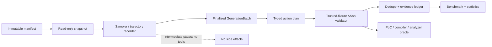
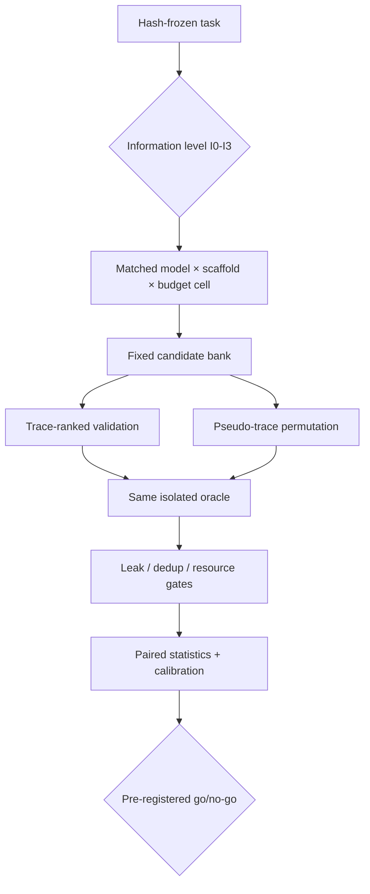

# dLLM 기반 취약점 에이전트: 우월성 주장이 아닌 denoising 궤적 기반 가설 우선순위화의 검증 설계

**사전등록·프로토콜 및 실제 공학 MVP 문서 · 최초 2026-08-19 · 최종 검토 2026-08-20 · 상태: efficacy 결과 미보고**

## 초록

**[INFERRED]** 확산 언어모델(diffusion large language model, dLLM)을 취약점 에이전트에 붙였다는 사실만으로 탐지 성능, 비용, 또는 보안성을 주장할 근거는 없다. 특히 생성·도구·검증 계층이 함께 바뀌면 모델 효과와 scaffold 효과를 분리할 수 없다.[1], [2] 이 문서는 empirical efficacy 논문이나 결과 보고가 아니라, 결정론적 engineering MVP 위에 놓인 사전등록·프로토콜이다. 넓은 명제인 “dLLM 취약점 에이전트의 우월성”은 기각하고, 후보별 denoising/commitment 궤적 특징이 동일 후보 은행·검증 예산에서 AR(autoregressive) confidence/self-consistency보다 **실행 가능한 가설의 우선순위화**를 개선하는가라는 좁은 미래 검정만 등록한다. **[FUTURE EXPERIMENT]** 1단계는 PrimeVul의 시간순 C/C++ 취약/패치 쌍 분별 및 위치화이고, SecVulEval은 재그룹화한 위치화 교차검증이다. 2단계는 VulnGym과 CyberGym-E2E로 확대하되 CyberGym 10개 과제는 smoke-only이다.[3]–[6]

주 모델은 Hugging Face revision `10cdaf9b486f1cf0273ad968459dbe2d21a1482a`의 Stable-DiffCoder-8B-Instruct이며 Dream-Coder가 대체 후보이다.[7], [8] 초기 17 GiB disk·Python 3.8 blocker는 정리 후 해소됐고, Python 3.12.13·Torch 2.5.1+cu121·Transformers 5.3.0에서 exact shard/custom-code hash를 검증해 실제 후보 생성과 `jsoncons` 격리 퍼징을 수행했다. 다만 Hub 메타데이터의 MIT 표기와 별개로 해당 weight revision에는 LICENSE artifact가 확인되지 않아 가중치 사용권은 미해결이다.[7], [9] 본 문서는 model efficacy를 보고하지 않으며, 실제 engineering 결과는 [jsoncons live run](live-hunt-results-20260819.md)과 [OpenEXR native run](dllm-native-fuzz-results-20260819.md)에 분리한다.

**키워드:** diffusion language model, software vulnerability, calibration, experimental control, PrimeVul, agent harness

**2026-08-20 update.** feedback-conditioned OpenEXR PoC revision은
[`superpowers/plans/2026-08-20-feedback-conditioned-poc-revision.md`](superpowers/plans/2026-08-20-feedback-conditioned-poc-revision.md)
와 [`superpowers/specs/2026-08-20-feedback-conditioned-poc-revision-design.md`](superpowers/specs/2026-08-20-feedback-conditioned-poc-revision-design.md)
에 별도로 정리했다. 구조화 particle, revision schema·policy·ledger와 prebuilt probe
기반 구현은 시작됐지만, 이 보고서는 여전히 efficacy 경계와 future-only 가설만 다루며
새 selective-revision treatment의 live 결과를 포함하지 않는다.

## 1. 집행 권고

**권고: 조건부 진행(Go-to-pilot), 단 광범위한 우월성 논문은 진행하지 않는다.** **[INFERRED]** Stable-DiffCoder의 공개 코드/논문은 코드용 block diffusion과 AR 계통 비교를 제시하지만, 이것은 보안 탐지·에이전트·동일 비용에서의 우월성을 증명하지 않는다.[8], [10] dLLM의 병렬적 생성이 저단계에서 코드 품질 저하와 비용-품질 절충을 낳을 수 있다는 재평가도 있으므로, 속도 이점도 측정 대상일 뿐 전제가 아니다.[11]

실행 우선순위는 다음과 같다.

1. **[MEASURED engineering]** 환경·모델 hash를 고정하고 Stable-DiffCoder offline load, non-empty output와 strict candidate-bank JSON smoke를 통과시켰다. Dataset efficacy gate는 별도다.
2. **[FUTURE EXPERIMENT]** 실제 dLLM 후보 네 개를 먼저 생성한 뒤, 후보별 trace로 1개 검증 슬롯을 배분하는 real-vs-pseudo trace 실험을 수행한다. 제안·검증·비용은 고정하고 trace만 순열한다.
3. **[FUTURE EXPERIMENT]** dLLM×AR 및 최소×검증 scaffold의 교차 설계로 PrimeVul에서 기제와 성능을 분리한다.
4. **[FUTURE EXPERIMENT]** 정적/동적 oracle이 있는 repository 평가로만 발견(discovery) 주장을 시험한다. 분류, 위치화·재현, 수리는 별도 endpoint다.

**[MEASURED]** 현재 저장소에는 trusted CWE-121 fixture, pin된 `jsoncons` live target, OpenEXR `v3.4.14` 공식-harness baseline과 native-controller bring-up이 있다. `jsoncons`에서는 실제 dLLM 후보가 두 UBSan-only zero-length copy 위반을 재현했고, ASan-only continuation은 121초·2,011,697 units에서 ASan crash를 관찰하지 않았다. OpenEXR 단일 비교에서 native wall-clock은 86.20초, static baseline은 50.29초였고 양쪽 모두 sanitizer finding이 없었다. target coverage의 소폭 차이는 후보 source·trajectory가 같고 반복이 없어 controller 효과로 해석하지 않는다. 이들은 runner engineering 증거이며 dLLM efficacy의 과학적 증거나 headline metric이 아니다. 원시 hash와 실행 경계는 [jsoncons 결과](live-hunt-results-20260819.md)와 [OpenEXR native 결과](dllm-native-fuzz-results-20260819.md)를 따른다.

## 2. 연구 질문·가설·판정 단위

### 2.1 연구 질문

**RQ1.** **[FUTURE EXPERIMENT]** Stable-DiffCoder의 후보별 irreversible commitment trace가 동일 계산량 AR confidence/self-consistency를 넘어 fixed-budget validated-hypothesis prioritization을 개선하는가?

**RQ2.** **[FUTURE EXPERIMENT]** 그 차이가 시간순·프로젝트 분리·중복 제거 후에도 유지되는가, 그리고 L2–L4 비국소 결함에서 L0–L1 국소 결함보다 큰가?

**RQ3.** **[FUTURE EXPERIMENT]** 분석기 힌트가 주어진 제한 범위 수리에서 editable diffusion intervention이 AR-FIM/구조화 교체보다 `secure_functional@1`을 개선하는가?

**RQ4.** **[FUTURE EXPERIMENT]** 관찰된 차이가 backbone, generation budget, scaffold, 정보 노출 중 무엇에서 발생하는가?

### 2.2 사전등록 가설

| ID | 가설과 대립가설 | 판정 |
|---|---|---|
| H1 | candidate-bank trace ranking의 real arm이 pseudo candidate-to-candidate score derangement arm보다 `validated_success@1`이 높다; H0는 차이가 0이다. `validated_success@1`은 각 task에서 **반드시** 선택한 한 후보가 dynamic oracle로 proved이면 1, 아니면 0인 지표다. | coverage=100%, primary arm abstention 금지; real−pseudo 점추정치 ≥+5점 및 paired lower 95% CI >0이면 지지, upper 95% CI <+5점이면 meaningful benefit 기각 |
| H2 | dLLM arm이 strongest equal-compute AR control보다 PrimeVul P-C를 5점 이상 높인다. | P-C 차이의 lower 95% CI >+5점; 아니면 기제 이점 기각 |
| H3 | L2–L4에서 dLLM 대 AR advantage가 ≥8점이고, 그 family×nonlocality DID가 ≥5점이다. | 두 효과의 lower 95% CI가 모두 >0 |
| H4 | analyzer-localized repair가 최강 AR local controller보다 `secure_functional@1` 8점 이상 높다. | 하한이 +8점 초과; AR Pareto 지배면 기각 |

**[INFERRED]** “결과가 좋으면 dLLM이 자기교정한다”는 해석은 허용하지 않는다. Stable-DiffCoder의 pin된 sampler는 mask인 위치만 대체하고, `low_confidence`/`random`은 commit 순서를 정할 뿐 이미 commit된 token을 수정하지 않는다.[9], [27] 따라서 본문에서 `remasking`은 **mask 위치의 commit 선택**으로만 쓰며 self-correction의 동의어가 아니다.

### 2.3 분석 단위와 endpoint

분류는 함수/패치쌍, 위치화는 함수 내 statement/line, 재현은 독립 sandbox의 PoC 또는 oracle, 발견은 source-only repository에서의 검증된 finding, 수리는 secure하면서 functional한 수정이다. **[FUTURE EXPERIMENT]** 한 endpoint의 성공을 다른 endpoint의 성공으로 변환하지 않는다. 예컨대 CVE 설명을 받고 위치를 맞히는 것은 guided localization이지 discovery가 아니다. CyberGym-E2E의 S1–S4도 discovery, own-PoC repair, regression safety, intended-vulnerability repair를 분리한다.[5]

## 3. 관련 연구와 기여의 경계

CDC/MDFI는 정적 분석기 피드백을 denoising에 주입해 secure generation을 연구한다. 그러나 공개 비교에는 동일 analyzer call·edit span·AR-FIM local edit 통제가 없으므로, 이는 discovery 우월성의 근거가 아니라 본 연구의 repair intervention comparator다.[13] DLLM-Searcher는 이미 dLLM tool agent를 제안했으므로 “최초 dLLM security agent”는 주장하지 않는다.[14] FVD-DPM과 같은 diffusion 기반 결함 탐지 계열은 생성 trajectory를 이용한 실행 가능한 보안 finding과는 다른 조건부 detection 문제다.[15]

LLaDA2.1은 기존 Mask-to-Token 경로에 Token-to-Token(T2T) 편집을 결합해 이미 확정한 토큰을 직접 교체한다.[29] 이후 Token-to-Mask(T2M) 연구는 의심 토큰을 `[M]`으로 되돌린 뒤 다시 예측하는 training-free 규칙을 제안했고, confidence remasking 재평가 연구는 한 번 확정한 토큰을 수정할 수 없는 문제와 remasking 정책의 조건 민감성을 다시 확인했다.[30], [31] 이 결과들은 일반 reasoning·code benchmark 또는 decoding 연구이며 sanitizer-guided vulnerability discovery 증거가 아니다. 따라서 본 프로젝트의 field-attributed selective remask는 별도 treatment로 구현·검증하고, T2T·T2M·AR-FIM을 서로 다른 comparator로 둔다.

RepoAudit류의 repository auditing, Atlantis의 대규모 AIxCC CRS, FuzzingBrain의 suspicious-point→PoV→동적 검증 파이프라인은 agentic security의 scaffold·검증 선행연구다.[12], [16], [17], [25] 2026년의 FuzzingBrain V2는 fuzzer-reproducible finding을 중심에 두고, Gentoo는 agent가 target-specific generator를 반복 합성하는 비교축을 제공한다.[33], [34] Google `oss-fuzz-gen`은 대규모 LLM harness 생성과 OSS-Fuzz 평가의 공개 구현이므로 최소 실용 baseline에 포함해야 한다.[32] Microsoft의 MDASH는 다중 모델 security scanning의 Prepare→Scan→Validate/debate→Dedupe→Prove 형태를 공개적으로 설명하지만 private preview이지 fork 가능한 framework가 아니다.[18] **[INFERRED]** 제안하는 기여는 (i) candidate-specific denoising trace의 순열 통제, (ii) 모델×scaffold×정보량×계산량의 교차 통제, (iii) 추적 가능한 executable-evidence endpoint이며, 이 우선순위나 효과가 이미 확립됐다고 주장하지 않는다.

## 4. dLLM 후보 행렬과 선택

| 후보 | 역할 | 채택/보류 사유 | 상태 |
|---|---|---|---|
| Stable-DiffCoder-8B-Instruct | 주 checkpoint | code block diffusion, pinned 구현·AR 계통 비교; trace 계측 가능 | **[MEASURED]** engineering run, efficacy FUTURE |
| Dream-Coder-v0-Instruct-7B | fallback | Apache-2.0 표기와 instruct checkpoint가 있으나 보고 성능 독립 재현 위험 | **[FUTURE]** fallback |
| DiffuCoder-7B-cpGRPO | mechanism comparator | historical diffusion baseline | **[FUTURE]** 보조 |
| CADD-Base-7B | architecture baseline | base-only alignment·가중치 조건 위험 | 보류 |
| LLaDA2.1-mini | committed-token edit comparator | native T2T editing을 제공하지만 16B·비보안 모델이고 Stable과 데이터/규모가 다름 | future-only |
| compatible dLLM + T2M rule | remask-policy comparator | token을 직접 교체하지 않고 mask로 되돌리는 최근 decoder rule | future-only, 독립 재현 필요 |
| Mercury/WeDLM/SDAR | hybrid/block-parallel control | 재현 가능한 core 조건이 불충분 | 제외 |

Stable-DiffCoder 선택의 근거는 모델 카드·repository가 제공하는 8B instruct checkpoint와 generation interface이며, “실무 최선”의 사실 주장으로 읽어서는 안 된다.[7], [8] **[MEASURED]** 초기 feasibility 점검의 17 GiB free·미설치 runtime blocker는 해소됐다. 네 BF16 shard와 custom source hash를 검증하고 Python 3.12.13, Torch 2.5.1+cu121, Transformers 5.3.0에서 RTX 3090 한 장에 allocated 16.50GB, reserved 16.64GB로 로드했다. 두 후보의 64/256-step live sampling을 완료했다. 8개 GPU는 download나 단일 8B sharding보다 다수 후보 data-parallel sampling에 적합하다. 이 결과는 실행 가능성만 증명하며 성능 우월성을 뜻하지 않는다.[7], [8]

Hub revision은 MIT metadata를 표시하지만 그 revision file tree에서 LICENSE artifact가 확인되지 않았고, GitHub source의 MIT text는 가중치 grant를 대체하지 않는다.[7], [19] **[INFERRED]** 따라서 checkpoint는 “official Hub-labelled MIT, artifact-level weight license unresolved”로만 기술하며 재배포·상업 사용·법적 결론은 보류한다. Dream-Coder는 공식 README의 Apache-2.0 표기를 fallback으로 삼되, 제3자 재현 issue의 낮은 benchmark 보고 때문에 vendor score를 재인용하지 않는다.[20], [21]

## 5. diffusion 기제 행렬

| 기제 | Stable에서 가능한가 | 대조군 | 해석 한계 |
|---|---|---|---|
| commitment time/entropy/margin | 예, 계측 필요 | AR token NLL, final confidence, self-review | vulnerability probability가 아님 |
| 후보별 trace 우선순위 | 예 | trace 순열, non-temporal trace | generation causal claim 아님 |
| masked reconstruction difficulty | 예 | teacher-forced AR/FIM | likelihood·길이와 분리 필요 |
| analyzer-localized detached replacement | 예 | AR-FIM, AR structured replace, random span | 수리이지 discovery 아님 |
| committed-token replacement | 아니오, 새 sampler 필요 | LLaDA2.1 T2T, AR-FIM | replacement는 token-to-mask remasking이 아님 |
| token-to-mask remasking | 아니오, 새 sampler 필요 | compatible dLLM+T2M, AR local edit | 공개 결과는 비보안 task 중심; attribution·budget 통제 필요 |
| analyzer-conditioned revision/MDFI | 아니오, 새 sampler 필요 | Dream/CDC treatment, AR-FIM | stock Stable 결과로 주장 금지 |
| forced token order | 새 scheduler 필요 | L2R/R2L/random/AST scoring | 출력 미래가 달라짐 |

**[INFERRED]** entropy, confidence, ELBO, commitment time은 취약 확률이 아니라 calibration 후보 feature다. 보안 전이를 직접 보장하는 증거가 없고, trajectory calibration이 악화되거나 confidence remasking의 효과가 policy·budget에 따라 달라질 수 있으므로 chronological held-out ECE/Brier와 AR controls를 통과할 때만 확률적 표현을 허용한다.[22], [31] **[FUTURE EXPERIMENT]** feature는 confidence/entropy/NLL의 area·slope, commit time, churn·replacement, reconstruction accuracy, length/lexer residual이며 raw sum 대신 line별 정규화 mean/max/percentile로 집계한다.

현재 `selective-revision/v1`은 Stable-DiffCoder checkpoint 위에 project-owned sampler와 field attribution을 추가하려는 treatment다. stock Stable의 `remasking` 옵션, LLaDA2.1 T2T, T2M 논문의 decoder를 재현했다고 부르지 않는다. 실제 model run에서 committed-token reopening, frozen anchor 보존, independent ASan proof와 비용 accounting을 모두 관찰한 뒤에만 해당 treatment를 완료로 분류한다.[9], [27], [29], [30]

진짜 trajectory 효과의 최소 통제는 다음과 같다. 동일 prompt·seed·candidate 수로 Stable 후보 4개를 생성하고 각 arm에 한 validation slot을 **의무적으로** 배정한다. real arm은 preregistered trace score로 rank하고 pseudo arm은 task 안에서 fixed-point 없는 candidate-to-candidate deterministic derangement로 trace score만 바꾼다. 후보 text, score 분포, validation call, 비용은 동일하다. **[FUTURE EXPERIMENT]** `validated_success@1`은 선택된 한 후보가 dynamic oracle로 proved인 task-level indicator이며 coverage=100%, abstention=0이다. real−pseudo 점추정치 ≥+5점 및 paired lower 95% CI >0만 H1을 지지하고, upper 95% CI <+5점이면 meaningful H1 benefit을 기각한다. 이는 proposal quality가 아니라 candidate-specific trace의 allocation 가치만 식별한다.

**[MEASURED]** 현재 MVP의 `rotate_trace_for_qa`/`synthetic_trace_rotation`은 한 synthetic trace 내부 문자열을 회전한 QA field일 뿐이다. 이는 후보 간 score derangement가 아니며 H1의 mechanism evidence나 pseudo arm으로 사용할 수 없다.

## 6. 독립 runner 아키텍처

DeepSeek Harness는 `GenerateOptions → AsyncIterable<StreamChunk>`와 terminal tool-call dispatch라는 AR stream 모양이다. durable event, bounded tool concurrency, fail-closed sandbox, workflow 경계는 유용하지만 denoising intermediate state를 assistant delta로 적응시키면 순서·도구부작용이 오염된다.[23] **[INFERRED]** 본 프로젝트는 Harness fork나 AR stream adapter가 아니라, 그 안전 원칙을 차용한 독립 MDASH-shaped runner다.

`GenerationBatch`는 완성된 후보·seed·output hash·resource record를, `DenoisingTrajectory`는 timestep/block/position update bitmap/token probability/state hash를 가진다. **[MEASURED]** `scan`은 trusted fixture allowlist를 유지하고, 별도 `hunt`는 repository URL, clean commit, tree/archive와 `SECURITY.md` hash를 검증한다. 해당 commit의 `git archive`만 non-root-readable staging한 뒤 digest-pinned, network-off, read-only, capability-dropped Docker에서 compile/fuzz/coverage한다. 일반 임의 target은 같은 manifest·pin·disclosure gate 없이는 거부한다. 중간 state는 분석 데이터일 뿐 tool을 호출할 수 없고, typed action은 final output 이후 schema validation을 통과해야 한다. finding은 `(target SHA, location, cause, reproducer/oracle, evidence hash)`가 없으면 count하지 않는다.

**구현 경계.** **[INFERRED]** `ReplaySampler → trajectory score → selection → sanitizer → hashed JSON`은 모든 backbone이 공유할 수 있는 재현 가능한 최소 spine이다. `ReplaySampler`는 결정론적 test double이고 oracle·증거 ledger는 model-agnostic이다. **[MEASURED]** live `DiffusionSampler`는 Stable-DiffCoder의 실제 token transfer별 confidence, commitment, state hash와 realised NFE를 수집해 candidate-specific ranking에 사용한다. Stock Stable은 finalized sample 뒤에만 typed tool을 실행한다. 여러 후보에 validator budget을 동적으로 배분하는 router와 AR 대조는 **[FUTURE EXPERIMENT]**다.[9], [23], [27]

## 7. 타깃·벤치마크 행렬

| 단계 | 자료 | 주 endpoint | 허용 주장 | 비고 |
|---|---|---|---|---|
| 1 primary | PrimeVul | patch-pair 분별, P-C, PR-AUC/MCC/VD-score, calibration | C/C++ 함수 수준 triage | 시간순·dedup split |
| 1 cross-check | SecVulEval | statement Top-k/MRR/F1 | 재그룹 위치화 | CVE/project/time holdout 필요 |
| 2 cross-check | VulnGym | repo localization/validation | 조건부 repo 평가 | precision 확장 필요 |
| 2 capability | CyberGym-E2E | S1–S4 | source-only capability | 10-task는 smoke-only |
| engineering QA | owned CWE-121 | schema/replay/dynamic proof | runner correctness | 과학 evidence 제외 |

PrimeVul은 chronological, deduplicated C/C++ vulnerability/patched pairing을 제공하므로 1단계의 가장 방어 가능한 시작점이다.[3], [4] 하지만 temporal split도 source/pretraining contamination을 증명하지 않으므로 raw row·repo/commit/time·CVE/CWE·before/after·path·change line을 canonical schema에 동결한다. raw hash, identifier/literal-normalized lexer hash, AST shape hash, MinHash candidate, shingle Jaccard 및 normalized-token Levenshtein를 결합하고, exact/near clone·동일 repo+commit·공유 CVE·before/after를 provenance component로 union한다. component는 train/dev/test를 절대 넘지 않는다. dataset duplication이 기존 성능 추정을 과장할 수 있다는 독립 audit은 이 gate의 근거다.[24]

SecVulEval은 문장 레이블을 제공하나 공식 material의 split/license 정보만으로 headline 일반화를 할 수 없다.[6] **[FUTURE EXPERIMENT]** 이 자료는 custom CVE/project/time grouped holdout, exclusion table, line-proxy label 표시가 완료된 뒤 location cross-check로만 쓴다. Patch diff line은 expert verification 전까지 ground truth가 아닌 proxy다.

CyberGym-E2E는 source-only 입력과 S1–S4 validator를 제공하는 repository 보안 benchmark다.[5], [28] **[FUTURE EXPERIMENT]** `b861317f11641b14ab6ba08b5179d0b044601057` pin에서 서로 다른 project 10개를 preselect하지만, n=10은 inferential evidence가 아니라 환경/라이선스/저장소/컨테이너 gate를 점검하는 smoke이다. gated data, 대용량 storage, privileged container와 host configuration이 필요한 상태에서는 실행하지 않는다. 조건부 mechanism arm은 successful S1 scout와 bounded source/call graph/build script retrieval pack을 동결하고 evaluator feedback 없이 AR-FIM과 dLLM을 비교한다. 전체 E2E와 shared-scout conditional repair를 섞지 않는다.

## 8. 실험 설계와 통제

### 8.1 cell 설계

**[FUTURE EXPERIMENT]** 주 cell은 backbone `{Stable, AR parent, strong independent AR}` × scaffold `{minimal common, security-validation}` × budget `{equal-FLOP, practical time, practical dollar}` × information `{I0,I1,I2,I3}`이다. I0=repo-only, I1=coarse weakness class, I2=sanitized behavior description, I3=sanitizer/three-frame diagnostic이다. 모든 arm에 tool access, prompt template, retrieval cap, retry, context window, candidate count, validator version을 고정한다.

AR parent만으로는 계통 공정성은 높지만 강한 독립 AR과의 실용 비교가 약해지고, 독립 AR만으로는 architecture/data matching이 약해진다. 따라서 둘 다 둔다. AR control은 parent, strong AR, best-of-N, self-review, FIM, structured local replacement, whole-program reprompt이며 static analyzer/fuzzer는 비생성 baseline이다. **[INFERRED]** equal parameter는 equal compute가 아니므로 `actual_forward_calls`, realized NFE, FLOP estimate, generated/input tokens, source bytes, GPU model, wall time, peak memory, validator/retry time, dollar estimate를 모두 보고한다.

### 8.2 기제 ablation

1. **H1 candidate-bank derangement:** 후보와 최종 출력은 고정하고 candidate-to-candidate score만 no-fixed-point derangement한다. 각 arm은 한 후보를 반드시 validation하며 `validated_success@1`을 비교한다. 이 future control은 현재 MVP의 within-trace string rotation QA field와 다르다.
2. **AR parity:** 동일 line aggregation의 AR NLL, equal-forward-call self-review, final dLLM confidence, lexical rarity/length/static analysis를 비교한다.
3. **Span intervention:** 동일 analyzer witness·최소 enclosing statement·32 lexer-token cap·전후 analyzer 1회·동일 oracle에서 dLLM detached local replacement, AR-FIM, AR structured replacement, AR full reprompt, random equal-size span을 비교한다.
4. **Order:** native/L2R/R2L/random/AST teacher-forced scoring은 future forward pass로 하고, true forced-order generation은 새 scheduler가 생길 때만 수행한다.

Stable에 대해 “MDFI/remask self-correction” arm을 표기하지 않는다. **[FUTURE EXPERIMENT]** committed position과 prior block을 reopen하는 new sampler 또는 true revision model이 생길 경우 별도 treatment와 별도 논문 질문으로 추가한다.[9], [13], [27]

### 8.3 누출·배제·통계

최종 prompt는 private forbidden fields(CVE id, gold path/symbol/line, patch, PoC)가 없는지 저장·검사한다. 하나라도 노출되면 해당 information condition은 무효다. source/commit/time 누락, cross-label duplicate, parse failure, metadata-free source row, ambiguous provenance는 이유별로 제외하고 표를 공개한다. model training cutoff 이후 public-label tier는 “unknown source code”를 보장하지 않는 별도 tier다.

**[FUTURE EXPERIMENT]** pilot은 최소 30–50 recent project-disjoint executable-oracle cases와 safe negatives, MVP는 3 seed, full study는 5 seed을 사용한다. task/advisory를 통계 단위로 하고 repo-cluster bootstrap, paired binary에는 McNemar, repeated task에는 hierarchical mixed effects, family-wise 비교에는 Holm 보정을 쓴다. power는 효과크기·intra-repo correlation·dropout을 hash-locked pilot의 관측 분산으로 계산하여 full n을 정한다. 결과가 없으므로 현재 표본력 수치나 예상 승률은 보고하지 않는다.

SESOI는 H1 real−pseudo `validated_success@1` 5점, H2 PrimeVul P-C 5점, H3 비국소 advantage 8점과 DID 5점, H4 `secure_functional@1` 8점이다. sensitivity는 2.5/5/10점으로 제한한다. calibration claim은 chronological test ECE ≤0.05와 positive Brier skill을 모두 요구하며, 불충족하면 ordinal ranking만 보고한다.

## 9. 구현 로드맵과 명시적 gate

| 시점 | 산출물 | 통과 | 중단/기각 |
|---|---|---|---|
| M0 환경 | Python 3.12+ pinned environment + smoke | import/load, JSON validity ≥90%, nonempty output, hash-audited custom model source/offline loading trust boundary | OOM, empty output, nonmonotonic NFE, missing source/loading trust evidence |
| M1 data | hash/schema/provenance audit | zero split component, frozen exclusion table | schema/label/provenance failure |
| M2 trace | 4-candidate real/pseudo candidate-bank derangement | hash-identical candidates, accounting complete, coverage=100%, abstention=0 | trace/validator mismatch or upper H1 CI <+5점 |
| M3 Phase 1 | 32-pair smoke → simulation-sized powered study | H2/H3 CI gate and multiplicity plan frozen | AR Pareto domination, either H3 lower CI ≤0, or H2 CI excludes +5점 |
| M4 repair | detached-span matrix | H4 lower CI >+8점 | out-of-span edit, leak, failed oracle |
| M5 repository | VulnGym then CyberGym | separate S1–S4 evidence | smoke result을 inference로 사용 |

**[FUTURE EXPERIMENT]** Stable smoke config는 `gen_length=512`, `block_length=8`, `eos_id=None`, temperature 0, low-confidence order, request steps 64/256/512, batch 1이다. 요청 step이 아니라 실제 forward call/NFE를 측정한다. 스케줄은 64 block에서 1/4/8 active pass가 될 수 있으므로 code instrumentation으로 검증한다.[9], [27]

**[MEASURED]** 구현·실행된 것은 owned fixture QA, pin된 `jsoncons` live engineering target, OpenEXR 공식-harness baseline과 native-controller bring-up이다. OpenEXR 비교는 각 arm 1회이고 후보 source·trajectory가 같아 모델 또는 controller 비교 표본이 아니다. “12 fixture 중 4개 secure+functional” 조건과 연구 go/no-go H1–H4 CI 규칙은 계속 **[FUTURE]**이며, real-run sample size와 multiplicity는 hash-locked pilot 분산에 근거한 simulation 전에는 확정하지 않는다.

## 10. 타당성, 안전, 공개

내적 타당성 위협은 scaffold·retrieval·validator가 model effect를 대체하는 것, trace와 output이 함께 변하는 것, label leakage, clone overlap, retry 비용 누락이다. 이에 대한 답은 candidate bank 고정/trace 순열, model×scaffold 교차, I0–I3 information ladder, provenance component gate, validator-inclusive accounting이다. 외적 타당성은 C/C++와 한 benchmark family에서 제한되며 Solidity/Java/Python/Rust 일반화는 주장하지 않는다.

**[MEASURED]** `scan`의 trusted-only host 경계와 `hunt`/`native-hunt`의 pin된 no-network Docker 경계를 분리했다. 실제 `jsoncons` run은 read-only verified archive, non-root UID, digest image, bounded output ingestion과 hash ledger를 사용했다. 두 UBSan finding은 동일 pin에서 최소 public-API 프로그램으로 재현했지만 ASan-only에서는 재현되지 않았고 외부로 제출하지 않았다. OpenEXR native proof와 static baseline은 모두 sanitizer marker와 crash artifact가 없었다. 공개 재현 package와 raw crash bytes는 maintainer의 비공개 중복·영향 판단 뒤에만 결정한다.

## 11. 결론

**[INFERRED]** 이 프로젝트가 지금 방어할 수 있는 것은 사전등록·protocol, trusted fixture QA, 두 OSS target의 공학적 실행과 hash evidence이지 “dLLM agent가 더 낫다”는 결과가 아니다. Stable-DiffCoder offline load, trajectory capture, isolated target fuzzing과 OpenEXR native-controller bring-up은 완료됐지만, 첫 native run은 static baseline보다 느렸고 trajectory 효과를 식별하지 못했다. 미래 질문은 후보별 irreversible denoising/commitment trace 또는 별도 selective revision이 동일 후보·검증·계산 예산에서 `validated_success@1`을 개선하는지, 그리고 AR confidence/self-consistency, AR-FIM, `oss-fuzz-gen`/generator scaffold를 통제한 뒤 효과가 남는지다. Exact weight license, dataset manifests, AR/pseudo-trace controls, simulation-derived sample size/multiplicity와 CyberGym 운영 조건은 여전히 future 또는 명시적 제외 대상이다.[9], [27], [29]–[34]

## 참고문헌

[1] OpenAI, “Introducing SWE-bench Verified,” 2024. [온라인]. Available: https://openai.com/index/introducing-swe-bench-verified/ (accessed 2026-08-19).

[2] M. Jimenez *et al.*, “SWE-bench: Can Language Models Resolve Real-World GitHub Issues?,” ICLR 2024. [온라인]. Available: https://arxiv.org/abs/2310.06770 (accessed 2026-08-19).

[3] DLVulDet, “PrimeVul,” source repository. [온라인]. Available: https://github.com/DLVulDet/PrimeVul/tree/6f54687c84947b1d17486495440b37030d147289 (accessed 2026-08-19).

[4] Y. Ding *et al.*, “Vulnerability Detection with Code Language Models: How Far Are We?,” arXiv:2403.18624, 2024. [온라인]. Available: https://arxiv.org/abs/2403.18624 (accessed 2026-08-19).

[5] CyberGym, “CyberGym-E2E.” [온라인]. Available: https://www.cybergym.io/cybergym-e2e/ (accessed 2026-08-19).

[6] B. D. Basim, “SecVulEval,” source repository. [온라인]. Available: https://github.com/basimbd/secvuleval (accessed 2026-08-19).

[7] ByteDance-Seed, “Stable-DiffCoder-8B-Instruct model card,” revision `10cdaf9b486f1cf0273ad968459dbe2d21a1482a`. [온라인]. Available: https://huggingface.co/ByteDance-Seed/Stable-DiffCoder-8B-Instruct/tree/10cdaf9b486f1cf0273ad968459dbe2d21a1482a (accessed 2026-08-19).

[8] ByteDance-Seed, “Stable-DiffCoder,” source repository, revision `ece1ffb526ee44fb6c9f212a8ef118d204cb9145`. [온라인]. Available: https://github.com/ByteDance-Seed/Stable-DiffCoder/tree/ece1ffb526ee44fb6c9f212a8ef118d204cb9145 (accessed 2026-08-19).

[9] ByteDance-Seed, “modeling_stable_diffcoder.py,” lines 46–135, revision `10cdaf9b486f1cf0273ad968459dbe2d21a1482a`. [온라인]. Available: https://huggingface.co/ByteDance-Seed/Stable-DiffCoder-8B-Instruct/blob/10cdaf9b486f1cf0273ad968459dbe2d21a1482a/modeling_stable_diffcoder.py#L46 (accessed 2026-08-19).

[10] ByteDance-Seed, “Stable DiffCoder,” 2026. [온라인]. Available: https://arxiv.org/abs/2601.15892 (accessed 2026-08-19).

[11] “A systematic evaluation of diffusion language-model decoding,” 2025. [온라인]. Available: https://arxiv.org/abs/2509.11252 (accessed 2026-08-19).

[12] FuzzingBrain, “AFC CRS: All You Need Is a Fuzzing Brain,” v2 source. [온라인]. Available: https://github.com/fuzzingbrain/afc-crs-all-you-need-is-a-fuzzing-brain/tree/e27ab8cf94b4f145043b5cae5d18fe922c7a8418/v2 (accessed 2026-08-19).

[13] “CDC/MDFI: Analyzer-guided diffusion for secure code generation,” 2026. [온라인]. Available: https://arxiv.org/pdf/2605.16829 (accessed 2026-08-19).

[14] “DLLM-Searcher,” 2026. [온라인]. Available: https://arxiv.org/abs/2602.07035 (accessed 2026-08-19).

[15] M. Shao and Y. Ding, “FVD-DPM: Fine-grained Vulnerability Detection via Conditional Diffusion Probabilistic Models,” *33rd USENIX Security Symposium*, 2024. [온라인]. Available: https://www.usenix.org/conference/usenixsecurity24/presentation/shao (accessed 2026-08-19).

[16] Team Atlanta, “AIXCC AFC Atlantis,” source repository. [온라인]. Available: https://github.com/Team-Atlanta/aixcc-afc-atlantis/tree/8a2b41329515dcdbd201a106cd4f25a7569c1969 (accessed 2026-08-19).

[17] Protect AI, “Vulnhuntr,” source repository. [온라인]. Available: https://github.com/protectai/vulnhuntr/tree/ead88c5adba4279dae5c56d65124c530a9a1c5ae (accessed 2026-08-19).

[18] Microsoft Security, “Defense at AI speed: Microsoft’s new multi-model agentic security system,” 2026. [온라인]. Available: https://www.microsoft.com/en-us/security/blog/2026/05/12/defense-at-ai-speed-microsofts-new-multi-model-agentic-security-system-tops-leading-industry-benchmark/ (accessed 2026-08-19).

[19] ByteDance-Seed, “Stable-DiffCoder source LICENSE,” revision `ece1ffb526ee44fb6c9f212a8ef118d204cb9145`. [온라인]. Available: https://github.com/ByteDance-Seed/Stable-DiffCoder/blob/ece1ffb526ee44fb6c9f212a8ef118d204cb9145/LICENSE (accessed 2026-08-19).

[20] DreamLM, “Dream-Coder README,” revision `79d43878c55ba4e7474d5e0b6057d110b43acfcd`. [온라인]. Available: https://github.com/DreamLM/Dream-Coder/blob/79d43878c55ba4e7474d5e0b6057d110b43acfcd/README.md (accessed 2026-08-19).

[21] DreamLM, “Reproduction issue #11.” [온라인]. Available: https://github.com/DreamLM/Dream-Coder/issues/11 (accessed 2026-08-19).

[22] “On calibration of diffusion language models,” 2026. [온라인]. Available: https://arxiv.org/abs/2604.23235 (accessed 2026-08-19).

[23] DeepSeek AI, “deepseek-harness,” local checkout `99f6f02fecdb7dff40c3fbc9470f5907c29f74ca`, `packages/llm/llm/src/types.ts`. [로컬 1차 자료].

[24] R. Croft *et al.*, “Data quality matters: a case study on vulnerability detection datasets,” ICSE 2023. [온라인]. Available: https://rolandcroft.github.io/assets/publications/ICSE_23.pdf (accessed 2026-08-19).

[25] J. Guo *et al.*, “RepoAudit: An Autonomous LLM-Agent for Repository-Level Code Auditing,” 2025. [온라인]. Available: https://arxiv.org/abs/2501.18160 (accessed 2026-08-19).

[26] dLLM_Agent 연구 journal, “Wave 2: Model Feasibility and Reproduction Manifest,” local runtime inspection, 2026-08-19. [로컬 1차 자료]. Available: [wave-2-model-feasibility.md](../.omo/ulw-research/20260819-134557/wave-2-model-feasibility.md).

[27] ByteDance-Seed, “modeling_stable_diffcoder.py,” assignment/write loop, lines 211–223, revision `10cdaf9b486f1cf0273ad968459dbe2d21a1482a`. [온라인]. Available: https://huggingface.co/ByteDance-Seed/Stable-DiffCoder-8B-Instruct/blob/10cdaf9b486f1cf0273ad968459dbe2d21a1482a/modeling_stable_diffcoder.py#L211-L223 (accessed 2026-08-19).

[28] Sunblaze UCB, “CyberGym-E2E,” source repository, revision `b861317f11641b14ab6ba08b5179d0b044601057`. [온라인]. Available: https://github.com/sunblaze-ucb/cybergym-e2e/tree/b861317f11641b14ab6ba08b5179d0b044601057 (accessed 2026-08-19).

[29] T. Bie *et al.*, “LLaDA2.1: Speeding Up Text Diffusion via Token Editing,” arXiv:2602.08676, v3, 2026. [온라인]. Available: https://arxiv.org/abs/2602.08676 (accessed 2026-08-20).

[30] L. Yao, “Remask, Don't Replace: Token-to-Mask Refinement in Diffusion Large Language Models,” arXiv:2604.18738, v2, 2026. [온라인]. Available: https://arxiv.org/abs/2604.18738 (accessed 2026-08-20).

[31] S. Frkovic *et al.*, “Re-evaluating Confidence Remasking in Masked Diffusion Language Models,” AdaptFM 2026. [온라인]. Available: https://openreview.net/forum?id=Bew2D82sWR (accessed 2026-08-20).

[32] Google, “oss-fuzz-gen: LLM powered fuzzing via OSS-Fuzz,” source repository. [온라인]. Available: https://github.com/google/oss-fuzz-gen (accessed 2026-08-20).

[33] V. Vikram and R. Padhye, “Fuzzing with Agents? Generators Are All You Need,” arXiv:2604.01442, 2026. [온라인]. Available: https://arxiv.org/abs/2604.01442 (accessed 2026-08-20).

[34] Z. Sheng *et al.*, “FuzzingBrain V2: A Multi-Agent LLM System for Automated Vulnerability Discovery and Reproduction,” arXiv:2605.21779, 2026. [온라인]. Available: https://arxiv.org/abs/2605.21779 (accessed 2026-08-20).
