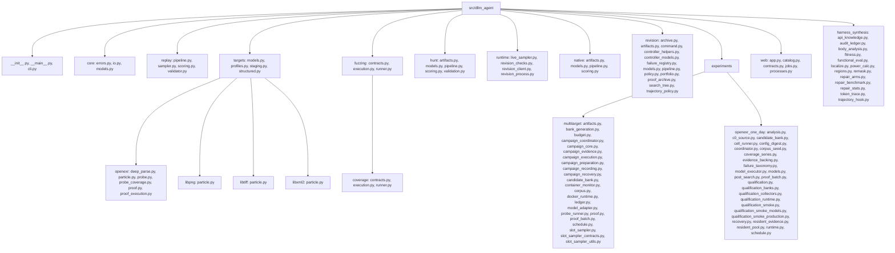
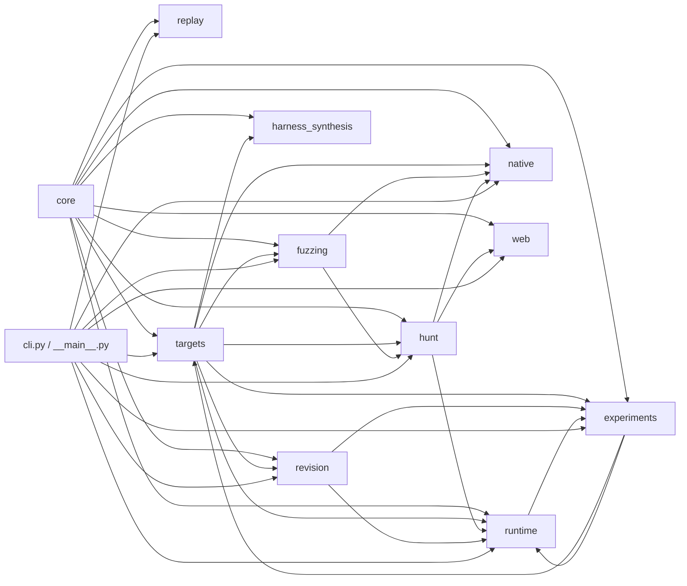

# dLLM Agent Source Layout

This document is the source ownership contract for `src/dllm_agent` after the
OSS-CRS-inspired package refactor. The inventory below is the 2026-09-02 working-tree
snapshot and must move with active revision and experiment modules. Runtime code keeps exactly three
Python files at package root: `__init__.py`, `__main__.py`, and `cli.py`.

## Current Tree (2026-09-02)

## Ownership

| Package | Owns | Must not own |
| --- | --- | --- |
| `core` | Shared errors, file/hash/JSON primitives, foundational schemas | Domain artifact semantics or orchestration |
| `replay` | Deterministic replay scan, scoring, sampling, validation | Live model processes or target staging |
| `targets` | Target identity, pins, staging, target-owned evidence, OpenEXR materialization, prepared probes, and promoted target coverage | Hunt lifecycle or native controller state |
| `fuzzing` | Typed fuzz and coverage runner contracts plus command construction | Candidate scoring, proof claims, or target ownership |
| `hunt` | Candidate validation, scoring, evidence, and hunt orchestration | Runtime process management, native controller state, or web serving |
| `runtime` | External model process clients and process-boundary validation | Candidate semantics or controller policy |
| `native` | Native controller models, artifacts, scoring, and lifecycle | Revision policy or runtime process clients |
| `revision` | Approved feedback-conditioned revision schemas, command config, policy, ledger, and deterministic controller orchestration | Target probe/proof implementation or runtime model clients |
| `experiments` | Multitarget and OpenEXR one-day experiment orchestration, banks, runtime adapters, evidence, recovery, and qualification helpers | Stable core contracts or generic target identity |
| `web` | FastAPI contracts, catalog, job/process adapters | CLI composition or lower-domain orchestration |
| `harness_synthesis` | Target-agnostic denoising-trajectory bookkeeping, statement/window region detection, compiler-diagnostic localization, remask-target selection, comment-aware body analysis, the RQ4b single-defect benchmark with its functional (AST + coverage) verdict, repair-arm/selection/budget logic and cluster-paired statistics, KB rendering, fitness scoring, audit ledger — pure, no live generation backend or torch import | Live model calls, target identity, orchestration (that lives in `tools/harness_synthesis/*.py`, invoked manually, never wired into the CLI or `openexr_one_day`) |
| `cli.py` | Composition root for installed and module-form commands | Reusable domain contracts |

Package `__init__.py` files are documentation-only. Import concrete contracts from
the module that defines them, not through package facades.

## Dependency Matrix

Allowed direct package dependencies are:

| Source | May import |
| --- | --- |
| `core` | `core` |
| `replay` | `core`, `replay` |
| `targets` | `core`, `experiments`, `targets`, `harness_synthesis` |
| `fuzzing` | `core`, `targets`, `fuzzing` |
| `hunt` | `core`, `targets`, `fuzzing`, `hunt` |
| `runtime` | `core`, `experiments`, `hunt`, `runtime`, `revision`, `targets` |
| `native` | `core`, `targets`, `fuzzing`, `hunt`, `native` |
| `revision` | `core`, `targets`, `revision` |
| `experiments` | `core`, `experiments`, `revision`, `runtime`, `targets` |
| `web` | `core`, `hunt`, `web` |
| `harness_synthesis` | `core`, `harness_synthesis` |
| `cli` | all runtime packages |

`dllm_agent.hunt` is now an intentional package. The removed flat
`src/dllm_agent/hunt.py` file remains forbidden, but imports such as
`dllm_agent.hunt.models` are valid.

## Composition Root

`pyproject.toml` keeps the installed script as `dllm_agent.cli:app`, and
`python -m dllm_agent` keeps delegating through `src/dllm_agent/__main__.py`.
Lower packages do not import `cli.py` or `web`; command wiring, report routing,
and user-facing command composition stay at the CLI boundary.

## Artifact Rules

`core/io.py` owns primitive file, JSON, atomic-write, and SHA-256 helpers. Each
domain owns its semantic artifact schema and path derivation:

- `hunt/artifacts.py` owns hunt evidence adapters.
- `native/artifacts.py` owns native controller events and artifacts.
- `revision/artifacts.py` owns feedback-conditioned revision ledger bytes.

Do not add a generic workspace service until more than one current domain needs
the same semantic path policy.

## OSS-CRS Boundary

This layout adapts OSS-CRS commit
`0061473c1afd37c93a00483e0aebc704b4897609` narrowly:

- Lifecycle separation from OSS-CRS prepare/build/run phases becomes
  `hunt/pipeline.py`, `native/pipeline.py`, and future `revision/pipeline.py`.
- Target ownership from OSS-CRS `Target` becomes `targets/models.py`,
  `targets/profiles.py`, and `targets/staging.py`.
- Separate build/fuzz/coverage contracts become `fuzzing/` and
  `fuzzing/coverage/`.
- Runtime isolation from the OSS-CRS model boundary becomes `runtime/` for
  external model processes only.
- Centralized path ownership is adapted as a rule: primitives in `core/io.py`,
  semantic artifacts in the owning domain.

The repository explicitly rejects OSS-CRS deployment-specific Compose,
private-network, sidecar, libCRS, LiteLLM, PostgreSQL, broad OSS-Fuzz
language/engine matrix, and standalone WebUI architecture.

## Extension Paths

- OpenEXR prepared snapshot probes live in `src/dllm_agent/targets/openexr/probe.py`.
- Promoted LLVM coverage replay for those probes lives in
  `src/dllm_agent/targets/openexr/probe_coverage.py`.
- Added target particle definitions live under `src/dllm_agent/targets/libpng/`,
  `src/dllm_agent/targets/libtiff/`, and `src/dllm_agent/targets/libxml2/`.
- Structured target particle helpers live in `src/dllm_agent/targets/structured.py`.
- Feedback-conditioned orchestration lives in `src/dllm_agent/revision/pipeline.py`,
  with controller-local request/protocol types in
  `src/dllm_agent/revision/controller_models.py`.
- Revision archives, proof archives, portfolios, and response trajectory policy live
  in `src/dllm_agent/revision/archive.py`,
  `src/dllm_agent/revision/proof_archive.py`,
  `src/dllm_agent/revision/portfolio.py`, and
  `src/dllm_agent/revision/trajectory_policy.py`.
- Per-lineage search-tree frontier tracking (`DenoNode`, `SearchAction`, multi-ancestor
  backtracking over the existing archive Pareto selection) lives in
  `src/dllm_agent/revision/search_tree.py`.
- Cross-run persistence of the tri-modal (`invalid`/`duplicate`/`proof_failure`) field-outcome
  signal lives in `src/dllm_agent/revision/failure_registry.py`.
- Installed PoC revision command config and run-manifest evidence live in
  `src/dllm_agent/revision/command.py`; live adapter composition remains in
  `src/dllm_agent/cli.py`.
- Resident selective-revision model processes belong in
  `src/dllm_agent/runtime/revision_client.py`, with worker validation helpers in
  `src/dllm_agent/runtime/revision_checks.py` and process-boundary execution in
  `src/dllm_agent/runtime/revision_process.py`.
- Exact-input OpenEXR proof lives in `src/dllm_agent/targets/openexr/proof.py`,
  with fixed Docker replay helpers in `src/dllm_agent/targets/openexr/proof_execution.py`.
- Multitarget experiment modules live in `src/dllm_agent/experiments/multitarget/`.
- OpenEXR one-day experiment modules live in
  `src/dllm_agent/experiments/openexr_one_day/`.
- New targets get a package under `targets/<name>/` and may depend only on
  `core` and `targets` unless the dependency matrix is deliberately changed.
- The matching implementation plan and design live in
  `docs/superpowers/plans/2026-08-20-feedback-conditioned-poc-revision.md` and
  `docs/superpowers/specs/2026-08-20-feedback-conditioned-poc-revision-design.md`.
