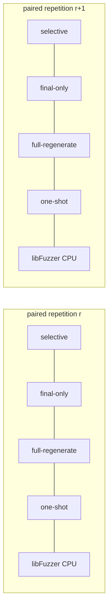

# OpenEXR One-Day dLLM Fuzzing Evaluation Plan

> **For agentic workers:** REQUIRED SUB-SKILL: Use `superpowers:test-driven-development` for Tasks 1–6 and `superpowers:executing-plans` or `superpowers:subagent-driven-development` to execute the plan task-by-task. Steps use checkbox (`- [ ]`) syntax for tracking.

**Goal:** Finish a paired, hash-bound OpenEXR fuzzing screening experiment within 24 hours of wall-clock time, test trajectory features as the sole confirmatory mechanism, and screen selective revision and closed-loop control as secondary mechanisms.

**Architecture:** Keep eight Stable-DiffCoder workers resident, run four model arms on two paired repetitions per three-hour wave, and run the matching libFuzzer cells on isolated CPU cores. Measure coverage with one external LLVM source-coverage build, prove sanitizer findings with exact-input replay, and analyze only repetition-level paired outcomes.

**Tech Stack:** Python 3.12, Stable-DiffCoder 8B, eight RTX 3090 GPUs, libFuzzer, ASan/UBSan, LLVM source-based coverage, Docker, Pydantic v2, pytest, Ruff, BasedPyright.

**Design inputs:** [`dllm-native-online-portfolio-harness.md`](../../dllm-native-online-portfolio-harness.md), [`experiment-protocol.md`](../../experiment-protocol.md), [`openexr-v3.4.14-online-portfolio.json`](../../../configs/openexr-v3.4.14-online-portfolio.json)

## 1. 결론부터

이 실험은 **논문 최종 효능 실험이 아니라 one-target mechanism screening**이다.

- 총 경과 시간: 최대 24시간
- 대상: OpenEXR `777d231a179de1711d2a942810d9559216ab3f4c`
- 구성: `5 arms × 10 paired repetitions × 3시간`
- GPU arm: 4개, 총 `120 GPU-hours`
- CPU 기준 arm: 1개, 같은 반복·같은 3시간 deadline
- 주 비교: `selective-revision` 대 `final-only`
- 주 지표: 외부 계측한 target-only branch coverage AUC
- 버그 수: 독립 ASan 재현을 통과한 원인만 보조 지표로 보고
- 주장 한계: OpenEXR 3시간 구간의 trajectory 효과를 판별할 수 있지만, 24시간 이상 장기 순위나 dLLM 대 AR 우월성은 주장하지 않는다.

현재 코드는 이 실험을 바로 시작할 상태가 아니다. 순차 smoke runner, 부재한 matched `final-only`/`full-regenerate` control, `cov` proxy, 30초 probe 상한을 먼저 고쳐야 한다. 이 네 항목은 아래 **NO-START gate**다.

## 2. 논문 평가 관행에서 가져오는 것

| 근거 | 원 평가 방식 | 본 실험에 적용 |
| --- | --- | --- |
| [FuzzBench paper](https://storage.googleapis.com/gweb-research2023-media/pubtools/6318.pdf), [report docs](https://google.github.io/fuzzbench/reference/report/), [experiment-data docs](https://google.github.io/fuzzbench/reference/experiment-data/) | 기본 20개 독립 trial, 약 23시간, 15분 corpus snapshot, fuzzer 내부 bitmap과 분리한 공통 Clang source coverage, 분포·CI·효과크기 보고 | 15분 snapshot, 공통 외부 coverage build, 모든 paired 점 공개. 시간 제약 때문에 10×3시간으로 축소 |
| [Evaluating Fuzz Testing](https://arxiv.org/abs/1808.09700) | 보통 30개 이상 반복과 24시간 실행을 권장하며 단일 실행과 짧은 실행의 순위 역전을 경고 | `24h × 1` 금지. 결과를 최종 우월성이 아닌 screening으로 제한 |
| [Magma](https://arxiv.org/abs/2009.01120) | 10개 반복, 24시간/7일, 동일 seed·timeout·memory, reach/trigger/detect와 right-censoring | 최소 10 paired repetition, exact proof, 미발견 시간의 right-censoring |
| [Fuzz4All](https://lingming.cs.illinois.edu/publications/icse2024a.pdf) | 주요 비교는 24시간·5회 반복, autoprompt 시간을 예산에 포함, coverage·validity·bug 수와 Mann–Whitney U 보고 | model load와 candidate generation을 end-to-end 시간에 포함하고 coverage와 validity를 함께 보고 |
| [CovRL-Fuzz](https://arxiv.org/abs/2402.12222) | 24시간·5회 반복, 5시간 component ablation, coverage over time·validity·ASan bug와 stack 기반 분류 | 전체 효능과 component ablation을 분리하고, 세 시간 곡선과 sanitizer evidence를 함께 수집 |

문헌의 24시간-per-trial 조건을 총 24시간에 그대로 넣을 수는 없다. 여기서는 실행 길이를 희생하고 반복 수를 보존한다. 따라서 유효한 결론은 “다음 장기 실험으로 확대할 가치가 있는가”까지다.

## 3. 연구 질문과 실험군

### RQ1: 실제 trajectory가 필요한가?

`selective-revision`과 `final-only`를 비교한다. 두 arm은 initial bank, 각 lineage의 실제 실행 feedback, NFE 상한, revision 횟수, portfolio, proof 정책, selective-remask 경로가 같아야 한다. `final-only`는 field policy에서 commit step, proposal flip, mask lifespan, confidence margin을 제거하고 final selector/AST와 실행 feedback만 사용한다.

기존 `pseudo-feedback`은 실행 feedback 자체를 회전하고, pseudo-trajectory는 올바른 state binding과 손상된 binding을 비교한다. 둘 다 “trajectory feature의 추가 가치”를 직접 격리하지 못하므로 역사/diagnostic control로만 남기고 이번 main arm에는 사용하지 않는다.

### RQ2: 선택적 remask가 전체 재생성보다 효율적인가?

`selective-revision`과 새 `full-regenerate`를 비교한다. 기존 `feedback-no-remask` legacy 경로를 재사용하지 않고, treatment와 같은 online controller 안에서 remask 범위만 전체 mutable slot으로 바꾼다.

### RQ3: closed loop가 one-shot보다 나은가?

`selective-revision`과 `structured-one-shot`을 비교한다.

### RQ4: 일반 libFuzzer보다 시스템 수준에서 경쟁력이 있는가?

`selective-revision`과 `libfuzzer-only`를 비교한다. dLLM arm은 GPU를 사용하므로 이 비교는 equal-cost가 아니라 equal-wall-clock system comparison이다.

| Arm | 역할 | 고정해야 할 요소 |
| --- | --- | --- |
| `selective-revision` | treatment | real trajectory, target feedback, lineage-local selective remask, online portfolio |
| `final-only` | RQ1 causal control | treatment와 동일한 selective controller에서 trajectory-derived feature만 제거; final selector/AST와 실제 feedback은 유지 |
| `full-regenerate` | RQ2 control | 동일 online controller, feedback cadence, portfolio, proof, model ceiling을 쓰되 선택 field만 여는 대신 전체 mutable slot 재생성 |
| `structured-one-shot` | RQ3 control | 공통 initial bank 뒤 model revision 없음; 남은 시간은 동일 libFuzzer campaign |
| `libfuzzer-only` | RQ4 reference | neutral corpus `C0`에서 즉시 시작; model·generated bank 없음 |

AR/FIM 비교군은 이 저장소에 동일 controller와 동등한 model budget으로 구현되어 있지 않다. 이번 하루 실험에 억지로 넣지 않으며, 결과에서 `dLLM > AR` 주장을 하지 않는다.

## 4. Pairing, corpus, particle diversity

실험 단위는 coverage snapshot이 아니라 **한 arm에서 3시간 실행한 한 repetition**이다.

1. `r = 0..9`의 독립 seed namespace를 미리 고정한다.
2. 모든 arm은 같은 최소 valid OpenEXR corpus `C0`, dictionary, max input length, timeout, memory limit를 받는다.
3. 각 repetition에서 model arm용 후보를 `32 raw` 생성한다.
4. byte hash 기준 `≥16 unique`가 아니면 고정된 다음 seed로 16개를 한 번만 보충한다.
5. 보충 후에도 `16 unique` 미만이면 main run을 시작하지 않는다.
6. 네 model arm은 같은 frozen 16-input bank와 같은 trajectory ledger에서 출발한다.
7. 각 arm의 mutable corpus, crash directory, RNG stream은 이후 완전히 분리한다.
8. `libfuzzer-only`는 `C0`에서 시작한다. 이는 end-to-end 기준군이며 dLLM bank를 몰래 제공하지 않는다.

Candidate bank 생성 시간 `B_r`은 네 model arm 모두의 3시간 예산에 포함한다. Coverage 곡선은 `t=0`부터 시작하며 bank가 준비될 때까지 model arm의 coverage는 `C0` 수준으로 유지한다. 실제 계산을 한 번 공유하더라도 각 arm의 시간 회계에는 같은 `B_r`을 결합한다.

## 5. 24시간 실행 일정

```mermaid
gantt
    title OpenEXR one-day experiment
    dateFormat HH:mm
    axisFormat %H:%M
    section Qualification
    Pin 검증·8 GPU resident load·2-pair smoke : 00:00, 45m
    section Main paired campaign
    Wave 1 — repetitions 0,1 : 00:45, 3h
    Wave 2 — repetitions 2,3 : 03:45, 3h
    Wave 3 — repetitions 4,5 : 06:45, 3h
    Wave 4 — repetitions 6,7 : 09:45, 3h
    Wave 5 — repetitions 8,9 : 12:45, 3h
    section Validation
    Exact ASan replay·minimize·root-cause dedup : 15:45, 2h
    External coverage replay·paired analysis : 17:45, 3h15m
    section Buffer
    hash audit·report·post-processing recovery : 21:00, 3h
```



각 wave는 다음처럼 배치한다.



- 네 model arm × 두 repetition = GPU 8장.
- libFuzzer cell 두 개는 같은 wave 동안 전용 physical core에서 실행한다.
- arm-to-GPU 배치는 사전 생성한 balanced rotation으로 wave마다 바꾼다.
- smoke 결과는 main 결과에 합치지 않으며 smoke를 본 뒤 hyperparameter를 바꾸지 않는다.
- 8개 model worker는 qualification 때 한 번 load하고 main 다섯 wave 동안 resident 상태를 유지한다.

## 6. 자원 고정

현재 호스트 관측값은 RTX 3090 8장, logical CPU 40개/physical core 20개, RAM 125 GiB, `/data` 여유 약 1.4 TiB다. `/` 여유는 약 21 GiB뿐이므로 실험 artifact는 `/data/dllm-agent/openexr-one-day-<run-id>`에만 둔다.

| 자원 | 규칙 |
| --- | --- |
| GPU | model cell당 RTX 3090 1장, 동일 power cap, MPS 금지, arm-to-GPU rotation |
| Model | 8개 resident worker, 하나의 read-only warmed HF cache, offline mode, cell별 writable cache 금지 |
| CPU | search 동안 target cell 10개에 physical core 10개, resident model worker 8개에 physical core 8개, OS/monitor에 2개; SMT sibling 미사용 |
| NUMA | GPU 0–3은 NUMA 0, GPU 4–7은 NUMA 1의 CPU와 memory binding |
| RAM | OpenEXR target RSS limit 2 GiB; host available RAM과 worker RSS를 30초마다 기록 |
| Storage | cell별 private corpus/artifact tree, campaign soft cap 100 GiB, corpus는 content hash로 dedup |
| Time | absolute monotonic deadline; process restart가 있어도 3시간을 연장하지 않음 |
| Threads | `OMP_NUM_THREADS=1`, `MKL_NUM_THREADS=1`, Torch intra/inter-op thread 1; run queue, context switches, GPU request latency, target exec/s를 gate에 포함 |
| Compute | NFE, forward calls, GPU seconds, CPU seconds, target executions, model load count/time 모두 저장 |

`equal wall-clock`, `coverage per GPU-hour`, `coverage per CPU-hour`, `coverage per 1,000 NFE`를 별도 표로 낸다. 서로 다른 계산 단위를 token 하나로 환산하지 않는다.

Shared bank 비용은 두 방식으로 고정한다.

- method-level `system_gpu_seconds`: 각 model arm이 독립 실행되었다고 보고 bank GPU seconds 전부를 각 arm에 더한다. 효율 비교는 이 값을 사용한다.
- campaign-level `physical_gpu_seconds`: 실제로 한 번 계산한 bank 비용만 기록한다. 24시간 운영 비용에만 사용한다.

Bank 비용을 arm 수로 나눈 one-quarter amortization은 보고하지 않는다.

## 7. Oracle과 측정

### Search build

- 모든 arm은 동일 OpenEXR ASan/UBSan libFuzzer binary를 사용한다.
- sanitizer signal은 search event일 뿐 bug 판정이 아니다.
- target crash 후 artifact를 보존하고 남은 absolute deadline 동안 frozen corpus에서 재시작한다.
- search 동안 exact bytes와 sanitizer log만 queue에 보존한다. Exact proof와 coverage replay는 main campaign 뒤 reserved validation 구간에서 실행해 search core와 경쟁하지 않는다.

### External coverage build

- fuzzer-native `cov`를 주 지표로 사용하지 않는다.
- 별도 LLVM source-coverage binary로 모든 arm의 cumulative corpus를 측정한다.
- OpenEXR source path만 포함하고 harness/runtime 코드는 제외한다.
- 15분마다 corpus hash index를 기록하고, 동일 binary로 incremental replay한다.
- primary coverage는 target-only covered branch count다. Region/line coverage와 fuzzer edge count는 secondary다.
- snapshot은 반복 측정치이지 독립 표본이 아니다.

### Exact proof

1. sanitizer가 낸 exact bytes를 SHA-256으로 저장한다.
2. 서로 다른 두 고정 seed로 fresh ASan process에서 재생한다.
3. 두 replay의 sanitizer class와 normalized root signature가 같을 때만 `proved`다.
4. `target commit + sanitizer class + normalized root signature`로 원인을 dedup한다.
5. stack hash만 같은 경우는 triage family이지 unique bug가 아니다.

## 8. 지표

### Primary endpoint

각 arm `a`, repetition `r`, 3시간 `T`에 대해:

```text
Y[a,r] = (1/T) × integral_0^T (target_branches[a,r,t] - target_branches[C0,r]) dt
L[r]   = log((1 + Y[selective,r]) / (1 + Y[final-only,r]))
```

`Y`는 세 시간 동안 평균적으로 몇 개의 새 target branch를 유지했는지를 뜻한다. 빠른 coverage 증가는 같은 final coverage라도 더 높은 점수를 받는다.

### Secondary endpoints

| 범주 | 지표 |
| --- | --- |
| 최종 효과 | 3시간 target branch/region/line coverage, coverage AUC, plateau escape rate |
| 효율 | AUC/GPU-second, AUC/CPU-second, AUC/1,000 NFE, target executions/second |
| 품질 | materialization validity, deep-parse rate, unique corpus contribution rate, rejected/dedup rate |
| 시간 | time-to-first-new-target-branch, time-to-coverage-threshold, time-to-first-proved-cause |
| 버그 | unique proved causes, reproduced inputs, proof failure/duplicate ratio |
| dLLM 기제 | selected field, remask ratio, commit step, flip count, mask lifespan, confidence margin, parent regression rate |
| 재현성 | source/model/image/prompt/config hashes, seed namespace, argv, resource map, corpus/event/evidence-tree hashes |

이벤트가 없는 시간 지표는 3시간에서 administratively right-censor한다. 이를 “3시간에 발견”으로 기록하지 않는다.

## 9. 통계와 사전 판정

### Confirmatory comparison

유일한 confirmatory 비교는 `selective-revision` 대 `final-only`다.

- 반복별 `L[r]` 10개를 사용한다.
- paired median uplift와 10,000-resample paired bootstrap 95% CI를 보고한다.
- bootstrap은 고정 seed `202608310001`로 repetition index만 재표집한다. 95% percentile
  CI는 정렬한 정확히 10,000개 uplift의 0-based index `249`와 `9749`를 사용하는
  nearest-rank 방식이며 보간하지 않는다.
- 방향 일관성은 exact two-sided sign test로 본다.
- rank-biserial effect와 모든 10개 paired 점을 함께 공개한다.

Bank/model 준비가 scheduled checkpoint 사이에 끝나면 준비 완료 직전까지의 excess
coverage는 정확히 0으로 둔다. AUC 적분에는 준비 완료 elapsed time에 `C0[r]`인 exact
knot을 삽입하고, 그 knot에서 첫 번째 이후 15분 관측점까지만 선형 보간한다. 따라서
준비 전 구간이나 준비 완료 순간에는 model corpus의 coverage 이득을 소급하지 않는다.

`time-to-coverage-threshold`의 사전 고정 threshold는 반복별 `C0[r] + 10` target
branches다. 미도달은 `10800`초에서 right-censor한다. `time-to-first-proved-cause`는
나중에 동일 root cause로 두 번 재현된 입력의 최초 search `CellEvent` 관측 시각이며,
post-search proof 종료 시각을 발견 시각으로 사용하지 않는다.

### GO-to-scale

아래 조건을 모두 만족할 때만 더 긴 논문 실험으로 확대한다.

1. 10개 pair 중 최소 9개에서 selective AUC가 더 높다. Exact two-sided sign-test `p ≈ 0.0215`다.
2. paired median AUC uplift가 최소 `+10%`다. 이 10%는 문헌 상수가 아니라 사전 고정한 engineering threshold다.
3. selective의 median final coverage가 final-only의 `95%` 이상이다.
4. selective의 median deep-parse rate 하락이 `5 percentage points` 이하다.
5. 10개 complete pair와 모든 resource-integrity gate가 유지된다.

### NO-GO / INCONCLUSIVE

- median uplift `≤0%`이거나 selective win이 `≤5/10`이면 `NO-GO-to-scale`이다.
- GO와 NO-GO 사이면 `INCONCLUSIVE`다.
- pair가 10개 미만이면 자동으로 `INCONCLUSIVE`다.

### Selective revision 효율의 보조 판정

`selective-revision` 대 matched `full-regenerate`에서 다음을 모두 만족하면 “selective revision efficiency signal”로만 보고한다.

- median AUC/1,000 NFE 또는 AUC/GPU-second가 `≥15%` 높음
- raw AUC가 `5%` 넘게 낮지 않음
- 최소 `7/10` pair에서 같은 방향

효율 uplift는 반복별 `Y/(NFE/1000)`와 `Y/GPU-second`를 먼저 계산한 뒤 arm별
median의 비율로 판정한다. 비교 arm의 median이 `<=0`, NFE/GPU-second가 `<=0`, 또는
값이 누락되면 해당 효율 축은 통과할 수 없다. raw AUC `-5%` 조건도 final-regenerate
median `Y`가 양수일 때만 `median(Y_selective) >= 0.95 * median(Y_full)`로 판정하며,
그 외에는 efficiency signal을 `INCONCLUSIVE`로 둔다. `7/10` 방향 조건은 동일한
반복 안에서 효율값의 strict win만 센다.

Resident model load 시간·RSS·VRAM은 main `t=0` 이전의 campaign-wide setup 비용으로
한 번만 별도 보고하며 arm별 AUC/GPU-second 분모에 중복 배분하지 않는다. 반면 각
반복의 공유 candidate-bank NFE/GPU 시간은 네 model arm 각각에 전액 논리적으로
부과한다. End-to-end 총비용 표에는 resident load를 한 번 포함한다.

RQ2–RQ4의 세 secondary contrast는 Holm 보정을 적용한다. Bug 수가 0 또는 매우 적으면 유의성 검정을 하지 않고 exact evidence와 censoring만 보고한다.

## 10. NO-START, 실패, 재실행 규칙

다음 중 하나라도 실패하면 main clock을 시작하지 않는다.

- target/model/image/prompt/config hash 불일치
- staggered direct/mmap-style worker load가 실패하거나, pre-load GPU당 free VRAM이 22 GiB 미만이거나, post-load GPU free VRAM이 4 GiB 미만
- load 중 host `MemAvailable`이 12 GiB 미만이거나 swap 사용량이 증가하거나 measured post-load RSS ceiling을 초과
- shared HF cache가 offline/read-only로 열리지 않음
- external coverage가 target-only branch count를 재현하지 못함
- `selective`와 `final-only`가 trajectory feature visibility 외 다른 경로를 사용함
- `32 raw → 16 unique` gate 실패
- CPU/GPU/NUMA pin 검증 실패 또는 예약 core의 지속 부하가 5% 초과
- `/data` free space 100 GiB 미만
- 2-pair smoke에서 schema/hash/deadline/restart/deferred-proof 검증 실패

Infrastructure failure는 GPU Xid/hardware reset, host power loss, storage I/O failure, orchestrator 자체 손상처럼 treatment와 무관한 외생 실패만 뜻한다. 이 경우 해당 repetition pair를 제외하며 10개 complete pair 미만이므로 결과는 `INCONCLUSIVE`다. 24시간 창 안의 full retry는 보장하지 않는다.

Model/controller crash, OOM, deadlock, self-timeout은 그 arm의 결과다. 해당 coverage 곡선을 3시간 deadline까지 동결하고 pair를 삭제하거나 재실행하지 않는다. Target sanitizer crash도 정상 outcome이며 exact bytes를 보존한 뒤 같은 absolute deadline 안에서 target process만 재시작한다.

## 11. 증거 구조

```text
openexr-one-day-<run-id>/
├── provenance/
│   ├── hardware.json
│   ├── topology.json
│   ├── source-model-image-prompt.json
│   └── process-snapshot.json
├── manifests/
│   ├── preregistration.json
│   ├── schedule.json
│   ├── seed-namespaces.json
│   └── resource-map.json
├── qualification/
│   ├── banks/rep-*/
│   │   └── candidate-bank.json
│   └── qualification.json
├── banks/rep-*/
│   ├── raw-candidates.jsonl
│   ├── unique-bank.json
│   └── trajectory-ledger.jsonl
├── cells/rep-*/<arm>/
│   ├── run-manifest.json
│   ├── revision-report.json
│   ├── events.jsonl
│   ├── coverage-timeseries.jsonl
│   ├── corpus-index.jsonl
│   ├── crashes/
│   └── logs/
├── proof/
│   ├── inputs/
│   ├── verdicts.jsonl
│   └── cause-index.json
└── results/
    ├── raw-arm-reports.jsonl
    ├── paired-summary.json
    ├── plots-data.json
    ├── report.md
    └── evidence-tree.sha256
```

Qualification banks are a pre-start gate artifact under `qualification/banks`; main
`banks/` remains uncreated until the 24h clock starts, so main candidate-bank cost is
included in the 3h repetition budget.

## 12. TDD 구현 순서

### Task 1: One-day campaign contract와 deterministic schedule

**Files:**
- Create: `src/dllm_agent/experiments/openexr_one_day/models.py`
- Create: `src/dllm_agent/experiments/openexr_one_day/schedule.py`
- Create: `tests/test_openexr_one_day_schedule.py`

- [ ] **Step 1: RED** — 10 repetitions, five arms, five three-hour waves, balanced GPU rotation, non-overlapping seed namespaces, absolute deadline을 검증하는 테스트를 작성한다.
- [ ] **Step 2: RED 확인**

```bash
uv run pytest tests/test_openexr_one_day_schedule.py -q
```

- [ ] **Step 3: GREEN** — immutable schedule와 preregistration manifest를 최소 구현한다.
- [ ] **Step 4: GREEN 확인**

```bash
uv run pytest tests/test_openexr_one_day_schedule.py -q
```

### Task 2: Online-matched causal controls

**Files:**
- Modify: `src/dllm_agent/revision/pipeline.py`
- Modify: `src/dllm_agent/revision/controller_helpers.py`
- Modify: `src/dllm_agent/revision/controller_models.py`
- Modify: `tests/test_poc_revision_pipeline.py`
- Create: `tests/test_openexr_one_day_arm_equivalence.py`

- [ ] **Step 1: RED** — selective/final-only가 동일 candidate bytes·실제 feedback·online portfolio·selective-remask·budget 경로를 쓰고 trajectory-derived feature visibility만 다름을 검증한다.
- [ ] **Step 2: RED** — full-regenerate가 같은 feedback cadence와 model ceiling을 쓰되 remask bitmap만 all-mutable임을 검증한다.
- [ ] **Step 3: GREEN** — legacy-path confound를 제거하고 arm 차이를 한 policy switch로 제한한다.
- [ ] **Step 4: 검증**

```bash
uv run pytest tests/test_poc_revision_pipeline.py tests/test_openexr_one_day_arm_equivalence.py -q
```

### Task 3: Shared `32 raw → 16 unique` bank와 campaign-level resident pool

**Files:**
- Create: `src/dllm_agent/experiments/openexr_one_day/candidate_bank.py`
- Create: `src/dllm_agent/experiments/openexr_one_day/resident_pool.py`
- Modify: `src/dllm_agent/runtime/revision_client.py`
- Modify: `tools/stable_diffcoder_generation.py`
- Modify: `tools/selective_revision_worker.py`
- Create: `tests/test_openexr_one_day_candidate_bank.py`
- Create: `tests/test_openexr_one_day_resident_pool.py`

- [ ] **Step 1: RED** — 네 model arm의 initial bytes/trajectory hashes가 같고 이후 corpus는 분리됨을 검증한다.
- [ ] **Step 2: RED** — worker 8개가 한 번씩 staggered load되고 wave 사이에 살아 있으며 cache path는 shared read-only이고 host/GPU memory telemetry가 gate에 남음을 검증한다.
- [ ] **Step 3: GREEN** — frozen bank adapter, low-host-memory load path, eight-worker request router를 구현한다.
- [ ] **Step 4: 검증**

```bash
uv run pytest tests/test_openexr_one_day_candidate_bank.py tests/test_openexr_one_day_resident_pool.py -q
```

### Task 4: Long-running cell, external coverage, deferred proof

**Files:**
- Create: `src/dllm_agent/experiments/openexr_one_day/cell_runner.py`
- Create: `src/dllm_agent/experiments/openexr_one_day/coverage_series.py`
- Create: `src/dllm_agent/experiments/openexr_one_day/proof_batch.py`
- Modify: `src/dllm_agent/targets/openexr/probe.py`
- Modify: `src/dllm_agent/targets/openexr/probe_coverage.py`
- Modify: `src/dllm_agent/targets/openexr/proof.py`
- Create: `tests/test_openexr_one_day_cell_runner.py`
- Create: `tests/test_openexr_one_day_coverage_series.py`
- Create: `tests/test_openexr_one_day_proof_batch.py`

- [ ] **Step 1: RED** — restart가 absolute deadline을 늘리지 않고, 15분 index가 단조 증가하며, target-only coverage가 harness line을 제외함을 검증한다.
- [ ] **Step 2: RED** — search가 exact bytes를 append-only queue에 넣고, post-run batch가 이를 두 번 재생하며, proof CPU seconds가 search 구간에 섞이지 않음을 검증한다.
- [ ] **Step 3: GREEN** — persistent fuzz loop, incremental corpus index, external replay, bounded post-run proof batch를 구현한다.
- [ ] **Step 4: 검증**

```bash
uv run pytest \
  tests/test_openexr_one_day_cell_runner.py \
  tests/test_openexr_one_day_coverage_series.py \
  tests/test_openexr_one_day_proof_batch.py -q
```

### Task 5: Eight-GPU coordinator와 recovery

**Files:**
- Create: `src/dllm_agent/experiments/openexr_one_day/coordinator.py`
- Create: `src/dllm_agent/experiments/openexr_one_day/recovery.py`
- Create: `tools/run_openexr_one_day.py`
- Create: `configs/openexr-v3.4.14-one-day.json`
- Create: `tests/test_openexr_one_day_coordinator.py`
- Create: `tests/test_openexr_one_day_recovery.py`

- [ ] **Step 1: RED** — GPU/physical-core/NUMA map, private output roots, exogenous pair invalidation, treatment failure curve freezing을 검증한다.
- [ ] **Step 2: RED** — crash/restart와 resume 후에도 seed, deadline, event hash가 바뀌지 않음을 검증한다.
- [ ] **Step 3: GREEN** — five-wave coordinator와 append-only checkpoint를 구현한다.
- [ ] **Step 4: 검증**

```bash
uv run pytest tests/test_openexr_one_day_coordinator.py tests/test_openexr_one_day_recovery.py -q
```

### Task 6: Paired analyzer와 hash audit

**Files:**
- Create: `src/dllm_agent/experiments/openexr_one_day/analysis.py`
- Create: `tools/analyze_openexr_one_day.py`
- Create: `tests/test_openexr_one_day_analysis.py`
- Create: `tests/test_openexr_one_day_evidence.py`

- [ ] **Step 1: RED** — trapezoid AUC, paired log-ratio, exact sign test, bootstrap CI, Holm correction, censoring, GO/NO-GO/INCONCLUSIVE 경계를 literal fixture로 검증한다.
- [ ] **Step 2: RED** — 한 raw file/hash/resource manifest가 바뀌면 분석이 fail-closed하는지 검증한다.
- [ ] **Step 3: GREEN** — stdlib 기반 deterministic analyzer와 Markdown report renderer를 구현한다.
- [ ] **Step 4: 검증**

```bash
uv run pytest tests/test_openexr_one_day_analysis.py tests/test_openexr_one_day_evidence.py -q
```

### Task 7: Qualification과 실제 24시간 실행

- [ ] 전체 targeted test, full test, Ruff, BasedPyright, build를 실행한다.

```bash
uv run pytest tests/test_openexr_one_day_*.py tests/test_poc_revision_pipeline.py -q
uv run pytest -q
uv run ruff check src tests tools
uv run basedpyright
uv build
```

- [ ] 2-pair, 5분 qualification smoke를 실행하고 결과를 main artifact와 분리한다.
- [ ] smoke가 모든 NO-START gate를 통과하면 config/hash를 freeze한다.
- [ ] 실제 campaign을 `/data`에서 실행한다.

```bash
PYTHONPATH=/home/seory0/dLLM_Agent/src:/home/seory0/dLLM_Agent \
  /home/seory0/dLLM_Agent/.venv/bin/python \
  /home/seory0/dLLM_Agent/tools/run_openexr_one_day.py \
  --config /home/seory0/dLLM_Agent/configs/openexr-v3.4.14-one-day.json \
  --artifact-root /data/dllm-agent/openexr-one-day-20260831 \
  --deadline-hours 24
```

- [ ] analyzer와 evidence-tree audit를 실행한다.

```bash
PYTHONPATH=/home/seory0/dLLM_Agent/src:/home/seory0/dLLM_Agent \
  /home/seory0/dLLM_Agent/.venv/bin/python \
  /home/seory0/dLLM_Agent/tools/analyze_openexr_one_day.py \
  /data/dllm-agent/openexr-one-day-20260831
```

## 13. 최종 보고 문장 경계

허용되는 가장 강한 문장은 다음과 같다.

> Under a preregistered three-hour, ten-pair OpenEXR screening protocol, trajectory-derived denoising features improved/did not improve externally measured target-branch coverage AUC over a matched final-only selective-revision control.

다음 문장은 이 실험만으로 쓰지 않는다.

- dLLM이 AR보다 우월하다.
- dLLM이 일반적으로 libFuzzer보다 우월하다.
- OpenEXR zero-day 탐지율이 향상됐다.
- 3시간 순위가 24시간 또는 7일에도 유지된다.
- sanitizer 문자열 또는 coverage 증가가 취약점 증거다.
