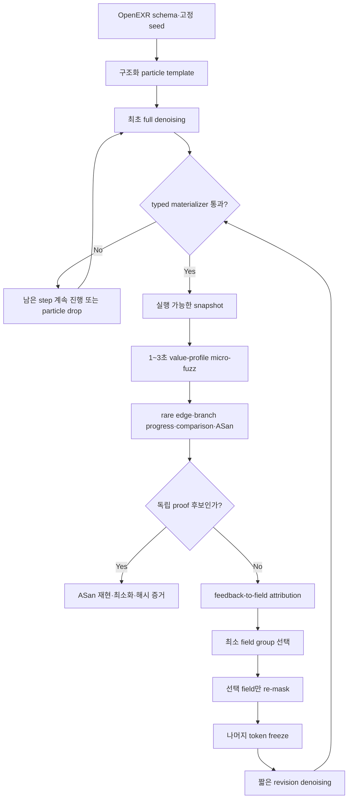
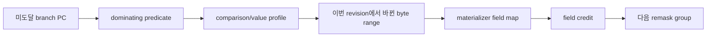
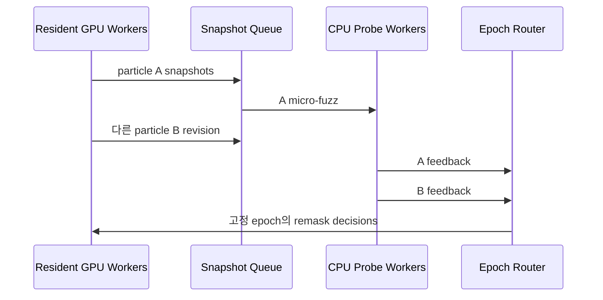
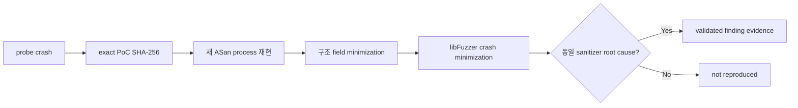

# Feedback-conditioned dLLM PoC revision runtime

**상태:** 설계 승인, 구현 진행 중, efficacy 미측정
**대상:** OpenEXR v3.4.14, commit `777d231a179de1711d2a942810d9559216ab3f4c`
**연구 treatment:** `selective-revision/v1`

## 1. 목표

현재의 `완성 harness 후보 → micro-fuzz tournament → 독립 proof` 구조를 다음 구조로
확장한다.

> 실행 가능한 구조화 PoC snapshot을 diffusion trajectory 경계에서 평가하고, 실행
> 피드백에 귀속된 최소 field span만 다시 mask하여 짧게 denoise한다.



## 2. 고려한 접근

| 접근 | 장점 | 문제 | 결정 |
| --- | --- | --- | --- |
| raw EXR bytes를 직접 denoise | 표현이 직접적임 | tokenizer 비효율, 문법 파괴, attribution 불안정 | 제외 |
| C++ harness source를 반복 revision | 현재 코드 재사용이 쉬움 | 매번 compile 필요, PoC 자체가 아니라 harness를 최적화함 | 보조 경로만 유지 |
| 구조화 EXR particle + deterministic materializer | 문법 유지, field attribution, 부분 remask, compile 재사용 | 제한된 EXR schema adapter 필요 | **채택** |

채택안은 dLLM이 raw bytes를 작성하지 않는다. dLLM은 고정 문법의 mutation particle에서
가변 field 값만 생성하고, materializer가 실제 EXR bytes를 만든다.

## 3. 구조화 particle

### 3.1 field 역할

각 field는 다음 중 하나다.

| 역할 | 예 | denoising 동작 |
| --- | --- | --- |
| `anchor` | magic, version, attribute name/type | 항상 고정 |
| `variable` | data window, compression, chunk offset, payload pattern | 선택적으로 mask 가능 |
| `derived` | attribute length, table size, checksum·offset 종속값 | materializer가 계산 |
| `opaque` | 아직 지원하지 않는 payload | parent bytes를 그대로 보존 |

```text
EXR_PARTICLE_V1
base = sample.exr                   # anchor
compression = ZIP                  # variable
data_window.min_x = -2147483648    # variable
data_window.max_x = 1024           # variable
chunk[0].offset = 0xfffffffffffffff0 # variable
header_size = <derived>             # model이 생성하지 않음
```

문법 token, key, 구분자는 frozen token이다. 각 RHS slot만 revision 대상이 된다. 값은 field별
허용 grammar로 logit을 제한하여 완성된 slot이 항상 typed parse 가능하도록 한다.

### 3.2 v1 지원 field group

- magic/version은 anchor로 고정
- `compression`, `lineOrder`
- `dataWindow`, `displayWindow`
- channel sampling/type metadata
- chunk offset table
- chunk size와 선택 payload window
- unsupported attribute/payload bytes는 opaque 보존

정상 포맷 탐색과 경계 위반 탐색을 분리한다.

- `validity-preserving`: 길이와 offset 종속값을 재계산
- `boundary-breaking`: 선택된 종속 조건 하나만 의도적으로 불일치시킴

두 모드와 예산은 manifest에 고정해 결과 해석을 섞지 않는다.

## 4. 진짜 selective revision sampler

Stock Stable-DiffCoder의 `remasking="low_confidence"`는 아직 mask인 token 중 확정 순서를
고를 뿐, committed token을 다시 열지 않는다. 따라서 새 treatment는 stock claim과 분리한다.

```text
RevisionRequest
  parent_token_ids
  remask_bitmap
  frozen_bitmap
  field_spans
  revision_steps
  rng_state
  feedback_digest
```

`selective-revision/v1`은 선택된 committed 위치를 명시적으로 mask ID로 되돌린다. frozen
위치는 sampling 중 절대 변경하지 않는다. earliest changed block부터 KV cache를 무효화하고
필요한 suffix만 다시 계산한다. 이는 Stable-DiffCoder checkpoint 위에 구현하는 새 sampler이며
stock Stable remasking 또는 모델 내부 self-correction이라고 부르지 않는다.

### 4.1 snapshot 경계

- 최초 particle은 full denoising한다.
- 후속 round는 선택 field group에 짧은 revision budget만 준다.
- remasked field slot이 완성되고 typed materializer가 통과할 때만 snapshot을 실행한다.
- 파싱 불가능한 중간 token 상태에는 오라클을 호출하지 않는다.
- 같은 snapshot SHA-256은 다시 실행하지 않는다.

기본 예산 목표는 다음과 같다.

```text
initial: 64~192 NFE
revision: 8~24 NFE
snapshot probe: 1~3 seconds
long proof: sanitizer 신호가 있는 경우에만
```

## 5. 실행 feedback과 field attribution

Sanitizer는 희소하므로 일상적인 revision reward로 단독 사용하지 않는다.

우선순위는 다음과 같다.

1. 독립 재현 가능한 sanitizer signal
2. target branch progress와 새 rare edge
3. comparison/value-profile 개선
4. target-only line/branch coverage delta
5. exec/s와 snapshot 유효성
6. trajectory uncertainty와 NFE 비용



v1 attribution은 한 particle revision에서 한 field group만 바꾸는 controlled intervention을
기본으로 한다. 이전 snapshot과의 reward delta를 그 field group에 귀속한다. 값 비교 tracing과
materializer의 field-to-byte map을 보조 신호로 사용한다. 완전한 dynamic taint는 v1 범위가
아니다.

선택 정책은 sanitizer, branch progress, rare edge를 최우선으로 하고 field별 UCB 탐색 보너스와
trajectory uncertainty를 결합한다. trajectory confidence만으로 field를 선택하지 않는다.

## 6. 효율 중심 runtime

### 6.1 모델 resident worker

- 모델은 GPU에 한 번만 적재한다.
- particle state는 token IDs, bitmaps, RNG state와 field map으로 저장한다.
- 8× RTX 3090 환경에서는 GPU별 resident replica를 두고 particle을 분산한다.
- 동일 revision cache key는 모델 호출 없이 재사용한다.

Revision cache key:

```text
SHA256(parent snapshot || remask spans || feedback digest || sampler config || seed)
```

### 6.2 build와 probe 분리

PoC revision 중 harness source는 바뀌지 않는다. OpenEXR ASan/value-profile harness를 캠페인
시작 때 한 번만 build하고 이후 snapshot은 입력 bytes만 바꾼다. 현재 probe마다 수행하는
CMake harness build와 전체 LLVM coverage replay는 제거한다.

- 매 snapshot: prebuilt target + cheap edge/value-profile probe
- promote 시점: target-only LLVM source coverage
- sanitizer signal: 별도 ASan proof
- 최종 결과: frozen corpus coverage와 crash minimization

### 6.3 GPU/CPU 비동기 중첩



CPU 완료 순서가 선택을 바꾸지 않도록 fixed decision epoch가 필요한 feedback 수를 모두 받은
뒤 정렬된 particle ID 순으로 결정한다. 실행 자체는 비동기지만 결과는 같은 입력에서 결정적이다.

### 6.4 dedup과 budget routing

- snapshot SHA dedup
- probe cache: target/image/harness/snapshot/fuzzer seed/duration hash
- compile cache: target image/harness hash
- 동일 source·trajectory particle 제거
- 유망 particle만 추가 revision NFE와 fuzz seconds를 받음
- coverage plateau가 연속 두 epoch이면 다른 field group으로 이동하거나 particle drop

## 7. probe와 proof의 보안 경계

Probe sanitizer signal은 우선순위 신호일 뿐 취약점 증명이 아니다.



최종 proof는 선택에 사용한 probe process와 corpus에서 분리하고, exact input, stack, target
commit, image, argv와 log hash를 저장한다. proof가 실패하면 zero-day나 취약점을 주장하지
않는다.

## 8. 증거 schema

새 report는 기존 `dllm-native-hunt-report/v1`을 덮어쓰지 않는다.

```text
dllm-poc-revision-report/v1
```

JSONL event 종류:

- `particle_started`
- `snapshot_materialized`
- `probe_completed`
- `field_attribution`
- `remask_decided`
- `revision_completed`
- `particle_promoted|particle_dropped`
- `proof_completed`

모든 event는 monotonic sequence, parent/snapshot/feedback/remask hash, NFE, forward calls,
GPU-seconds, validator milliseconds, fuzz seconds, exec/s, cache/dedup hit와 artifact manifest를
포함한다. timestamp는 관측 정보로만 저장하고 결정 key에는 포함하지 않는다.

## 9. 오류 처리

- invalid particle grammar: 오라클을 호출하지 않고 해당 revision 실패 기록
- materializer invariant 실패: snapshot 미발행
- hash mismatch: 실행 전 fail closed
- model timeout: partial snapshot을 publish하지 않음
- 모든 particle build/materialize 실패: proof 없이 종료
- probe crash 후 proof 실패: `not_reproduced`
- symlink, target pin, Docker sandbox 경계는 기존 정책 유지

## 10. 검증과 비교 실험

### 10.1 필수 TDD 계약

1. feedback이 달라지면 remask field가 달라진다.
2. 선택 field의 committed token은 실제 mask로 되돌아가고 값이 바뀐다.
3. frozen token과 anchor bytes는 bit-identical하다.
4. 다음 probe가 parent가 아니라 새 snapshot bytes를 실행한다.
5. 동일 snapshot은 model/probe를 다시 호출하지 않는다.
6. 비동기 완료 순서가 달라도 ledger와 선택은 같다.
7. probe sanitizer와 최종 proof verdict는 분리된다.
8. JSONL과 report hash는 동일 입력에서 byte-stable하다.

### 10.2 OpenEXR 수동 QA

- 서로 다른 snapshot bytes를 만드는 particle 최소 4개
- 실제 Stable-DiffCoder revision 최소 1회
- 최소 한 round에서 remask field와 snapshot hash가 변함
- prebuilt harness build 횟수 1회
- snapshot별 cheap probe와 promote-only LLVM coverage 확인
- ASan proof가 없으면 취약점 주장 없음

### 10.3 비교군

- libFuzzer only
- dLLM one-shot structured particle
- dLLM feedback loop without selective remask
- dLLM selective revision
- AR-FIM/structured edit with 같은 schema·feedback·budget
- real feedback를 particle 사이에서 뒤섞은 pseudo-feedback control

`AR은 원리상 불가능`이라고 주장하지 않는다. 정확한 주장은 vanilla left-to-right decoding은
한 trajectory에서 arbitrary committed 위치를 여는 native 연산이 없고, AR-FIM/편집 모델은
별도 conditioning으로 근사한다는 것이다.

## 11. 성공 지표

주 지표:

- time-to-target-branch
- time-to-first-independent-sanitizer-proof
- 고정 wall-clock에서 unique target branches
- coverage plateau 탈출률
- validated root cause 수

비용 지표:

- wall-clock, CPU/GPU-seconds
- NFE와 forward calls
- model load count
- build/validator/probe 호출 수
- cache/dedup hit rate
- proof까지 사용한 총 fuzz seconds

token 수만으로 AR과 dLLM을 비교하지 않는다.

## 12. 구현 단계

1. typed particle, field map, materializer와 invariant
2. snapshot/probe/remask/report schema와 deterministic ledger
3. prebuilt persistent OpenEXR probe boundary와 cheap value-profile feedback
4. deterministic sampler double로 controller TDD
5. resident Stable-DiffCoder worker와 resumable selective revision sampler
6. async particle scheduler, cache와 dedup
7. 독립 ASan proof와 minimization
8. OpenEXR live campaign과 동일-budget 비교

각 단계는 이전 단계의 unit/integration gate를 통과한 뒤 진행한다.

## 13. 비목표

- arbitrary EXR 전체 명세 지원
- 매 denoising step마다 sanitizer 실행
- stock Stable-DiffCoder가 true remasking을 제공한다는 주장
- sanitizer 없이 vulnerability/zero-day 주장
- 첫 OpenEXR 실행만으로 dLLM 우월성 주장
