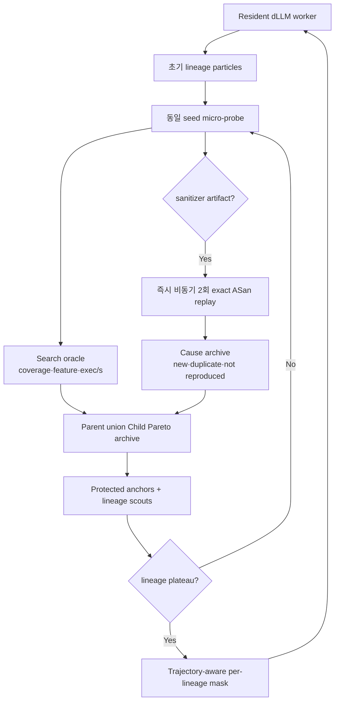
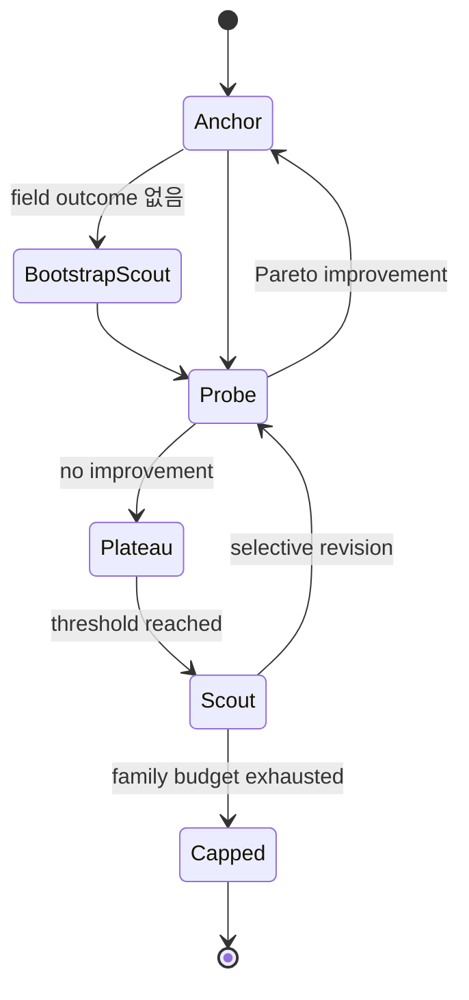

# dLLM-native online proof and portfolio runtime

**상태:** 설계 승인, 구현 중
**적용 경로:** `dllm_agent.revision`
**역사적 실험 보존:** `tools/run_multitarget_24h.py`와 기존 artifact schema는 재현을 위해 유지

## 1. 목표

완성된 dLLM 후보를 한 번 교체하는 현재 루프를, 실행 피드백이 들어올 때마다 기존의 좋은
부분을 보존하고 불확실하거나 실패에 기여한 field만 다시 여는 온라인 runtime으로 바꾼다.



## 2. 핵심 불변식

1. `canary_triggered`는 artifact와 사후 평가에는 남지만 controller reward에는 절대 포함하지
   않는다.
2. probe의 sanitizer 문자열은 proof trigger일 뿐 취약점 verdict나 elite bonus가 아니다.
3. `proved`는 새 process에서 exact bytes를 두 번 재생해 동일 ASan 원인이 나온 경우에만
   성립한다.
4. revision 후 population은 child로 덮어쓰지 않고 `parent ∪ child`에서 선택한다.
5. baseline anchor와 각 lineage의 최소 한 parent anchor는 revision으로 제거할 수 없다.
6. 모델 worker는 전체 run 동안 한 번만 열고 plateau round 사이에도 닫지 않는다.
7. mask는 전역 한 field가 아니라 lineage별 trajectory와 실제 parent-child 결과로 결정한다.
8. wall-clock 완료 순서는 선택 결과에 영향을 주지 않는다. epoch barrier 뒤 정렬된 ID로
   결정한다.
9. revision에서 허용 grammar로 제한된 model-selected token을 그대로 commit한다. controller가
   임의의 다음 selector class로 대체하면 dLLM trajectory가 실행 결과에 영향을 주지 못하므로
   금지한다.

## 3. 두 오라클

### 3.1 search oracle

일상적인 cheap probe는 다음 벡터만 제공한다.

```text
validity, target branches, rare/new edges, value-profile features,
executions/second, cost, structural diversity
```

search-side canary와 sanitizer boolean은 이 벡터에 들어가지 않는다. sanitizer artifact가 생기면
online proof queue에 exact snapshot hash와 bytes를 보낼 뿐이다.

### 3.2 proof oracle

proof 결과는 다음 네 상태로 정규화한다.

```text
not_reproduced | crash_without_sanitizer | proved_duplicate_cause | proved_new_cause
```

cause ID는 target commit, sanitizer class, 정규화된 target stack signature의 canonical hash다.
rich signature를 제공하지 않는 test/legacy runner는 input hash가 아니라 proof log hash를
provisional family key로만 사용하며 새 원인 보상은 주지 않는다.

## 4. Pareto archive와 portfolio

각 parent-child pair는 다음 벡터로 비교한다.

```text
proof novelty, branch reach, rare/new edges, value-profile features,
validity, exec/s, negative compute cost
```

한 후보가 모든 축에서 나쁘지 않고 하나 이상 더 좋을 때만 다른 후보를 지배한다. archive가
넘치면 protected anchor를 먼저 보존하고, 나머지는 crowding distance와 snapshot hash 순서로
결정적으로 줄인다.

portfolio 역할은 다음과 같다.

- `baseline_anchor`: 모델 revision을 전혀 받지 않는 비교 기준
- `parent_anchor`: lineage에서 지금까지 가장 좋은 실행 가능 snapshot
- `scout`: 선택 field를 다시 mask해 plateau 탈출을 시도하는 child

같은 proof family가 반복 실패하거나 같은 원인이 반복되면 family별 proof/revision cap을 적용해
CPU와 GPU 예산을 다른 lineage로 돌린다.

## 5. Plateau와 iterative revision

고정 `epochs`는 안전 상한이다. 각 lineage는 field 결과를 한 번도 관측하지 않은 초기
상태에서 **bounded bootstrap scout 1개**를 허용한다. 이후 revision은 실행된 scout의
Pareto 개선이 `plateau_epochs`번 연속 없을 때만 발생한다. Bootstrap은 plateau revision과
별도 accounting/event로 식별하고 ablation에서 제거할 수 있어야 한다. 따라서 초기 인과
calibration 뒤의 dLLM NFE는 실행 피드백으로 정당화된 위치에만 사용된다.



## 6. Trajectory-aware mask

lineage별 field score는 다음 신호를 결합한다.

- 해당 slot이 commit된 normalized step
- commit confidence와 confidence margin
- revision 동안 token flip 수
- mask lifespan
- 같은 field를 바꾼 이전 child의 Pareto 결과
- duplicate, invalid materialization, proof 실패 횟수

실행상 개선된 field는 freeze credit을 받고, duplicate·invalid·proof 실패를 만든 field에는
failure cooldown을 적용해 아직 시도하지 않았거나 trajectory 불확실성이 큰 field를 먼저
탐색한다. 실패 field를 영구 제외하지는 않으며 다른 field evidence가 누적된 뒤 다시 선택될
수 있다. dLLM의 병렬 any-order trajectory가 실제 실행 reward와 결합되는 지점이며, 단순 UCB
field rotation과 구분된다.

## 7. dLLM-native 판단 기준

이 구조가 dLLM을 최대한 활용한다고 주장하려면 다음 ablation을 모두 통과해야 한다.

| 비교 | 제거되는 dLLM-native 요소 | 필요한 관측 |
| --- | --- | --- |
| final-only | trajectory 신호 | time-to-branch와 proof 감소 |
| global-mask | per-lineage mask | lineage 다양성과 plateau 탈출 감소 |
| full-regenerate | 부분 remask/freeze | 같은 개선 대비 NFE·GPU초 증가 |
| pseudo-trajectory | 실제 token dynamics | 성능이 실제 trace보다 낮음 |
| close-per-epoch | resident worker | load 시간과 wall-clock 증가 |
| child-only | parent archive | coverage/proof regression 증가 |

이를 통과하기 전에는 “이론상 최적”이라고 표현하지 않고 “현재 구현 가능한 dLLM-native
구조 중 가장 강한 검증 가능한 설계”라고 표현한다.

## 8. 성공 조건

- canary 값만 바뀌어도 controller 순위와 remask가 변하지 않는다.
- child가 coverage/feature/exec 축에서 열등하면 parent가 살아남는다.
- sanitizer probe 직후 run 종료 전 proof event가 생성된다.
- 같은 root cause는 한 번만 `proved_new_cause`가 된다.
- family cap 이후 같은 family는 proof/revision 예산을 받지 않는다.
- bounded bootstrap 이후 개선이 있는 lineage는 revision하지 않고, plateau lineage만
  remask한다.
- 서로 다른 trajectory를 가진 lineage가 서로 다른 field를 고를 수 있다.
- 한 run 동안 resident worker load count는 정확히 1이다.
