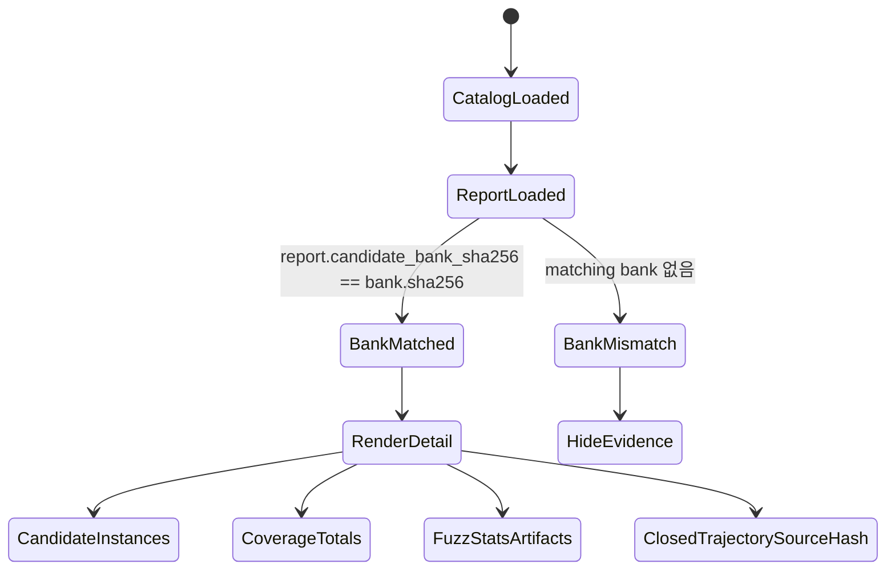

# dLLM Hunt Console 구현 결과

기준일: 2026-08-19

## 결론

현재 콘솔은 [OSS-CRS](https://github.com/ossf/oss-crs)의 run/status/coverage/artifact
정보 구조를 dLLM hunt evidence에 맞춘 **minimal dashboard**로 구현한다. 픽셀 복제품이나
관제형 작업 화면이 아니라, 저장된 hunt report를 조회하는 sparse Runs table이다.

| OSS-CRS 계열 문법 | 현재 dLLM Hunt Console 구현 |
| --- | --- |
| 실행 목록 | `/`의 Runs table: Run ID, status, target, dLLM instances, coverage, findings, artifacts |
| 실행 drill-down | `/run/{resource_id}`의 detail view |
| coverage 요약 | HuntReport totals의 Lines, Functions, Branches, Regions |
| artifact 확인 | fuzz corpus/crash artifact table과 Copy hash button |
| 증거 경계 | trajectory, source, hash evidence를 닫힌 disclosure로 보관 |
| report-bank 결합 | `candidate_bank_sha256`과 catalog candidate bank SHA-256이 같을 때만 결합 |

## 최종 구조

```mermaid
flowchart LR
    U["Loopback Web UI\n/ and /run/{resource_id}"]
    A["Typed FastAPI routes"]
    C["Opaque resource catalog"]
    R["HuntReport evidence\ncoverage + fuzz"]
    B["Candidate bank\ntrajectory/source/hash"]
    H["SHA binding\ncandidate_bank_sha256"]

    U -->|GET /api/v1/catalog| A
    U -->|GET /api/v1/reports/{resource_id}| A
    U -->|GET /api/v1/trajectories/{resource_id}| A
    A --> C
    C --> R
    C --> B
    R --> H
    B --> H
    H --> U
```

### 화면 배치

`/`는 다음 열만 가진 sparse Runs table이다.

| 열 | 값 |
| --- | --- |
| Run ID | detail route로 이동하는 hunt ID 또는 resource ID |
| Status | matched bank가 있으면 job/catalog 상태, 없으면 bank mismatch |
| Target | report target repository |
| dLLM Instances | `candidate_scores` 개수 |
| Coverage | lines coverage |
| Findings | proved oracle이면 `1 proved`, 아니면 `0` |
| Artifacts | fuzz corpus/crash artifact 개수 |

`/run/{resource_id}`는 selected report detail이다. 상단 summary는 oracle status, target,
selected candidate, trajectory truth를 보여준다. 그 아래에는 dLLM candidate instance card,
HuntReport Lines/Functions/Branches/Regions coverage, fuzz stats, corpus/crash artifact table이
순서대로 배치된다. trajectory/source/hash evidence는 기본적으로 닫힌 disclosure이다.

현재 minimal dashboard의 observable UI는 report 조회와 evidence drill-down에 집중한다.
job API route는 서버에 남아 있지만 현재 `/` 첫 화면에 노출되는 조작 표면은 아니다.

## Evidence 결합



- detail은 report의 `candidate_bank_sha256`과 catalog candidate bank SHA-256이 같을 때만
  candidate bank trajectory를 report evidence와 결합한다.
- mismatch 상태에서는 validation evidence를 숨기고, candidate/coverage/fuzz artifact 영역에
  unavailable 또는 empty 상태를 표시한다.
- candidate instance card는 score, API coverage, NFE, step 수를 표시하고 selected candidate를
  별도 스타일로 구분한다.
- card 내부 detail과 page-level trajectory/source/hash 영역은 모두 사용자가 열기 전에는 닫힌다.

## 구현 표면

| 영역 | 파일 |
| --- | --- |
| FastAPI 앱, 보안 헤더, document routes | `src/dllm_agent/web/app.py` |
| resource catalog | `src/dllm_agent/web/catalog.py` |
| typed request/response | `src/dllm_agent/web/contracts.py` |
| minimal dashboard document | `src/dllm_agent/web/static/index.html` |
| dashboard rendering | `src/dllm_agent/web/static/app.js` |
| API/report helpers | `src/dllm_agent/web/static/ui.js`, `src/dllm_agent/web/static/report-selection.js` |
| style and responsive behavior | `src/dllm_agent/web/static/app.css` |
| UI-only showcase | `src/dllm_agent/web/static/showcase.html` |

주요 조회 API는 다음과 같다.

| Route | 역할 |
| --- | --- |
| `GET /api/v1/catalog` | catalog resource list |
| `GET /api/v1/reports/{resource_id}` | HuntReport detail |
| `GET /api/v1/trajectories/{resource_id}` | candidate bank trajectory view |
| `GET /api/v1/jobs` | job status list |
| `GET /api/v1/jobs/{job_id}` | single job status |
| `GET /api/v1/jobs/{job_id}/events` | job event list |
| `POST /api/v1/jobs/sample` | sample job start API |
| `POST /api/v1/jobs/hunt` | hunt job start API |

## 브라우저 QA 결과

구조화된 QA 결과는 `.omo/evidence/minimal-dashboard/browser-qa.json`에 있다.

| Viewport | Runs rows | Detail cards | Lines | Functions | Branches | Regions | Open disclosures | Page errors | Horizontal overflow |
| --- | ---: | ---: | ---: | ---: | ---: | ---: | ---: | ---: | --- |
| 1280×900 | 7 | 2 | 13.2% | 25.1% | 22.7% | 26.7% | 0 | 0 | 없음 |
| 768×1024 | 7 | 2 | 13.2% | 25.1% | 22.7% | 26.7% | 0 | 0 | 없음 |
| 375×844 | 7 | 2 | 13.2% | 25.1% | 22.7% | 26.7% | 0 | 0 | 없음 |

캡처 파일도 같은 디렉터리에 저장되어 있다.

| Viewport | Summary capture | Detail capture |
| --- | --- | --- |
| 1280×900 | `.omo/evidence/minimal-dashboard/runs-1280x900.png` | `.omo/evidence/minimal-dashboard/detail-1280x900.png` |
| 768×1024 | `.omo/evidence/minimal-dashboard/runs-768x1024.png` | `.omo/evidence/minimal-dashboard/detail-768x1024.png` |
| 375×844 | `.omo/evidence/minimal-dashboard/runs-375x844.png` | `.omo/evidence/minimal-dashboard/detail-375x844.png` |

## 현재 제한 사항

1. 현재 화면은 저장된 report, candidate bank, trajectory view를 조회하는 minimal dashboard이다.
   첫 화면에서 sample/hunt 작업을 시작하는 controls는 없다.
2. trajectory/source/hash는 evidence disclosure로 제공되지만 별도 playback UI는 현재 구현
   범위가 아니다.
3. 저장된 결과 열람은 즉시 가능하지만 새 sample 또는 hunt API를 사용하려면 pinned model
   runtime, checkpoint cache, target checkout, Docker fuzzing 환경이 필요하다.
4. 현재 제품 경계는 로컬 연구 도구다. 원격 배포, 인증, TLS, 다중 사용자 job isolation은
   구현 범위에 포함하지 않았다.

## 최종 판단

현재 UI는 OSS-CRS를 그대로 복제한 화면이 아니라, 그 콘솔 문법을 dLLM 취약점 탐지 pipeline의
저장 증거 조회에 맞게 줄인 형태다. 운영자는 `/`에서 여러 run을 비교하고, `/run/{resource_id}`
에서 matched candidate bank, coverage totals, fuzz artifact, trajectory/source/hash evidence를
확인할 수 있다.
