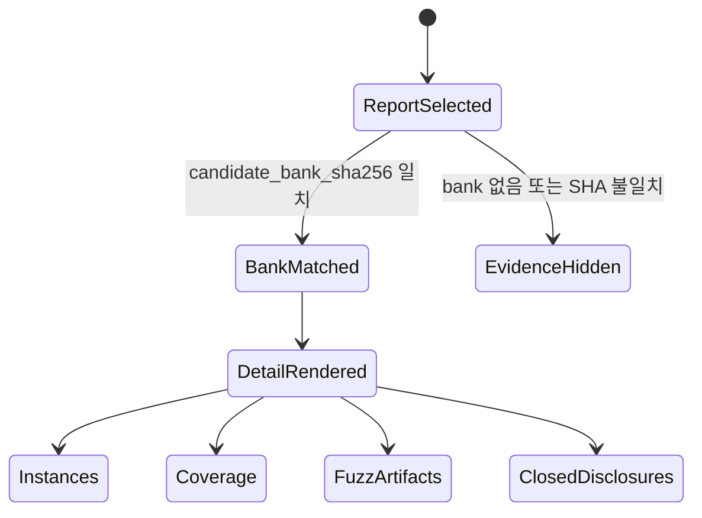

# dLLM Hunt Console

> 아래 브라우저 QA 표는 2026-08-19 당시 7개 run을 가진 catalog snapshot이다. 현재
> catalog의 동적 row 수를 뜻하지 않으며, 최신 기능 상태는 자동 테스트와 실제 화면으로
> 다시 확인한다.

`dLLM Hunt Console`은 기존 CLI와 증거 JSON 위에 얇게 올린 로컬 조회 화면이다.
현재 구현은 OSS-CRS 계열 콘솔의 run/status/coverage/artifact 정보 구조를 최소 형태로
옮겼고, 첫 화면은 작업 제어가 아니라 저장된 hunt report를 나열하는 sparse Runs table이다.

## 실행

`dllm-agent web` 서버를 loopback에서 실행한 뒤 브라우저에서 `http://127.0.0.1:8080`을
연다. 저장된 candidate bank와 hunt report를 조회하는 데는 GPU가 필요하지 않다. 새 sample
또는 hunt 작업을 API로 시작할 때만 model runtime, checkpoint cache, 검증된 target checkout,
Docker fuzzing 환경이 필요하다.

## 구조

```mermaid
flowchart LR
    Browser["Browser\nminimal Runs + detail views"]
    API["Loopback FastAPI\nfixed typed routes"]
    Catalog["Repository catalog\nopaque resource IDs"]
    Reports["Hunt reports\ncoverage + fuzz evidence"]
    Banks["Candidate banks\ntrajectory/source hashes"]

    Browser -->|GET /api/v1/catalog| API
    Browser -->|GET /api/v1/reports/{resource_id}| API
    Browser -->|GET /api/v1/trajectories/{resource_id}| API
    API --> Catalog
    Catalog --> Reports
    Catalog --> Banks
    Reports --> API
    Banks --> API
```

문서 route는 두 개의 주요 화면을 제공한다.

| Route | 화면 |
| --- | --- |
| `/` | sparse Runs table. Run ID, status, target, dLLM instance 수, lines coverage, finding 수, artifact 수를 표시한다. |
| `/run/{resource_id}` | run detail. 선택한 report와 같은 SHA-256 candidate bank를 결합해 evidence를 표시한다. |

`/showcase`는 실제 증거와 분리된 UI-only synthetic primitive 상태 확인 화면이다. 현재
Runs 화면의 첫 viewport는 저장된 report 조회에만 집중한다.

## Evidence 결합

화면은 report의 `candidate_bank_sha256`과 카탈로그에 기록된 candidate bank SHA-256이
일치할 때만 detail evidence를 렌더링한다. bank가 없거나 SHA가 맞지 않으면 candidate,
coverage, fuzz artifact 증거를 숨기고 불일치 상태를 표시한다. candidate ID 문자열만 같은
서로 다른 generation 결과를 결합하지 않는다.



## Detail 화면

`/run/{resource_id}` detail은 report와 matched candidate bank에서 다음 정보를 읽어 표시한다.

| 영역 | 표시 내용 |
| --- | --- |
| Summary | oracle status, target, selected candidate, trajectory truth |
| dLLM Instances | candidate instance card, selected 표시, score, API coverage, NFE, step 수 |
| Code Coverage | HuntReport totals: Lines, Functions, Branches, Regions |
| Fuzzing | build/fuzz/oracle status, executed units, edges, features, exec/s, sanitizer |
| Artifacts | corpus/crash artifact kind, status, name, size, Copy hash button |
| Closed disclosures | trajectory evidence, selected source, report/command/artifact hashes |

trajectory, source, hash evidence는 기본적으로 닫힌 disclosure로 남는다. candidate card 내부의
trajectory/source/hash detail도 사용자가 열기 전에는 닫힌다. UI는 실시간 모델 사고 과정이나
저장되지 않은 token-level playback을 제공한다고 주장하지 않고, 저장된 HuntReport와 candidate bank 증거만
표시한다.

취약점 증명은 candidate score나 trajectory 표시가 아니라 sandbox에서 재현된 sanitizer crash와
그 결과를 담은 hash-carrying hunt report로만 성립한다.

## 검증 근거

브라우저 QA 결과는 `.omo/evidence/minimal-dashboard/browser-qa.json`에 있다. 기록된 세
viewport는 1280×900, 768×1024, 375×844이며 모두 다음 값을 확인했다.

| 항목 | 결과 |
| --- | --- |
| Runs table rows | 7 |
| Detail instance cards | 2 |
| Lines coverage | 13.2% |
| Functions coverage | 25.1% |
| Branches coverage | 22.7% |
| Regions coverage | 26.7% |
| Open evidence disclosures | 0 |
| Page errors | 0 |
| Horizontal overflow | 없음 |

스타일 토큰과 반응형·접근성 계약은 [`DESIGN.md`](../DESIGN.md)에 정의되어 있다.
구현 완료 범위와 검증 결과는
[`web-console-results-20260819.md`](web-console-results-20260819.md)에 정리되어 있다.
